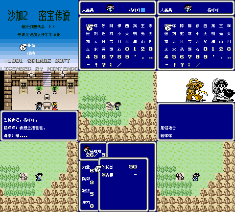
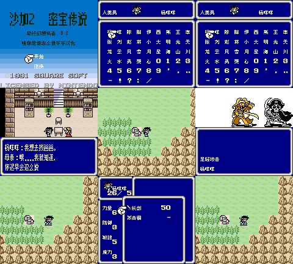
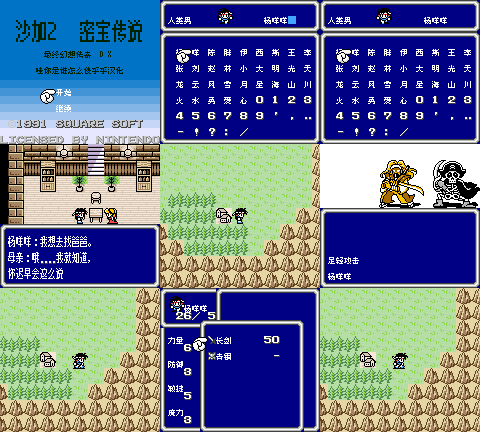

# 沙加2 DX

原输入：Final Fantasy Legend II DX (user-provided English color modified edition)

原输入完整SHA256：`3330a0c9187afe8b9a9f33b5975880f9e965f5e5bfa6944e89b4b69f937c40a2`。此处“原输入”保留改版、既有汉化或地区修订身份，不一律称干净零售ROM。

| 字号 | 当前版本 | 音频 | 输出完整SHA256 |
| --- | --- | --- | --- |
| 8px | v0.1.1 | music | `fd70fc973fcdd432dfeb8c67b2b1e97922552ea7b0045aebcd5bd798cffd83b0` |
| 8px | v0.1.1 | no-music | `d6ccd0cc2b53eb0194f6bb815176efcf81b47c1ad6a5df76edbf2962fa602fd8` |
| 8x12 | v0.1.1 | music | `1543c710b42a7e11de38c7a92b542f241d58a910a2e6c914a1a0880b2605486a` |
| 8x12 | v0.1.1 | no-music | `2456bf2a4f480357c864ab1c5b2c61de23165f085ec753045ab436002790e75a` |

## 源码与补丁

- 8px／v0.1.1／music：源码包（完整性未独立确认）：[下载](https://github.com/shiyi1133/youxi-hanhua-releases/releases/download/source-migration-20261022-02b/saga-2-dx-current-source-8bea161bc802-public-r01.zip)（ZIP SHA256 `5821f5ce5d44a4b33eb412cc032dd274211be69d92375d8be714e88ee6641e6d`）；补丁：[下载](https://github.com/shiyi1133/youxi-hanhua-releases/releases/download/patch-migration-20261022/saga-2-dx-current-patches.zip)（ZIP SHA256 `333e4b7e65884c7c09b1ee064894244d91365939a047aa19c011f9bff9134971`）。
  该包已核对对应版本与字节安全；完整修改源码覆盖范围未独立确认。
- 8px／v0.1.1／no-music：源码包（完整性未独立确认）：[下载](https://github.com/shiyi1133/youxi-hanhua-releases/releases/download/source-migration-20261022-02b/saga-2-dx-current-source-8bea161bc802-public-r01.zip)（ZIP SHA256 `5821f5ce5d44a4b33eb412cc032dd274211be69d92375d8be714e88ee6641e6d`）；补丁：[下载](https://github.com/shiyi1133/youxi-hanhua-releases/releases/download/patch-migration-20261022/saga-2-dx-current-patches.zip)（ZIP SHA256 `333e4b7e65884c7c09b1ee064894244d91365939a047aa19c011f9bff9134971`）。
  该包已核对对应版本与字节安全；完整修改源码覆盖范围未独立确认。
- 8x12／v0.1.1／music：源码包（完整性未独立确认）：[下载](https://github.com/shiyi1133/youxi-hanhua-releases/releases/download/source-migration-20261022-02b/saga-2-dx-current-source-8bea161bc802-public-r01.zip)（ZIP SHA256 `5821f5ce5d44a4b33eb412cc032dd274211be69d92375d8be714e88ee6641e6d`）；补丁：[下载](https://github.com/shiyi1133/youxi-hanhua-releases/releases/download/patch-migration-20261022/saga-2-dx-current-patches.zip)（ZIP SHA256 `333e4b7e65884c7c09b1ee064894244d91365939a047aa19c011f9bff9134971`）。
  该包已核对对应版本与字节安全；完整修改源码覆盖范围未独立确认。
- 8x12／v0.1.1／no-music：源码包（完整性未独立确认）：[下载](https://github.com/shiyi1133/youxi-hanhua-releases/releases/download/source-migration-20261022-02b/saga-2-dx-current-source-8bea161bc802-public-r01.zip)（ZIP SHA256 `5821f5ce5d44a4b33eb412cc032dd274211be69d92375d8be714e88ee6641e6d`）；补丁：[下载](https://github.com/shiyi1133/youxi-hanhua-releases/releases/download/patch-migration-20261022/saga-2-dx-current-patches.zip)（ZIP SHA256 `333e4b7e65884c7c09b1ee064894244d91365939a047aa19c011f9bff9134971`）。
  该包已核对对应版本与字节安全；完整修改源码覆盖范围未独立确认。

补丁须直接应用于完整SHA一致的实际原输入；普通字、大字和音乐变体分别核对。公开源码归档不表示本轮重新构建或通过新的运行验收。原作、字体、已有翻译及工具依赖的权利与许可，依各包对应许可保留。

## 范围与验证边界

- 8px／v0.1.1：普通Fusion Pixel8px；大字仅普通对白Muzai真8×12上移4px，战斗/菜单/取名/密集UI8px；CGB专用。。
  普通Fusion Pixel8px；大字仅普通对白Muzai真8×12上移4px，战斗/菜单/取名/密集UI8px；CGB专用。
  未自然商店买卖、全地图事件/技能状态/最长变量/首领结局/全通、实机/其它模拟器/联机/其它版存档。
  无音乐不是全作卡顿修复；原版/旧汉化非ASCII姓名含义未保证；大字刷新/实机帧率未验。
- 8px／v0.1.1：普通Fusion Pixel8px；大字仅普通对白Muzai真8×12上移4px，战斗/菜单/取名/密集UI8px；CGB专用。。
  普通Fusion Pixel8px；大字仅普通对白Muzai真8×12上移4px，战斗/菜单/取名/密集UI8px；CGB专用。
  未自然商店买卖、全地图事件/技能状态/最长变量/首领结局/全通、实机/其它模拟器/联机/其它版存档。
  无音乐不是全作卡顿修复；原版/旧汉化非ASCII姓名含义未保证；大字刷新/实机帧率未验。
- 8x12／v0.1.1：普通Fusion Pixel8px；大字仅普通对白Muzai真8×12上移4px，战斗/菜单/取名/密集UI8px；CGB专用。。
  普通Fusion Pixel8px；大字仅普通对白Muzai真8×12上移4px，战斗/菜单/取名/密集UI8px；CGB专用。
  未自然商店买卖、全地图事件/技能状态/最长变量/首领结局/全通、实机/其它模拟器/联机/其它版存档。
  无音乐不是全作卡顿修复；原版/旧汉化非ASCII姓名含义未保证；大字刷新/实机帧率未验。
- 8x12／v0.1.1：普通Fusion Pixel8px；大字仅普通对白Muzai真8×12上移4px，战斗/菜单/取名/密集UI8px；CGB专用。。
  普通Fusion Pixel8px；大字仅普通对白Muzai真8×12上移4px，战斗/菜单/取名/密集UI8px；CGB专用。
  未自然商店买卖、全地图事件/技能状态/最长变量/首领结局/全通、实机/其它模拟器/联机/其它版存档。
  无音乐不是全作卡顿修复；原版/旧汉化非ASCII姓名含义未保证；大字刷新/实机帧率未验。

本次资料搬运未新增模拟器、实机或全通验收；未记录或未测试的范围不写成通过。问题单开放只表示尚未关闭，已关闭也不单独证明全部场景都修复。

[公开反馈及问题状态](feedback.md) · [报告BUG](https://github.com/shiyi1133/youxi-hanhua-releases/issues/new?template=bug_report.md)

## 对应版本截图

v0.1.1 普通Fusion Pixel8px；大字仅普通对白Muzai真8×12上移4px，战斗/菜单/取名/密集UI8px；CGB专用。 音频：music；当前四目标原生CGB9格；旧v0.1.0测试报告仅作历史，v0.1.1音频增量另列。

图像SHA256：`d4aa30a010e7639c5716c157994f26383b3b7b7c67f2fc58f37f0e91830186c0`；绑定ROM SHA256：`fd70fc973fcdd432dfeb8c67b2b1e97922552ea7b0045aebcd5bd798cffd83b0`。

v0.1.1 普通Fusion Pixel8px；大字仅普通对白Muzai真8×12上移4px，战斗/菜单/取名/密集UI8px；CGB专用。 音频：no-music；当前四目标原生CGB9格；旧v0.1.0测试报告仅作历史，v0.1.1音频增量另列。

图像SHA256：`d4aa30a010e7639c5716c157994f26383b3b7b7c67f2fc58f37f0e91830186c0`；绑定ROM SHA256：`d6ccd0cc2b53eb0194f6bb815176efcf81b47c1ad6a5df76edbf2962fa602fd8`。

v0.1.1 普通Fusion Pixel8px；大字仅普通对白Muzai真8×12上移4px，战斗/菜单/取名/密集UI8px；CGB专用。 音频：music；当前四目标原生CGB9格；旧v0.1.0测试报告仅作历史，v0.1.1音频增量另列。

图像SHA256：`134e70a07f480b8f32915e75d43d988a2e124724331423f2bd1acadd8ff2625c`；绑定ROM SHA256：`1543c710b42a7e11de38c7a92b542f241d58a910a2e6c914a1a0880b2605486a`。

v0.1.1 普通Fusion Pixel8px；大字仅普通对白Muzai真8×12上移4px，战斗/菜单/取名/密集UI8px；CGB专用。 音频：no-music；当前四目标原生CGB9格；旧v0.1.0测试报告仅作历史，v0.1.1音频增量另列。

图像SHA256：`361135e5bd6627019f56484be75998c581632741e1712db9e5fae5a44a5c2942`；绑定ROM SHA256：`2456bf2a4f480357c864ab1c5b2c61de23165f085ec753045ab436002790e75a`。

