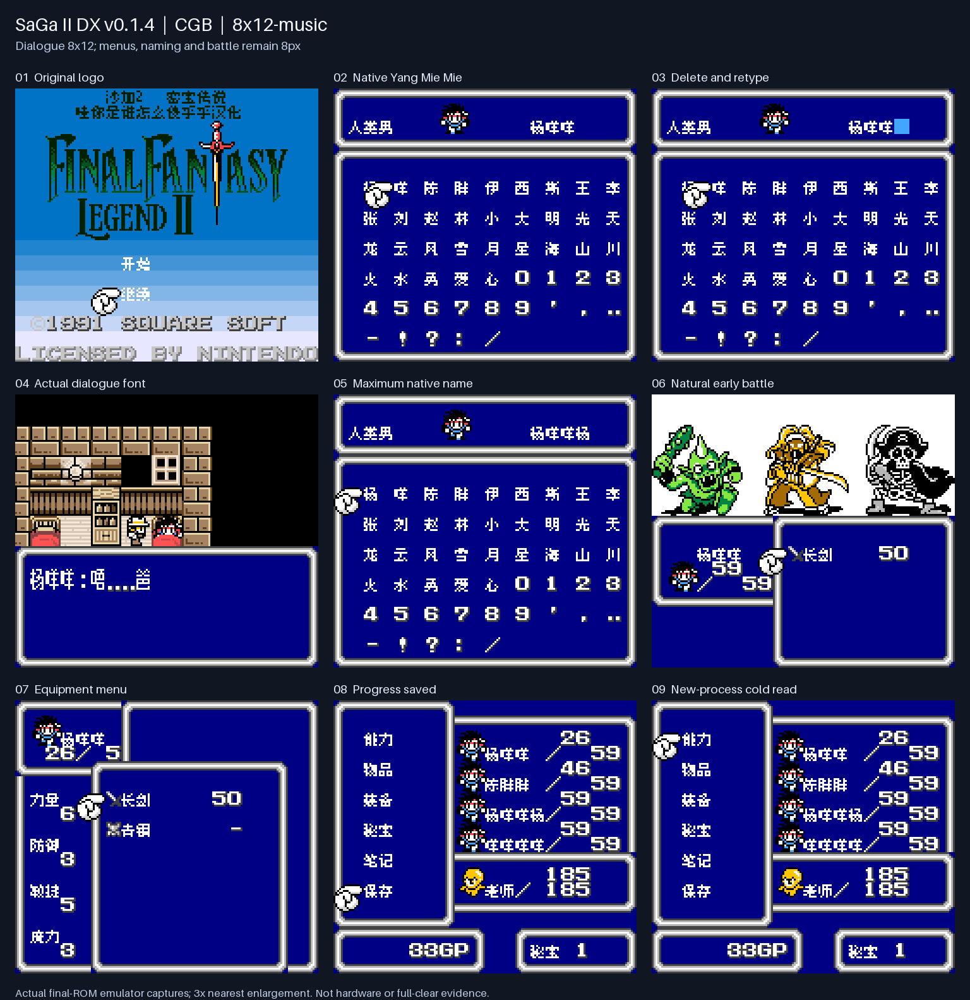
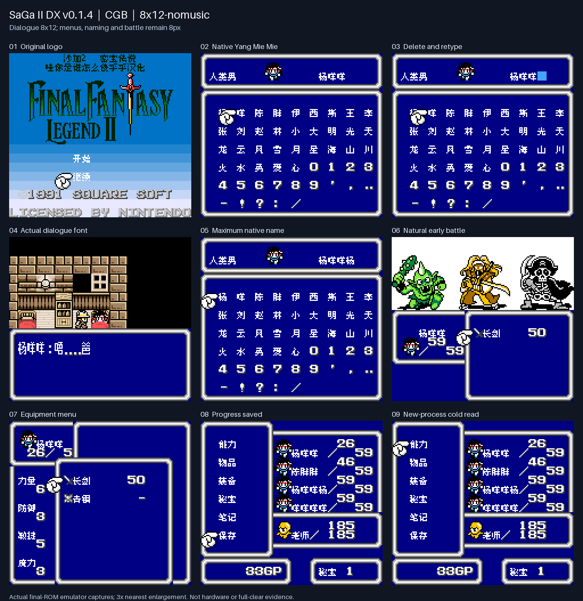

# 沙加2 DX v0.1.4（限定测试版）

[源码与补丁Release](https://github.com/shiyi1133/youxi-hanhua-releases/releases/tag/saga-2-dx-v0.1.4) · [公开反馈](feedback.md) · [报告BUG](https://github.com/shiyi1133/youxi-hanhua-releases/issues/new?template=bug_report.md)

原游戏／实际输入：Final Fantasy Legend II DX (user-provided English color modified edition)

原输入完整 SHA-256：`3330a0c9187afe8b9a9f33b5975880f9e965f5e5bfa6944e89b4b69f937c40a2`（524288字节）。

范围：保持音乐驱动和完整缓存扫描语义的文字渲染减负；继承菜单临界区修复。

## 8px v0.1.4 / music

字号范围：普通8px；既有大字仅对白，密集界面保留原字号。

目标完整 SHA-256：`25f5c06ae5dbb4e7368d3f038cc341e13fbc52245484df024a843690b88d741b`（524288字节）。

补丁：`SaGa2-DX-zh-v0.1.4-8px-music.bps`，SHA-256 `bff78fe332cc1d5ea91f8dcaa46598afe057eae14bce711f3771604963727b48`。

[源码（完整性未独立确认）](https://github.com/shiyi1133/youxi-hanhua-releases/releases/download/saga-2-dx-v0.1.4/saga-2-dx-v0.1.4-SOURCE-public.zip) · [补丁包](https://github.com/shiyi1133/youxi-hanhua-releases/releases/download/saga-2-dx-v0.1.4/saga-2-dx-v0.1.4-PATCH-public.zip)

v0.1.4 / 8px / music 最终ROM提供者实际画面；真实九格，按提供者场景分别保留自然和诊断边界。维护未运行、未全通或实机验收。

## 8px v0.1.4 / no-music

字号范围：普通8px；既有大字仅对白，密集界面保留原字号。

目标完整 SHA-256：`f79e1d4000aa42173eb0ab4b114a7c63f3bff1a213349a13f9e43ff89c569cbb`（524288字节）。

补丁：`SaGa2-DX-zh-v0.1.4-8px-nomusic.bps`，SHA-256 `adba0e6de2112816a3dfb0f8ccdc77d3544d38a860418339d47f8dc3ad021f38`。

[源码（完整性未独立确认）](https://github.com/shiyi1133/youxi-hanhua-releases/releases/download/saga-2-dx-v0.1.4/saga-2-dx-v0.1.4-SOURCE-public.zip) · [补丁包](https://github.com/shiyi1133/youxi-hanhua-releases/releases/download/saga-2-dx-v0.1.4/saga-2-dx-v0.1.4-PATCH-public.zip)

v0.1.4 / 8px / no-music 最终ROM提供者实际画面；真实九格，按提供者场景分别保留自然和诊断边界。维护未运行、未全通或实机验收。

## 8x12 v0.1.4 / music

字号范围：普通8px；既有大字仅对白，密集界面保留原字号。

目标完整 SHA-256：`aa51f68db33ee28e4145ee5d52da0109ade462d0577cb05b4ff3af9c3b35b59f`（524288字节）。

补丁：`SaGa2-DX-zh-v0.1.4-8x12-music.bps`，SHA-256 `722fc7497c32f4141f9d6209c333b840c14a0cf276d80bb530ba1fb4e0ff24cf`。

[源码（完整性未独立确认）](https://github.com/shiyi1133/youxi-hanhua-releases/releases/download/saga-2-dx-v0.1.4/saga-2-dx-v0.1.4-SOURCE-public.zip) · [补丁包](https://github.com/shiyi1133/youxi-hanhua-releases/releases/download/saga-2-dx-v0.1.4/saga-2-dx-v0.1.4-PATCH-public.zip)

v0.1.4 / 8x12 / music 最终ROM提供者实际画面；真实九格，按提供者场景分别保留自然和诊断边界。维护未运行、未全通或实机验收。

## 8x12 v0.1.4 / no-music

字号范围：普通8px；既有大字仅对白，密集界面保留原字号。

目标完整 SHA-256：`1c1b2e3f1c82c5000e817e181c27c18817128d036e10e34f7400a7311f906ca7`（524288字节）。

补丁：`SaGa2-DX-zh-v0.1.4-8x12-nomusic.bps`，SHA-256 `7d88c8466cfc48fa96a55629b17c8f5db5b0af1cf1bf9b01cefa3fb5975d0893`。

[源码（完整性未独立确认）](https://github.com/shiyi1133/youxi-hanhua-releases/releases/download/saga-2-dx-v0.1.4/saga-2-dx-v0.1.4-SOURCE-public.zip) · [补丁包](https://github.com/shiyi1133/youxi-hanhua-releases/releases/download/saga-2-dx-v0.1.4/saga-2-dx-v0.1.4-PATCH-public.zip)

v0.1.4 / 8x12 / no-music 最终ROM提供者实际画面；真实九格，按提供者场景分别保留自然和诊断边界。维护未运行、未全通或实机验收。

## 测试及限制

提供方自然范围：提供者自测：四变体分别命名、早期剧情/首战/菜单、普通保存新进程读档及旧v0.1.3自建SAV冷读。

提供方诊断范围：提供者诊断：8相位600帧音频服务计数及被动cache/VRAM观察；摘要饱和明确为诊断。

保存边界：仅按具体版本材料，不推定所有旧存档兼容。

维护本轮独立核原输入、补丁逐字节还原、ZIP/CRC、Source安全与原图字节；未执行提供方源码、未重建或运行ROM，未宣称独立人员QA、实机或全流程验收。

- 未验证：维护仅做数据/字节与独立补丁验证，未执行提供者源码或ROM，未独立重建。
- 未验证：性能只有有限改善，音频仍有断档，音乐卡顿问题保持开放。
- 未验证：未全通/实机/玩家故障现场及全部动态变量验收。

大字版更容易出现拖慢、刷新残留等问题，遇到请及时在原楼反馈。
