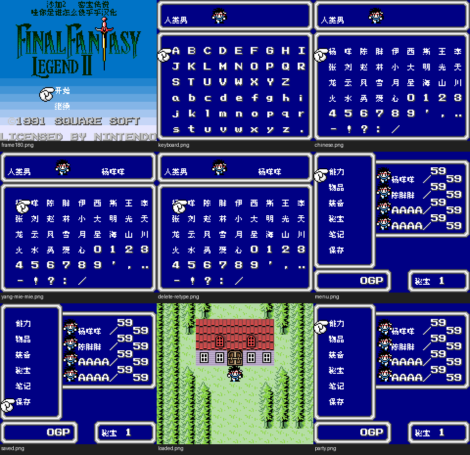

# 沙加2 DX（限定测试版）

[公开反馈](feedback.md) · [报告BUG](https://github.com/shiyi1133/youxi-hanhua-releases/issues/new?template=bug_report.md)

原游戏／实际基底：Final Fantasy Legend II DX (user-provided English color modified edition)

原输入完整SHA-256：`3330a0c9187afe8b9a9f33b5975880f9e965f5e5bfa6944e89b4b69f937c40a2`（524288字节）。原输入保留其地区、修订、改版或已有汉化基底身份。

## 8px v0.1.2 music

字号范围：普通原生8px；标题中文为独立静态字图，不等于正文字号变化。

[源码包（完整性未独立确认）](https://github.com/shiyi1133/youxi-hanhua-releases/releases/download/localization-update-20261022-six-games/saga-2-dx-logo-restored-four-variants-source-public-r01.zip) · [补丁包](https://github.com/shiyi1133/youxi-hanhua-releases/releases/download/localization-update-20261022-six-games/saga-2-dx-v0.1.2-patches-public.zip)

目标完整SHA-256：`f00b2308879e0fb7d5b640bbd1593679e7794d2682491b33634b02bb5bb3dbda`（524288字节）。

图证：v0.1.2 普通原生8px；标题中文为独立静态字图，不等于正文字号变化。 音频：music；提供方最终ROM真实CGB九宫格，维护侧新运行未执行。

## 8px v0.1.2 no-music

字号范围：普通原生8px；标题中文为独立静态字图，不等于正文字号变化。

[源码包（完整性未独立确认）](https://github.com/shiyi1133/youxi-hanhua-releases/releases/download/localization-update-20261022-six-games/saga-2-dx-logo-restored-four-variants-source-public-r01.zip) · [补丁包](https://github.com/shiyi1133/youxi-hanhua-releases/releases/download/localization-update-20261022-six-games/saga-2-dx-v0.1.2-patches-public.zip)

目标完整SHA-256：`3a1b5c255ab01edb29efa8285c241fd7df660411599241f657b2dda9f1bdaa00`（524288字节）。

图证：v0.1.2 普通原生8px；标题中文为独立静态字图，不等于正文字号变化。 音频：no-music；提供方最终ROM真实CGB九宫格，维护侧新运行未执行。

## 8x12 v0.1.2 music

字号范围：仅普通对白原生8×12并上移4px，战斗/菜单/取名/密集UI仍8px。

[源码包（完整性未独立确认）](https://github.com/shiyi1133/youxi-hanhua-releases/releases/download/localization-update-20261022-six-games/saga-2-dx-logo-restored-four-variants-source-public-r01.zip) · [补丁包](https://github.com/shiyi1133/youxi-hanhua-releases/releases/download/localization-update-20261022-six-games/saga-2-dx-v0.1.2-patches-public.zip)

目标完整SHA-256：`1ac73a079b6349c761cf65a1ac4956cebc8cb805abf2b09466fe2ca941ab3798`（524288字节）。

图证：v0.1.2 仅普通对白原生8×12并上移4px，战斗/菜单/取名/密集UI仍8px。 音频：music；提供方最终ROM真实CGB九宫格，维护侧新运行未执行。

## 8x12 v0.1.2 no-music

字号范围：仅普通对白原生8×12并上移4px，战斗/菜单/取名/密集UI仍8px。

[源码包（完整性未独立确认）](https://github.com/shiyi1133/youxi-hanhua-releases/releases/download/localization-update-20261022-six-games/saga-2-dx-logo-restored-four-variants-source-public-r01.zip) · [补丁包](https://github.com/shiyi1133/youxi-hanhua-releases/releases/download/localization-update-20261022-six-games/saga-2-dx-v0.1.2-patches-public.zip)

目标完整SHA-256：`347492e8ce7c69bf60485588bc5a50cd4b434df262ced2e2bb735bf950018180`（524288字节）。

图证：v0.1.2 仅普通对白原生8×12并上移4px，战斗/菜单/取名/密集UI仍8px。 音频：no-music；提供方最终ROM真实CGB九宫格，维护侧新运行未执行。

## 范围与测试边界

- Restore original title logo/background/copyright and add Chinese title in blank rows; title/init/local data/checksum increment.
- 未自然商店买卖、全地图事件/技能状态/最长变量/首领结局/全通、实机/其它模拟器/联机/其它版存档。
- 无音乐不是全作卡顿修复；原版/旧汉化非ASCII姓名含义未保证；大字刷新/实机帧率未验。
- 本次是标题恢复修订；独立核验对应补丁还原完整目标字节及最终九宫格原生像素。本轮维护未执行源码、重新构建或运行游戏；不增加SAVE、冷读或自然全流程通过声明。

维护侧独立补丁应用与目标字节一致；18张本批最终九宫格已各自核对9张原生单帧。未执行源码、未新增游戏运行、全流程或实机验收。

大字版更容易出现拖慢、刷新残留等问题，遇到请在原反馈楼说明版本和触发方式。

公开问题状态与玩家测试记录见[反馈页](feedback.md)。开放不代表正在修复；已关闭也不能单独证明所有症状或完整游戏验收。
