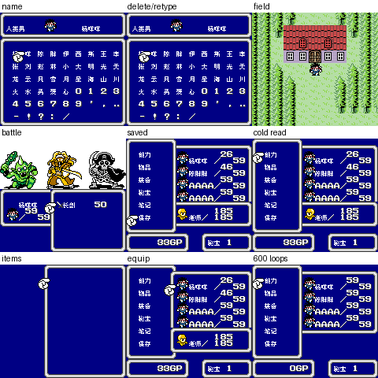

# 沙加2 DX：公开反馈

以下均为公开证据，玩家原话不自动等于维护已复现或已修复。

## 154043281410

84楼 · 命運的召喚 · [原回帖](https://tieba.baidu.com/p/11092365551?pid=154043281410#154043281410)

> dx2 音乐也有卡顿 麻烦大佬有空排查一下

## 问题状态

- 玩家称DX2音乐也有卡顿。：开放；公开Issue待单独建档。

实际玩家ROM SHA未知时保持未知；当前参考版本SHA不能冒充玩家字节。

## 维护者版本更新：v0.1.3

[原楼实际答复](https://tieba.baidu.com/p/11092365551?pid=154063169543#p154063169543)（84楼，PID 154063169543）。以下是维护者已公开发送的版本通知，不是玩家测试结论。

> 《沙加2 DX》v0.1.3已更新，修复反复开关菜单死机的问题。请从总分享“GBC/沙加2 DX”重新下载测试，普通8px和对白8×12的音乐、静音四版都已更新。
> 图1：8px音乐；图2：对白8×12音乐；图3：8px静音；图4：对白8×12静音。四图均对应各自v0.1.3最终ROM；对白8×12版的菜单、取名、战斗仍为8px，图中未展示大字对白。
> 大字版更容易出现拖慢、刷新残留等问题，遇到请及时在这楼反馈。

v0.1.3 普通8px最终CGB九格；两格缺独立单帧，按提供方最终ROM绑定记录。

原PNG完整SHA-256：`ed7f1be2722f8043454512c237ef26babba576fd5408b2979d72847ebf2bb477`。

v0.1.3 对白8×12版最终CGB九格，图中菜单、取名和战斗仍原生8px；未展示8×12对白；两格缺独立单帧，按提供方最终ROM绑定记录。

原PNG完整SHA-256：`b738718a85c2266bc3dd59c34411acff65c56f79e19171438f22b3cb898c9277`。

v0.1.3 普通8px最终CGB九格；两格缺独立单帧，按提供方最终ROM绑定记录。

原PNG完整SHA-256：`40341f4a60c04291306d41cc758278520ef212d9eb905d4fd142d0925d319eb6`。

v0.1.3 对白8×12版最终CGB九格，图中菜单、取名和战斗仍原生8px；未展示8×12对白；两格缺独立单帧，按提供方最终ROM绑定记录。

原PNG完整SHA-256：`b738718a85c2266bc3dd59c34411acff65c56f79e19171438f22b3cb898c9277`。

上述全文及全部图像已按该PID公开核验；本次导出仅补充通知记录，不新增通关、实机、源码完整性或问题全部修复结论。
