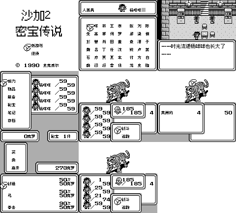
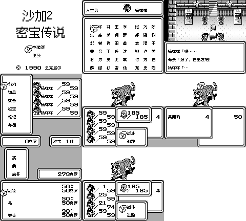

# 沙加2：秘宝传说

原输入：Sa-Ga 2 - Hihou Densetsu

原输入完整SHA256：`31477ea9ae09d98e4170938d91ba5a9f5ab94072db4c289988882e0de7e48851`。此处“原输入”保留改版、既有汉化或地区修订身份，不一律称干净零售ROM。

| 字号 | 当前版本 | 音频 | 输出完整SHA256 |
| --- | --- | --- | --- |
| 10px-dialogue | v1.0.1 | music | `8744d992316d38bca41d22b38f2e6434c21966adb9bb63aa9a54b9eb180712be` |
| 10px-dialogue | v1.0.1 | no-music | `99cd83849efa5049f24de21f7cb6e368e451fb397d6f9817c0fd9314be9871c0` |
| 8px | v1.0.1 | music | `698adbfa4460945a67259c2d07a3b4742b3b05d22eae7e9e4a37b7888c581113` |
| 8px | v1.0.1 | no-music | `106a920d2645c94f49b311b829cdf270038ce5916d8caaf1b3867f5785a64a88` |

## 源码与补丁

- 10px-dialogue／v1.0.1／music：源码包（完整性未独立确认）：[下载](https://github.com/shiyi1133/youxi-hanhua-releases/releases/download/source-migration-20261022-02b/saga-2-current-source-824fcfacc41b-public-r01.zip)（ZIP SHA256 `fb0501bc473a748e42ded0356a2235fe0a6417212d5586314fba4ef9553d89de`）；补丁：[下载](https://github.com/shiyi1133/youxi-hanhua-releases/releases/download/patch-migration-20261022/saga-2-current-patches.zip)（ZIP SHA256 `1b53bb99d4320bd12df2f0f49432842b3bd6c65d6e04a2b01dc27d2232dab96b`）。
  该包已核对对应版本与字节安全；完整修改源码覆盖范围未独立确认。
- 10px-dialogue／v1.0.1／no-music：源码包（完整性未独立确认）：[下载](https://github.com/shiyi1133/youxi-hanhua-releases/releases/download/source-migration-20261022-02b/saga-2-current-source-824fcfacc41b-public-r01.zip)（ZIP SHA256 `fb0501bc473a748e42ded0356a2235fe0a6417212d5586314fba4ef9553d89de`）；补丁：[下载](https://github.com/shiyi1133/youxi-hanhua-releases/releases/download/patch-migration-20261022/saga-2-current-patches.zip)（ZIP SHA256 `1b53bb99d4320bd12df2f0f49432842b3bd6c65d6e04a2b01dc27d2232dab96b`）。
  该包已核对对应版本与字节安全；完整修改源码覆盖范围未独立确认。
- 8px／v1.0.1／music：源码包（完整性未独立确认）：[下载](https://github.com/shiyi1133/youxi-hanhua-releases/releases/download/source-migration-20261022-02b/saga-2-current-source-824fcfacc41b-public-r01.zip)（ZIP SHA256 `fb0501bc473a748e42ded0356a2235fe0a6417212d5586314fba4ef9553d89de`）；补丁：[下载](https://github.com/shiyi1133/youxi-hanhua-releases/releases/download/patch-migration-20261022/saga-2-current-patches.zip)（ZIP SHA256 `1b53bb99d4320bd12df2f0f49432842b3bd6c65d6e04a2b01dc27d2232dab96b`）。
  该包已核对对应版本与字节安全；完整修改源码覆盖范围未独立确认。
- 8px／v1.0.1／no-music：源码包（完整性未独立确认）：[下载](https://github.com/shiyi1133/youxi-hanhua-releases/releases/download/source-migration-20261022-02b/saga-2-current-source-824fcfacc41b-public-r01.zip)（ZIP SHA256 `fb0501bc473a748e42ded0356a2235fe0a6417212d5586314fba4ef9553d89de`）；补丁：[下载](https://github.com/shiyi1133/youxi-hanhua-releases/releases/download/patch-migration-20261022/saga-2-current-patches.zip)（ZIP SHA256 `1b53bb99d4320bd12df2f0f49432842b3bd6c65d6e04a2b01dc27d2232dab96b`）。
  该包已核对对应版本与字节安全；完整修改源码覆盖范围未独立确认。

补丁须直接应用于完整SHA一致的实际原输入；普通字、大字和音乐变体分别核对。公开源码归档不表示本轮重新构建或通过新的运行验收。原作、字体、已有翻译及工具依赖的权利与许可，依各包对应许可保留。

## 范围与验证边界

- 10px-dialogue／v1.0.1：普通8px；大字仅普通剧情真10px，战斗/取名/密集菜单8px；主标题12px静态放大24px，非正文字号。。
  普通8px；大字仅普通剧情真10px，战斗/取名/密集菜单8px；主标题12px静态放大24px，非正文字号。
  未全部地图/事件/技能、全流程、实机/联机；原作无SGB。
  音频子程序约75%减负不等于整机加速75%；旧日文姓名语义/跨即时状态兼容不保证。
- 10px-dialogue／v1.0.1：普通8px；大字仅普通剧情真10px，战斗/取名/密集菜单8px；主标题12px静态放大24px，非正文字号。。
  普通8px；大字仅普通剧情真10px，战斗/取名/密集菜单8px；主标题12px静态放大24px，非正文字号。
  未全部地图/事件/技能、全流程、实机/联机；原作无SGB。
  音频子程序约75%减负不等于整机加速75%；旧日文姓名语义/跨即时状态兼容不保证。
- 8px／v1.0.1：普通8px；大字仅普通剧情真10px，战斗/取名/密集菜单8px；主标题12px静态放大24px，非正文字号。。
  普通8px；大字仅普通剧情真10px，战斗/取名/密集菜单8px；主标题12px静态放大24px，非正文字号。
  未全部地图/事件/技能、全流程、实机/联机；原作无SGB。
  音频子程序约75%减负不等于整机加速75%；旧日文姓名语义/跨即时状态兼容不保证。
- 8px／v1.0.1：普通8px；大字仅普通剧情真10px，战斗/取名/密集菜单8px；主标题12px静态放大24px，非正文字号。。
  普通8px；大字仅普通剧情真10px，战斗/取名/密集菜单8px；主标题12px静态放大24px，非正文字号。
  未全部地图/事件/技能、全流程、实机/联机；原作无SGB。
  音频子程序约75%减负不等于整机加速75%；旧日文姓名语义/跨即时状态兼容不保证。

本次资料搬运未新增模拟器、实机或全通验收；未记录或未测试的范围不写成通过。问题单开放只表示尚未关闭，已关闭也不单独证明全部场景都修复。

[公开反馈及问题状态](feedback.md) · [报告BUG](https://github.com/shiyi1133/youxi-hanhua-releases/issues/new?template=bug_report.md)

## 对应版本截图

v1.0.1 普通8px；大字仅普通剧情真10px，战斗/取名/密集菜单8px；主标题12px静态放大24px，非正文字号。 音频：music；四变体各自最终DMG原生9帧；自然路线与受控商店/最长变量诊断分列。

图像SHA256：`fcadcfb79d4f12c5c7e55f2fcbea80e5a0b001592e8581878429b1c32567c09e`；绑定ROM SHA256：`8744d992316d38bca41d22b38f2e6434c21966adb9bb63aa9a54b9eb180712be`。

v1.0.1 普通8px；大字仅普通剧情真10px，战斗/取名/密集菜单8px；主标题12px静态放大24px，非正文字号。 音频：no-music；四变体各自最终DMG原生9帧；自然路线与受控商店/最长变量诊断分列。

图像SHA256：`fcadcfb79d4f12c5c7e55f2fcbea80e5a0b001592e8581878429b1c32567c09e`；绑定ROM SHA256：`99cd83849efa5049f24de21f7cb6e368e451fb397d6f9817c0fd9314be9871c0`。

v1.0.1 普通8px；大字仅普通剧情真10px，战斗/取名/密集菜单8px；主标题12px静态放大24px，非正文字号。 音频：music；四变体各自最终DMG原生9帧；自然路线与受控商店/最长变量诊断分列。

图像SHA256：`0b2515274ffd84c4565a80a41a5e110bad36e705155e72830e8c88e61ced736a`；绑定ROM SHA256：`698adbfa4460945a67259c2d07a3b4742b3b05d22eae7e9e4a37b7888c581113`。

v1.0.1 普通8px；大字仅普通剧情真10px，战斗/取名/密集菜单8px；主标题12px静态放大24px，非正文字号。 音频：no-music；四变体各自最终DMG原生9帧；自然路线与受控商店/最长变量诊断分列。

图像SHA256：`0b2515274ffd84c4565a80a41a5e110bad36e705155e72830e8c88e61ced736a`；绑定ROM SHA256：`106a920d2645c94f49b311b829cdf270038ce5916d8caaf1b3867f5785a64a88`。

