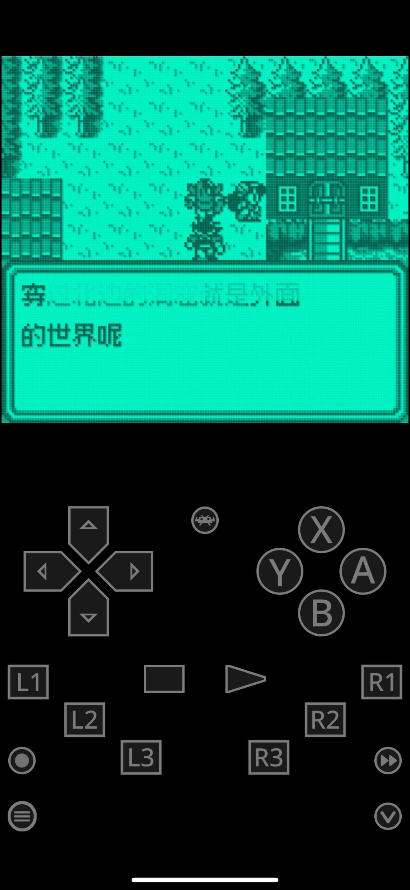

# 沙加2：秘宝传说：公开反馈

以下为已公开证据摘录，不能自动当成已经复现或修复。下载／存档分享地址、本机路径或项目署名文字省略时逐条标记。

## 154038663862

50楼 · ♬肚皮吸碗🎶 · [原回帖](https://tieba.baidu.com/p/11092365551?pid=154038663862#154038663862)

> 开场故事介绍结束时有乱码。游戏中人物对话的第一帧总是快速闪过上一段对话的最后一帧

[玩家公开图片](https://tiebapic.baidu.com/forum/pic/item/bf300a3b5bb5c9ea701a2fe49339b6003bf3b373.jpg)（玩家反馈图，不作当前最终ROM运行证明）

[玩家公开图片](https://tiebapic.baidu.com/forum/pic/item/c09da5af2edda3ccfa0d942747e93901203f9273.jpg)（玩家反馈图，不作当前最终ROM运行证明）

## 154039632447

50楼 · ♬肚皮吸碗🎶 · [原回帖](https://tieba.baidu.com/p/11092365551?pid=154039632447#154039632447)

> rom名称： SaGa2-zh-Hans-v1.0.0-test-dialogue-10px 后缀名.gb SaGa2-zh-Hans-v1.0.0-test-native-8px 后缀名.gb 8号和10号字体都相同的花屏

## 问题状态

- [待核版本与复现] 沙加2：秘宝传说：开场结束乱码、对白首帧残留上一段最后一帧：开放；公开问题单待单独建档。

问题单开放不等于正在修复；关闭不自动代表所有报告症状全部验收。玩家实际ROM SHA未知时仍保留未知，当前版本的参考SHA见[游戏页面](README.md)。

## 20261023-0416 公开反馈补充

50楼 · ♬肚皮吸碗🎶 · [原回帖](https://tieba.baidu.com/p/11092365551?pid=154060654790#154060654790)

> 经测试，Saga2_MibaoChuanshuo_v1.0.1_10px_music 在和npc对话时，对话框打开的一瞬间会消失上一次对话的信息。

- 沙加GB2 v1.0.1 10px music：对白打开一瞬间会消失上一次对话的信息（玩家原话）：开放待核；本次没有新增维护复现、修复或完整流程验收。

[已公开答复](https://tieba.baidu.com/p/11092365551?pid=154061177641#154061177641)：@♬肚皮吸碗🎶 沙加2黑白GB的10px音乐版v1.0.1开启对白时的刷新异常已补进原问题，继续排查。

玩家实际输入/输出完整SHA保持未知；公开答复属于登记/信息回复，不是ROM新交付或修复完成通知。

## 20261025-1619 公开反馈更新

按当前实际未关闭问题去重：纯BUG 1 项，建议/覆盖等 0 项，分类待核 0 项。开放不代表正在修复。

玩家实际完整ROM字节未知时仍保留未知；自然流程、原生消费者诊断及静态证据分别记录，不外推实机或全流程。
