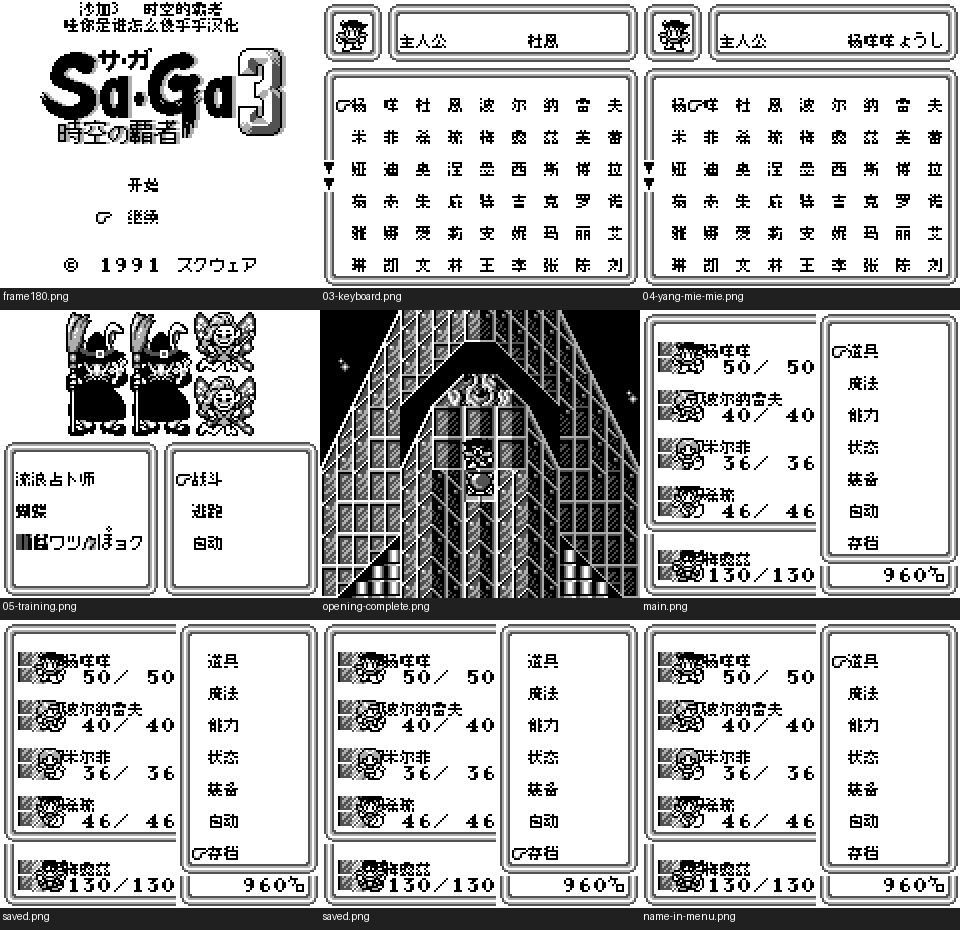
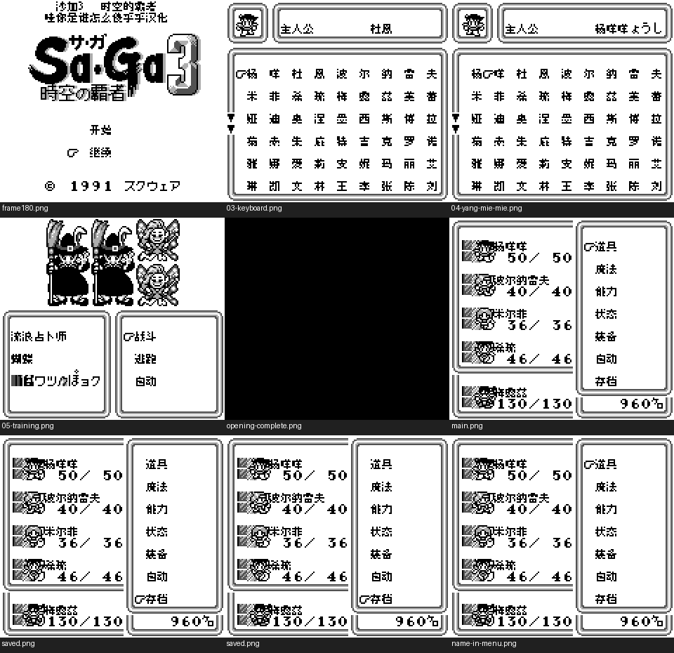

# 沙加3 时空的霸者 黑白GB版（限定测试版）

[公开反馈](feedback.md) · [报告BUG](https://github.com/shiyi1133/youxi-hanhua-releases/issues/new?template=bug_report.md)

原游戏／实际基底：Sa-Ga 3 - Jikuu no Hasha (Japan)

原输入完整SHA-256：`3f54fab4d0c4c6b0128f4ce9e9f6d05b36e854566eefc689fd7272cabe5a1596`（262144字节）。原输入保留其地区、修订、改版或已有汉化基底身份。

## 8px v0.1.2 music

字号范围：普通原生8px；标题中文为独立静态字图，不等于正文字号变化。

[源码包（完整性未独立确认）](https://github.com/shiyi1133/youxi-hanhua-releases/releases/download/localization-update-20261022-six-games/saga-3-gb-logo-restored-four-variants-source-public-r01.zip) · [补丁包](https://github.com/shiyi1133/youxi-hanhua-releases/releases/download/localization-update-20261022-six-games/saga-3-gb-v0.1.2-patches-public.zip)

目标完整SHA-256：`24115fb393dcdd4860f39ce3c0700085c718fb298d710fc966b4b63fb976f00a`（524288字节）。

图证：v0.1.2 普通原生8px；标题中文为独立静态字图，不等于正文字号变化。 音频：music；提供方最终ROM真实DMG九宫格，维护侧新运行未执行。

## 8px v0.1.1 no-music

字号范围：普通原生8px；标题中文为独立静态字图，不等于正文字号变化。

[源码包（完整性未独立确认）](https://github.com/shiyi1133/youxi-hanhua-releases/releases/download/localization-update-20261022-six-games/saga-3-gb-logo-restored-four-variants-source-public-r01.zip) · [补丁包](https://github.com/shiyi1133/youxi-hanhua-releases/releases/download/localization-update-20261022-six-games/saga-3-gb-v0.1.2-patches-public.zip)

目标完整SHA-256：`71f4960bc9522a698675fce5af052cc49038655b6aa8e3747571c92315e71723`（524288字节）。

图证：v0.1.1 普通原生8px；标题中文为独立静态字图，不等于正文字号变化。 音频：no-music；提供方最终ROM真实DMG九宫格，维护侧新运行未执行。

## 10px v0.1.1 music

字号范围：普通对白原生10px；密集菜单/命名及部分UI仍8px，非全界面大字。

[源码包（完整性未独立确认）](https://github.com/shiyi1133/youxi-hanhua-releases/releases/download/localization-update-20261022-six-games/saga-3-gb-logo-restored-four-variants-source-public-r01.zip) · [补丁包](https://github.com/shiyi1133/youxi-hanhua-releases/releases/download/localization-update-20261022-six-games/saga-3-gb-v0.1.2-patches-public.zip)

目标完整SHA-256：`2b0d349b4914d970fbd0bdda2a836a3e9348ea13ddb88c91278a0b47888c4fc0`（524288字节）。

图证：v0.1.1 普通对白原生10px；密集菜单/命名及部分UI仍8px，非全界面大字。 音频：music；提供方最终ROM真实DMG九宫格，维护侧新运行未执行。

## 10px v0.1.1 no-music

字号范围：普通对白原生10px；密集菜单/命名及部分UI仍8px，非全界面大字。

[源码包（完整性未独立确认）](https://github.com/shiyi1133/youxi-hanhua-releases/releases/download/localization-update-20261022-six-games/saga-3-gb-logo-restored-four-variants-source-public-r01.zip) · [补丁包](https://github.com/shiyi1133/youxi-hanhua-releases/releases/download/localization-update-20261022-six-games/saga-3-gb-v0.1.2-patches-public.zip)

目标完整SHA-256：`0eda949c13ccfa3e26940865f9d6aebbe782af018900f6e93c832564a3d90ab9`（524288字节）。

图证：v0.1.1 普通对白原生10px；密集菜单/命名及部分UI仍8px，非全界面大字。 音频：no-music；提供方最终ROM真实DMG九宫格，维护侧新运行未执行。

## 范围与测试边界

- Restore original title logo/background/copyright and add Chinese title in blank rows; title/init/local data/checksum increment.
- 本次仅标题图像/初始化/局部数据及校验和修订；不以旧版测试证明当前四个字体/音频输出的自然流程、正常SAVE或新进程冷读通过。
- 提供方命名使用被动断点，并使用同ROM自有续接状态取证；不能当自然全流程、正常SAVE或新进程冷读验收。
- 最终九宫格仍保留日文对白和继承姓名字形，大字开场过渡帧为黑画面；不声称这些现象已修复，也不声称开场全过程通过。
- 后期、全部物品/技能/敌人、深商店、最长变量、全部分支、全通、硬件与任意历史存档兼容未验收。
- 本轮维护只核ZIP、原件、独立补丁应用、真实原像素及证据，未重建源码、运行模拟器或做听感/实机/全通验收。
- 本次是标题恢复修订；独立核验对应补丁还原完整目标字节及最终九宫格原生像素。本轮维护未执行源码、重新构建或运行游戏；不增加SAVE、冷读或自然全流程通过声明。

维护侧独立补丁应用与目标字节一致；18张本批最终九宫格已各自核对9张原生单帧。未执行源码、未新增游戏运行、全流程或实机验收。

大字版更容易出现拖慢、刷新残留等问题，遇到请在原反馈楼说明版本和触发方式。

## 历史范围记录（NOT_CURRENT_ACCEPTANCE）

以下仅保留此前版本的记录，不能当本次四个输出的测试通过证据。

- 限定测试修复；仅普通8px有音乐新目标；旧v0.1.0剧情10px未重建、未纳入本次修复。
- 本轮维护者只做ZIP/原件/补丁/原像素/证据审核，未重建源码、运行模拟器或听感/实机/全通验收。
- 实现者同人自然开场、命名、训练、菜单及原生保存冷读自测有精确SHA记录，不能等同独立人员QA。
- #95所报两例已有中文新帧；不表示全游戏所有日文或所有敌人字段通过。
- #96仅所测开场A加速、命名和训练战斗提速；仍慢于原件且首命名/复杂界面/全部组合未穷尽，保持open。
- 后期、全部物品/技能/敌人、深商店、最长变量、全部分支、全通、硬件与任意历史存档兼容未验收。
- 音乐只抽样PCM/APU非零；无维护者新运行或完整听感验收。

公开问题状态与玩家测试记录见[反馈页](feedback.md)。开放不代表正在修复；已关闭也不能单独证明所有症状或完整游戏验收。
