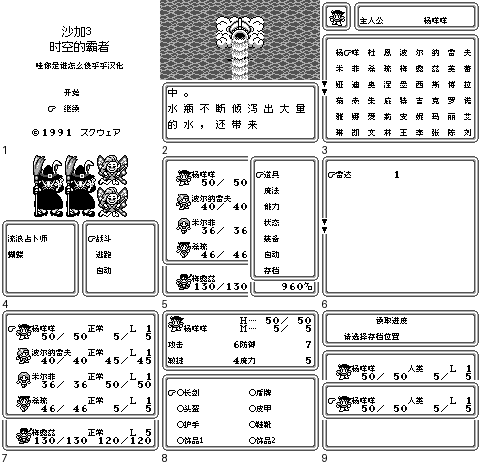
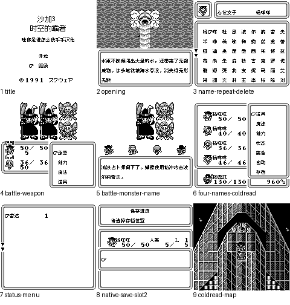

# 沙加3 时空的霸者 黑白GB版

原输入：Sa-Ga 3 - Jikuu no Hasha (Japan)

原输入完整SHA256：`3f54fab4d0c4c6b0128f4ce9e9f6d05b36e854566eefc689fd7272cabe5a1596`。此处“原输入”保留改版、既有汉化或地区修订身份，不一律称干净零售ROM。

| 字号 | 当前版本 | 音频 | 输出完整SHA256 |
| --- | --- | --- | --- |
| 8px | v0.1.1 | unchanged | `9985a6b08eb049eb07209f905bec106216bd13e155e00d304ad1cf8059213bc0` |
| 10px | v0.1.0 | unchanged | `7c9ac176fdf72e08a1618f56ce7a326a748f940f5ed565ff934f958bc6854006` |

## 源码与补丁

- 8px／v0.1.1／unchanged：源码包（完整性未独立确认）：[下载](https://github.com/shiyi1133/youxi-hanhua-releases/releases/download/source-migration-20261022-02b/saga-3-gb-current-source-99c223ef30ca-public-r01.zip)（ZIP SHA256 `bc20265e7da5cb78a0b4c827485a6dbad49c8f0482ceb997402cddec52aa622e`）；补丁：[下载](https://github.com/shiyi1133/youxi-hanhua-releases/releases/download/patch-migration-20261022/saga-3-gb-current-patches.zip)（ZIP SHA256 `694904407b557867b31654d598f4aaa2d380f37d24335e47aef98e893f49bcb3`）。
  该包已核对对应版本与字节安全；完整修改源码覆盖范围未独立确认。
- 10px／v0.1.0／unchanged：源码包（完整性未独立确认）：[下载](https://github.com/shiyi1133/youxi-hanhua-releases/releases/download/source-migration-20261022-04/saga-3-gb-current-scope-source-public-r01.zip)（ZIP SHA256 `08dbfa3954b14d68f2b405656210359718b79df1a471c6c92e18cd602349e0a8`）；补丁：[下载](https://github.com/shiyi1133/youxi-hanhua-releases/releases/download/patch-migration-20261022/saga-3-gb-current-patches.zip)（ZIP SHA256 `694904407b557867b31654d598f4aaa2d380f37d24335e47aef98e893f49bcb3`）。
  该包已核对对应版本与字节安全；完整修改源码覆盖范围未独立确认。

补丁须直接应用于完整SHA一致的实际原输入；普通字、大字和音乐变体分别核对。公开源码归档不表示本轮重新构建或通过新的运行验收。原作、字体、已有翻译及工具依赖的权利与许可，依各包对应许可保留。

## 范围与验证边界

- 8px／v0.1.1：剧情/界面原生8px；标题独立12px字模；普通有音乐版。
  战斗HUD与已报怪物动态名中文回查；所测开篇A加速、命名与训练战斗整窗提速。
  限定测试修复；仅普通8px有音乐新目标；旧v0.1.0剧情10px未重建、未纳入本次修复。
  本轮维护者只做ZIP/原件/补丁/原像素/证据审核，未重建源码、运行模拟器或听感/实机/全通验收。
  实现者同人自然开场、命名、训练、菜单及原生保存冷读自测有精确SHA记录，不能等同独立人员QA。
  #95所报两例已有中文新帧；不表示全游戏所有日文或所有敌人字段通过。
  #96仅所测开场A加速、命名和训练战斗提速；仍慢于原件且首命名/复杂界面/全部组合未穷尽，保持open。
  后期、全部物品/技能/敌人、深商店、最长变量、全部分支、全通、硬件与任意历史存档兼容未验收。
  音乐只抽样PCM/APU非零；无维护者新运行或完整听感验收。
- 10px／v0.1.0：剧情正文原生10×10点阵、16px格距；菜单/战斗密集界面/命名/动态姓名/插入物品魔法名保持8px。
  普通8px及剧情正文10px，均保留音乐音效；菜单、取名、战斗密集UI和动态姓名/物品/魔法字段仍8px。指定自然剧情、中文取名、训练、菜单、原生保存与冷读记录，未作全流程验收。
  本版为限定测试版；未完成后期与结局自然通关、全部分支、最长变量组合、所有物品/技能/敌人和深层商店购买验收。
  10px仅剧情正文为原生10×10点阵（16px格距），菜单、战斗密集界面、命名、动态姓名/插入物品与魔法名保留8px。
  大字版更容易出现拖慢、刷新残留等问题，遇到请及时在原楼反馈。
  8px有乐与两种10px的独立自然训练/引导与保存冷读是provider自测声明；8px无音乐存档往返使用真实自然进度，不冒称独立完成全开场。
  十种状态字段检查注入CDEC临时缓冲，仅为诊断，不代表自然获得这些异常状态。
  音乐/音效只验证provider标题、开场、确认及有限训练样本的PCM统计和APU写入；无维护者新运行、听感或全程性能验收。
  未测试实机/烧录卡、所有历史存档兼容、全游戏帧率；没有多人支持声明。
  维护者本次实际完成原件下载、静态、补丁、原帧像素与隔离净重建核验；未运行游戏或模拟器。

本次资料搬运未新增模拟器、实机或全通验收；未记录或未测试的范围不写成通过。问题单开放只表示尚未关闭，已关闭也不单独证明全部场景都修复。

[公开反馈及问题状态](feedback.md) · [报告BUG](https://github.com/shiyi1133/youxi-hanhua-releases/issues/new?template=bug_report.md)

## 对应版本截图

沙加3 黑白GB日版 v0.1.0 剧情10px大字，密集界面和动态字段仍8px 有音乐限定测试版；原生DMG最终ROM九宫格

图像SHA256：`c5128aa702883311a2db366183174618b52676c220dc0b8008da4a2d0e1cff7f`；绑定ROM SHA256：`7c9ac176fdf72e08a1618f56ce7a326a748f940f5ed565ff934f958bc6854006`。

沙加3 黑白GB日版 v0.1.1 普通8px有音乐限定测试修复版；原生DMG最终ROM九宫格；所测自然开场/命名/训练/菜单/保存冷读，非全通。

图像SHA256：`53bc482b475450919124d60e3c87a8e7d3f80700d1ee5a44bc8f6d5bcba87554`；绑定ROM SHA256：`9985a6b08eb049eb07209f905bec106216bd13e155e00d304ad1cf8059213bc0`。

