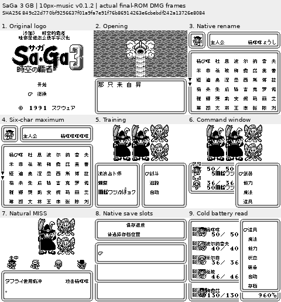
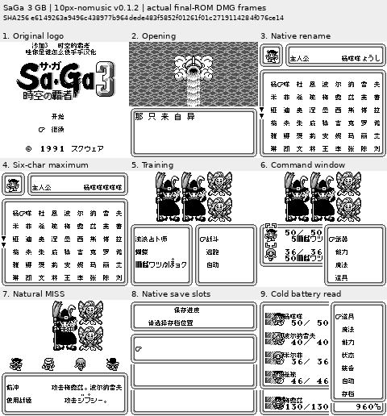
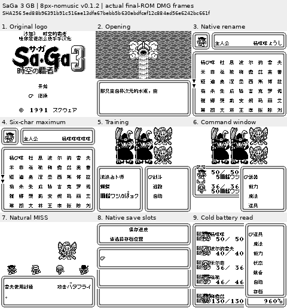
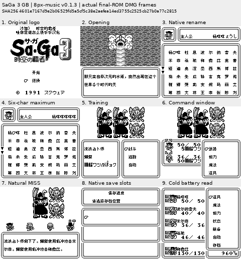

# 沙加3 时空的霸者 黑白GB版 v0.1.3（限定测试版）

[源码与补丁Release](https://github.com/shiyi1133/youxi-hanhua-releases/releases/tag/saga-3-gb-v0.1.3) · [公开反馈](feedback.md) · [报告BUG](https://github.com/shiyi1133/youxi-hanhua-releases/issues/new?template=bug_report.md)

原游戏／实际输入：Sa-Ga 3 - Jikuu no Hasha (Japan)

原输入完整 SHA-256：`3f54fab4d0c4c6b0128f4ce9e9f6d05b36e854566eefc689fd7272cabe5a1596`（262144字节）。

范围：四变体独立MISS精灵字图译为未中；仅普通8px音乐版另作有限字库查找/搬运提速。

## 10px v0.1.2 / music

字号范围：普通8px；既有大字仅对白，密集界面保留原字号。

目标完整 SHA-256：`849c22d770bf9256637f01a9fa7e91f76b86914263e6cbebdf242a13726e8084`（524288字节）。

补丁：`SaGa-gb3-zh-v0.1.2-10px-music.bps`，SHA-256 `b79decda384b59d5d92547c39f6b2a25925922bc346806ea7202092929dfa7fa`。

[源码（完整性未独立确认）](https://github.com/shiyi1133/youxi-hanhua-releases/releases/download/saga-3-gb-v0.1.3/saga-3-gb-v0.1.3-SOURCE-public.zip) · [补丁包](https://github.com/shiyi1133/youxi-hanhua-releases/releases/download/saga-3-gb-v0.1.3/saga-3-gb-v0.1.3-PATCH-public.zip)

v0.1.2 / 10px / music 最终ROM提供者实际画面；真实九格，按提供者场景分别保留自然和诊断边界。维护未运行、未全通或实机验收。

## 10px v0.1.2 / no-music

字号范围：普通8px；既有大字仅对白，密集界面保留原字号。

目标完整 SHA-256：`e6149263a9496c438977b964dede483f5852f01261f01c2719114284f076ce14`（524288字节）。

补丁：`SaGa-gb3-zh-v0.1.2-10px-nomusic.bps`，SHA-256 `05568330092af4f6825445b29363cb8d58f88c8ea2c868c3d04176bd95a7edde`。

[源码（完整性未独立确认）](https://github.com/shiyi1133/youxi-hanhua-releases/releases/download/saga-3-gb-v0.1.3/saga-3-gb-v0.1.3-SOURCE-public.zip) · [补丁包](https://github.com/shiyi1133/youxi-hanhua-releases/releases/download/saga-3-gb-v0.1.3/saga-3-gb-v0.1.3-PATCH-public.zip)

v0.1.2 / 10px / no-music 最终ROM提供者实际画面；真实九格，按提供者场景分别保留自然和诊断边界。维护未运行、未全通或实机验收。

## 8px v0.1.2 / no-music

字号范围：普通8px；既有大字仅对白，密集界面保留原字号。

目标完整 SHA-256：`5ed88b96391b91c516ae13dfa67bebb5b630abdfcaf12c884ad56e6242bc661f`（524288字节）。

补丁：`SaGa-gb3-zh-v0.1.2-8px-nomusic.bps`，SHA-256 `735fd3d6406c5aed5363ffe3c08a231f6473c26accd2296282da3c6207509c6c`。

[源码（完整性未独立确认）](https://github.com/shiyi1133/youxi-hanhua-releases/releases/download/saga-3-gb-v0.1.3/saga-3-gb-v0.1.3-SOURCE-public.zip) · [补丁包](https://github.com/shiyi1133/youxi-hanhua-releases/releases/download/saga-3-gb-v0.1.3/saga-3-gb-v0.1.3-PATCH-public.zip)

v0.1.2 / 8px / no-music 最终ROM提供者实际画面；真实九格，按提供者场景分别保留自然和诊断边界。维护未运行、未全通或实机验收。

## 8px v0.1.3 / music

字号范围：普通8px；既有大字仅对白，密集界面保留原字号。

目标完整 SHA-256：`4601e7167d9e2b06529fd5a5cf5c38e2aefea14ed3755c2525cb27b0a77c2815`（524288字节）。

补丁：`SaGa-gb3-zh-v0.1.3-8px-music.bps`，SHA-256 `56dc7ac1bc5f3c2c28e1a2fd5afedde5a07c09dc2ef66d1e0221fc96f6f279bb`。

[源码（完整性未独立确认）](https://github.com/shiyi1133/youxi-hanhua-releases/releases/download/saga-3-gb-v0.1.3/saga-3-gb-v0.1.3-SOURCE-public.zip) · [补丁包](https://github.com/shiyi1133/youxi-hanhua-releases/releases/download/saga-3-gb-v0.1.3/saga-3-gb-v0.1.3-PATCH-public.zip)

v0.1.3 / 8px / music 最终ROM提供者实际画面；真实九格，按提供者场景分别保留自然和诊断边界。维护未运行、未全通或实机验收。

## 测试及限制

提供方自然范围：提供者自测：四变体分别自然训练MISS、最大6字姓名、训练控制及原生保存新进程冷读；字号分别留边界。

提供方诊断范围：提供者诊断：字库实际返回的被动16字节比对；不同字号/音频单独统计。

保存边界：仅按具体版本材料，不推定所有旧存档兼容。

维护本轮独立核原输入、补丁逐字节还原、ZIP/CRC、Source安全与原图字节；未执行提供方源码、未重建或运行ROM，未宣称独立人员QA、实机或全流程验收。

- 未验证：维护仅做数据/字节与独立补丁验证，未执行提供者源码或ROM，未独立重建。
- 未验证：普通8px音乐v0.1.3，其余三变体v0.1.2；不把普通版性能或既有修复套到其它变体。
- 未验证：战斗整窗仍迟滞，性能问题保持开放；未全通/实机/全部后期场景/任意旧档兼容。

大字版更容易出现拖慢、刷新残留等问题，遇到请及时在原楼反馈。
