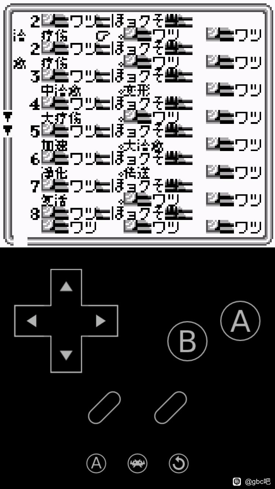
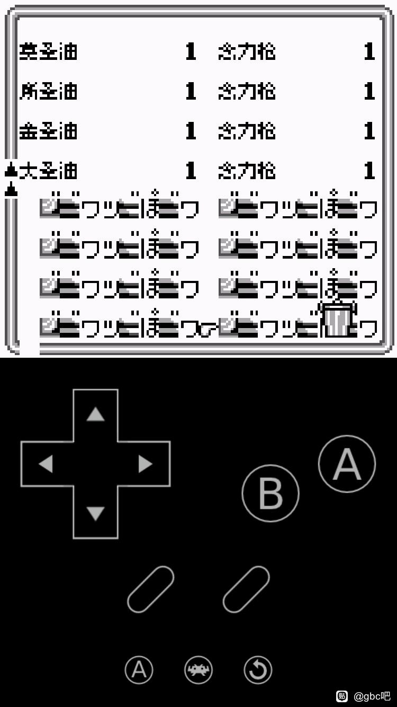

# 沙加3 时空的霸者 黑白GB版：公开反馈

以下均为公开证据，玩家原话不自动等于维护已复现或已修复。

## 154050170883

148楼 · 球总好学 · [原回帖](https://tieba.baidu.com/p/11092365551?pid=154050170883#154050170883)

> 8px 0.1.0，有日文残留，战斗中

[玩家公开图片](https://tiebapic.baidu.com/forum/pic/item/2aefa4345982b2b7803a4ac377adcbef77099bbf.jpg)（玩家反馈图）

[玩家公开图片](https://tiebapic.baidu.com/forum/pic/item/9e653fd3d539b600066b7cb0af50352ac75cb7bf.jpg)（玩家反馈图）

[玩家公开图片](https://tiebapic.baidu.com/forum/pic/item/877c982397dda144e0ac1fb5f4b7d0a20df486bf.jpg)（玩家反馈图）

[玩家公开图片](https://tiebapic.baidu.com/forum/pic/item/3dab33f33a87e9500ab2806b56385343faf2b4bf.jpg)（玩家反馈图）

## 154050181591

148楼 · 球总好学 · [原回帖](https://tieba.baidu.com/p/11092365551?pid=154050181591#154050181591)

> 8px 0.1.0，游戏开篇故事介绍时，文字是很慢的一个字一个字地显示出来，很慢，不能快进。原日文版按住a键可以快速显示文本

[玩家公开图片](https://tiebapic.baidu.com/forum/pic/item/daa4d0f9d72a6059148f921d6e34349b023bba41.jpg)（玩家反馈图）

[玩家公开图片](https://tiebapic.baidu.com/forum/pic/item/6053134c510fd9f9f888266e632dd42a2934a441.jpg)（玩家反馈图）

[玩家公开图片](https://tiebapic.baidu.com/forum/pic/item/b1583387e950352a86fe560f1543fbf2b3118b41.jpg)（玩家反馈图）

[玩家公开图片](https://tiebapic.baidu.com/forum/pic/item/5c816959252dd42a1b9672ac453b5bb5c8eab841.jpg)（玩家反馈图）

## 154050195512

148楼 · 球总好学 · [原回帖](https://tieba.baidu.com/p/11092365551?pid=154050195512#154050195512)

> 8px 0.1.0，游戏开篇剧情介绍后，画面切换到角色取名时有4-6秒钟的卡顿，几位角色取名界面切换之间也有2-3秒钟卡顿。战斗时，选择指定时和选择攻击目标时也有2-4秒钟的卡顿

[玩家公开图片](https://tiebapic.baidu.com/forum/pic/item/e0c8ff246b600c33adeaadcf5c4c510fd8f9a155.jpg)（玩家反馈图）

[玩家公开图片](https://tiebapic.baidu.com/forum/pic/item/91e7580fd9f9d72a50f7631a922a2834359bbb55.jpg)（玩家反馈图）

[玩家公开图片](https://tiebapic.baidu.com/forum/pic/item/daa4d0f9d72a60591483921d6e34349b023bba55.jpg)（玩家反馈图）

[玩家公开图片](https://tiebapic.baidu.com/forum/pic/item/b12ce050352ac65c51961574bdf2b21192138a55.jpg)（玩家反馈图）

[玩家公开图片](https://tiebapic.baidu.com/forum/pic/item/b1583387e950352a86f2560f1543fbf2b3118b55.jpg)（玩家反馈图）

## 154054287773

148楼 · 球总好学 · [原回帖](https://tieba.baidu.com/p/11092365551?pid=154054287773#154054287773)

> 8px 0.1.1，战斗中，文本按a键快进显示文字时稍有卡顿。移动指令选择选项时和选择敌人时有卡顿（大约0.2-0.5秒）

[玩家公开图片](https://tiebapic.baidu.com/forum/pic/item/32aa4390f603738d7e806f25f51bb051f919ec1f.jpg)（玩家反馈图）

[玩家公开图片](https://tiebapic.baidu.com/forum/pic/item/c13bff03738da977e1e5e52cf651f8198718e31f.jpg)（玩家反馈图）

[玩家公开图片](https://tiebapic.baidu.com/forum/pic/item/0db33f7adab44aedce84dde3f51c8701a08bfb1f.jpg)（玩家反馈图）

[玩家公开图片](https://tiebapic.baidu.com/forum/pic/item/7da87a8da97739126aece666be198618377ae21f.jpg)（玩家反馈图）

## 154054651661

148楼 · 炽天火3 · [原回帖](https://tieba.baidu.com/p/11092365551?pid=154054651661#154054651661)

> 是的，我也感觉到了，希望能修复

## 154054285017

148楼 · 球总好学 · [原回帖](https://tieba.baidu.com/p/11092365551?pid=154054285017#154054285017)

> 8px 0.1.1，战斗时，我方攻击未命中敌人时的文字显示未汉化，日文残留（画面上方，敌人身上显示的日文）

[玩家公开图片](https://tiebapic.baidu.com/forum/pic/item/4df719385343fbf286e6c524f67eca8064388f1e.jpg)（玩家反馈图）

## 154054296408

148楼 · 球总好学 · [原回帖](https://tieba.baidu.com/p/11092365551?pid=154054296408#154054296408)

> 8px 0.1.1，对话文本中，角色名字后面有多个空字符（角色名字后与接下来的文字之间有多余的空格）

[玩家公开图片](https://tiebapic.baidu.com/forum/pic/item/da962f9759ee3d6d51fbe5cc05166d224f4ade27.jpg)（玩家反馈图）

[玩家公开图片](https://tiebapic.baidu.com/forum/pic/item/2b4701fa513d26975bee6a5a13fbb2fb4316d827.jpg)（玩家反馈图）

[玩家公开图片](https://tiebapic.baidu.com/forum/pic/item/9a74a0ec8a1363279e2fa134d78fa0ec09fac727.jpg)（玩家反馈图）

[玩家公开图片](https://tiebapic.baidu.com/forum/pic/item/13897b0e0cf3d7ca6acb5d71b41fbe096b63a927.jpg)（玩家反馈图）

[玩家公开图片](https://tiebapic.baidu.com/forum/pic/item/5c6172cb0a46f21faa093c54b0246b600c33ae27.jpg)（玩家反馈图）

[玩家公开图片](https://tiebapic.baidu.com/forum/pic/item/79b4b7096b63f6247c605b04c144ebf81a4ca327.jpg)（玩家反馈图）

[玩家公开图片](https://tiebapic.baidu.com/forum/pic/item/825c99529822720e03f380fd3dcb0a46f21fab27.jpg)（玩家反馈图）

[玩家公开图片](https://tiebapic.baidu.com/forum/pic/item/ab0f4f2309f79052952225394af3d7ca7bcbd527.jpg)（玩家反馈图）

[玩家公开图片](https://tiebapic.baidu.com/forum/pic/item/ab0f4f2309f79052952225394af3d7ca7bcbd527.jpg)（玩家反馈图）

## 问题状态

- 鬼太郎10px对白框下沿冒头、疑缺字；黑之书10px v1.0.1对白出现第二行溢出；海贼王省略号或声响描述附近文字缺失；柯南地下游乐园v1.0.2：推理摘要显示不全；柯南奇岩岛v1.0.1：玩家报告混合字号，切换现象待核；柯南豪华列车v1.0.3：对白下方笔画残留；DT：章标题字底截断、长对白快速跳末句（玩家已补v1.0.0文件名）；黑之书：10px v1.0.3第二行/文本范围排版反馈（9张截图）待复现；怪兽旅行者：大字对白姓名错位待核（实际ROM版本待补；动态姓名保留8px属当前范围）；实际左栏文字到右缘后不完整，原话称语句不通或显示不全。；合入既有反馈待复现，不另建排版重复Issue；只记录这一游戏/字号/版本范围，不宣称总批完成。；切换地图的标题被报告显示越界。；玩家要求统一战斗指令及目的地“召唤兽馆”等名称左对齐。；“学习网球知识”等模式说明要求与“查看角色等信息”统一左对齐。；8px v0.9.2默认名古比后有多空格，姓名与标点间不自然。；玩家报角色名与后续对白之间多余空字符；9图引用含1张完全相同的重复图，8张不同原图。；玩家报自定义姓名与后续对白间有多个空字符，2张原图。：开放；公开Issue待单独建档。
- 玩家报战斗中日文残留，4图可见HUD假名“ぶき”及战斗消息中的“ジプシー”；手机截图列表文件名为saga-3-gb-v0.1.0-8px-music。：已关闭；公开Issue待单独建档。
- 玩家报告开篇逐字很慢且按住A不能像日版快速显示；开篇至取名约4–6秒、不同角色取名切换约2–3秒，战斗选择指令及攻击目标约2–4秒。9图覆盖剧情、男女朋友取名和战斗指令页。：开放；公开Issue待单独建档。
- 玩家报我方攻击未命中时，敌身上方显示日文。原图敌身白字可能为「ミス」，精确字形待最终ROM运行核对。：开放；公开Issue待单独建档。

实际玩家ROM SHA未知时保持未知；当前参考版本SHA不能冒充玩家字节。

## 20261025-1619 公开反馈更新

按当前实际未关闭问题去重：纯BUG 2 项，建议/覆盖等 0 项，分类待核 0 项。开放不代表正在修复。

- 黑白GB普通8px音乐版训练战未命中原ミス精灵字图（记录版本：v0.1.2、v0.1.3）：限定证据已核验；原报告范围关闭；该证据不代表当前最新版或整作全通。

玩家实际完整ROM字节未知时仍保留未知；自然流程、原生消费者诊断及静态证据分别记录，不外推实机或全流程。

## 20261026-1624 玩家反馈增量

- 沙加3 黑白GB：普通8px音乐版道具与魔法乱码（保持开放）：玩家报SaGa-gb3-zh-v0.1.3-8px-music道具及魔法页乱码，附2图和主动提供的即时状态来源。图中文字重叠可见，实际ROM字节、触发链和共同根因未核；即时状态未下载或运行，不并入彩色DX版。
- 沙加3 黑白GB：菜单慢的版本补充（保持开放）：同一玩家把菜单文字显示慢补充到普通8px音乐版v0.1.3上下文；这不代表旧版开篇加速、取名或战斗迟滞已重新复现或已修。速度仍为玩家报告，实际ROM完整SHA未知，原记录继续开放。

本次仅登记玩家证据和限定复测，未运行ROM、未新增修复；当前发布参考不代表玩家实际ROM字节。

[xfbb333 · 275楼 · 154072926383](https://tieba.baidu.com/p/11092365551?pid=154072926383#154072926383)

> 时空霸者黑白版呢道具魔法界面显示乱码字幕显示速度慢 版本 SaGa-gb3-zh-v0.1.3-8px-music
> 通过百度网盘分享的文件：SaGa-gb3....state1
> 链接：[下载链接已省略，见原帖定位]
> 复制这段内容打开「百度网盘APP 即可获取」

下载地址与对应提取码以原帖定位替代；其余原话、空格、观点和标点保留，私库保存完整原文。

[原楼登记答复](https://tieba.baidu.com/p/11092365551?pid=154075364530#154075364530)：v0.1.3普通8px音乐版的道具、魔法乱码和拖慢已记录，截图和状态来源已收到，继续排查。

## 20261106-2333 增量反馈

### 沙加3黑白GB：普通8px音乐版对白姓名空隙

玩家补充该版本对白的姓名和后续文字之间有明显空隙，沿用既有对白排版问题。

[玩家原反馈](https://tieba.baidu.com/p/11092365551?pid=154112836595#154112836595)

> 8px 0.1.3音乐版，对话文本中，角色名字和后续文本之间有多余的空格         

- 图1预览 SHA256 `8a9cf7ab8b2004bdd0e5f5efc77bc18599ee26c8771035e6b3aa0182a7c3e64a`，192247字节。
- 图2预览 SHA256 `155b209925a81e6240f3f73bb2153b7bfc699c1e915e273a03d4001bb3064be4`，210451字节。
- 图3预览 SHA256 `6ffbe8991b5286d99fd36f6fb28780d5cc1bd3d2fd3efbc143da93d2d7e4c459`，210531字节。
- 图4预览 SHA256 `7472fbaf393519b147274fd4814b67c059a3651254f211639d1d2bbd46764e5b`，211102字节。
- 图5预览 SHA256 `33a354508c30bb7edde1e1d1a3b9fa978e31b655211c2eb3282a63d21c934434`，187432字节。
- 图6预览 SHA256 `c5e6fe36585b7f061eda10a654ba73633dd215d61edbc24bf807cefbf709af07`，178457字节。
- 图7预览 SHA256 `b978eca724b86ee00e23640b69e6049b7582f282d2187165b6150a7769676320`，193557字节。
- 图8预览 SHA256 `95ed6ce3825a9d2feefa23c940055c5c82d2d7cbf621d9d360caa055784802c7`，201709字节。
- 图9预览 SHA256 `5d47dd2514e068df482691ca18b66d119041392847961b07dc2c403f89d6fe8e`，204130字节。

### 沙加3黑白GB：战斗主指令区及我方HP周边乱码

玩家报告战斗主指令选择时左下怪物栏出现乱码，以及我方HP下方和右侧出现异常文字。两个显示位置分别跟踪。

[玩家原反馈](https://tieba.baidu.com/p/11092365551?pid=154112841084#154112841084)

> 8px 0.1.3音乐版，战斗界面，选择指令时的界面，画面下方左侧，显示异常乱码   

- 图1预览 SHA256 `feb474a336d21125acf80faf4121ba11e754a4025467ab5bd1ab2cb8293332eb`，179495字节。
- 图2预览 SHA256 `a239841feb43032940740edcfdfc7a3b8fb32294b2e263b844c0dc3565b95ab4`，154315字节。
- 图3预览 SHA256 `394053e7fcfbef2d50e25e9a557211e24d640c758ddd61d8b18191d682ffdfeb`，146454字节。

[玩家原反馈](https://tieba.baidu.com/p/11092365551?pid=154112851698#154112851698)

> 8px 0.1.3音乐版，战斗中，画面下方我方角色信息的hp的下面那以后，有乱码（50/50、36/36等的下面那一行），图4我方角色hp的右侧也出现乱码    

- 图1预览 SHA256 `2350fa76f0903ee960bd63f8e062c139d012094451e0cd61c3769684b35c0872`，183533字节。
- 图2预览 SHA256 `743762defd54ac7cbb5822be6ff46a1011170dc9bb8adbcb368d28d373ee8f55`，184966字节。
- 图3预览 SHA256 `7b4c3222b03f806b290f12a0156f535f63b1e9bdd08c6171eed5b8450403efcf`，176815字节。
- 图4预览 SHA256 `a15bdd89f9fb6c1a2529c13cf2ee3acadf1de51bce6b445387acf762545405d6`，163339字节。

### 沙加3黑白GB：能力、魔法、道具子菜单乱码补充

玩家补充战斗中选择能力、魔法、道具后大面积乱码，沿用既有魔法、道具界面反馈范围，并独立记下能力菜单。

[玩家原反馈](https://tieba.baidu.com/p/11092365551?pid=154112845388#154112845388)

> 8px 0.1.3音乐版，战斗中，指令选择“能力”“魔法”“道具”后均会出现大面积乱码     

- 图1预览 SHA256 `743762defd54ac7cbb5822be6ff46a1011170dc9bb8adbcb368d28d373ee8f55`，184966字节。
- 图2预览 SHA256 `6e734190e4381b219cf38f93a5560b294987848c9aa8d4405c0c29d24bddbf8a`，208108字节。
- 图3预览 SHA256 `ba0d9a770899045e8fa61532ea1ba4ea0aa6885e5f6d28bf793624210cdd18e7`，187639字节。
- 图4预览 SHA256 `7dc020f6e167c1e42c817b012fc7f2a013f3f02c1f0e1ed149338cf8d1167de5`，191432字节。
- 图5预览 SHA256 `46cce5a143129aa48edca7fde9f03dc843f6174673645158cd3ffede173b029c`，191314字节。

