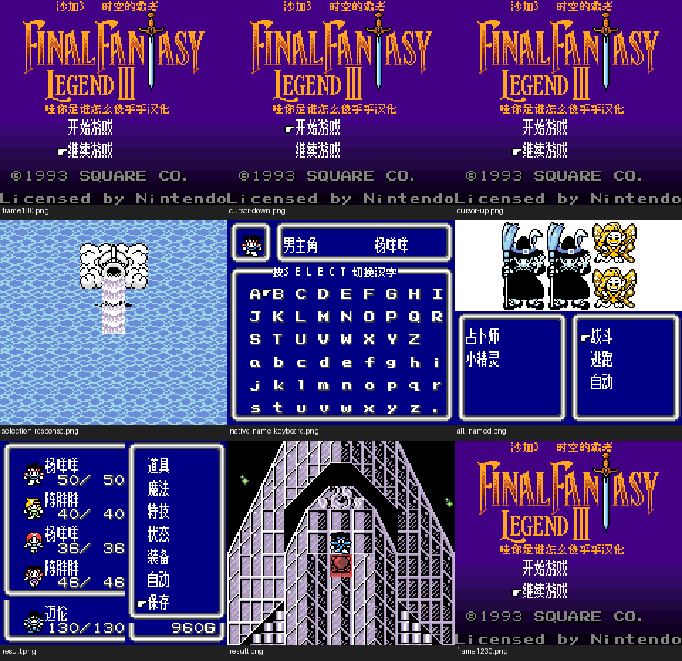

# 沙加3：时空之霸者（彩色DX基底）（限定测试版）

[公开反馈](feedback.md) · [报告BUG](https://github.com/shiyi1133/youxi-hanhua-releases/issues/new?template=bug_report.md)

原游戏／实际基底：Sa-Ga 3 / Final Fantasy Legend III (requester-provided English DX colorization ROM-hack input)

原输入完整SHA-256：`e54b808db9aa0722975226289415869a19ef5f11c40e7a205f6f2a634c4de565`（524288字节）。原输入保留其地区、修订、改版或已有汉化基底身份。

## 8px v1.0.6 music

字号范围：普通原生8px；标题中文为独立静态字图，不等于正文字号变化。

[源码包（完整性未独立确认）](https://github.com/shiyi1133/youxi-hanhua-releases/releases/download/localization-update-20261022-six-games/saga-3-logo-restored-four-variants-source-public-r01.zip) · [补丁包](https://github.com/shiyi1133/youxi-hanhua-releases/releases/download/localization-update-20261022-six-games/saga-3-v1.0.9-patches-public.zip)

目标完整SHA-256：`9f0eb758731af3e40cdb6256e0c49d85cdf36252249d1c6234b186cbd0a70f62`（524288字节）。

图证：v1.0.6 普通原生8px；标题中文为独立静态字图，不等于正文字号变化。 音频：music；提供方最终ROM真实CGB九宫格，维护侧新运行未执行。

## 8px v1.0.6 no-music

字号范围：普通原生8px；标题中文为独立静态字图，不等于正文字号变化。

[源码包（完整性未独立确认）](https://github.com/shiyi1133/youxi-hanhua-releases/releases/download/localization-update-20261022-six-games/saga-3-logo-restored-four-variants-source-public-r01.zip) · [补丁包](https://github.com/shiyi1133/youxi-hanhua-releases/releases/download/localization-update-20261022-six-games/saga-3-v1.0.9-patches-public.zip)

目标完整SHA-256：`6829523388b051844f8e49df439cd84359f096142f61c622b847e8767762bee4`（524288字节）。

图证：v1.0.6 普通原生8px；标题中文为独立静态字图，不等于正文字号变化。 音频：no-music；提供方最终ROM真实CGB九宫格，维护侧新运行未执行。

## 8x12 v1.0.9 music

字号范围：原生8×12，密集菜单/命名提示仍8px；标题独立静态字图。

[源码包（完整性未独立确认）](https://github.com/shiyi1133/youxi-hanhua-releases/releases/download/localization-update-20261022-six-games/saga-3-logo-restored-four-variants-source-public-r01.zip) · [补丁包](https://github.com/shiyi1133/youxi-hanhua-releases/releases/download/localization-update-20261022-six-games/saga-3-v1.0.9-patches-public.zip)

目标完整SHA-256：`9aa0c4b712b5c2f0d5ceac5f35136bbef44630ac3c1644a3923d77aae2662d26`（524288字节）。

图证：v1.0.9 原生8×12，密集菜单/命名提示仍8px；标题独立静态字图。 音频：music；提供方最终ROM真实CGB九宫格，维护侧新运行未执行。

## 8x12 v1.0.9 no-music

字号范围：原生8×12，密集菜单/命名提示仍8px；标题独立静态字图。

[源码包（完整性未独立确认）](https://github.com/shiyi1133/youxi-hanhua-releases/releases/download/localization-update-20261022-six-games/saga-3-logo-restored-four-variants-source-public-r01.zip) · [补丁包](https://github.com/shiyi1133/youxi-hanhua-releases/releases/download/localization-update-20261022-six-games/saga-3-v1.0.9-patches-public.zip)

目标完整SHA-256：`f524b05686128a6f3c0bbcbf891a7ade7613e1a44124e2972ed1daa034f0fbd3`（524288字节）。

图证：v1.0.9 原生8×12，密集菜单/命名提示仍8px；标题独立静态字图。 音频：no-music；提供方最终ROM真实CGB九宫格，维护侧新运行未执行。

## 范围与测试边界

- Restore original title logo/background/copyright and add Chinese title in blank rows; title/init/local data/checksum increment.
- 未全流程/实机/全部模拟器/深层动态名称/最长变量；大字可能拖慢/残留，忙碌期短按可能漏收。
- 战斗固定名称残留未复现，旧“仍漏汉化未修”说明已由新核查纠正；默认英文姓名/英文字母/技术缩写/版权保留，不保证零残留。
- 撤回的战斗卡住调查保持撤回；本次不声称修复。无音乐减负不等于整体78–84%提速。
- 本次是标题恢复修订；独立核验对应补丁还原完整目标字节及最终九宫格原生像素。本轮维护未执行源码、重新构建或运行游戏；不增加SAVE、冷读或自然全流程通过声明。

维护侧独立补丁应用与目标字节一致；18张本批最终九宫格已各自核对9张原生单帧。未执行源码、未新增游戏运行、全流程或实机验收。

大字版更容易出现拖慢、刷新残留等问题，遇到请在原反馈楼说明版本和触发方式。

公开问题状态与玩家测试记录见[反馈页](feedback.md)。开放不代表正在修复；已关闭也不能单独证明所有症状或完整游戏验收。
