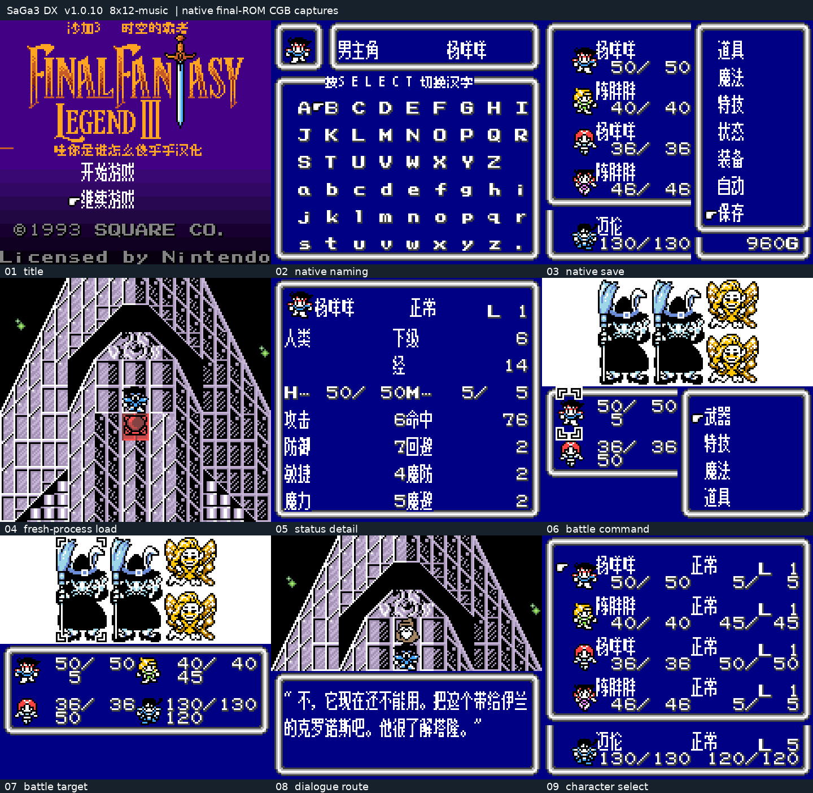
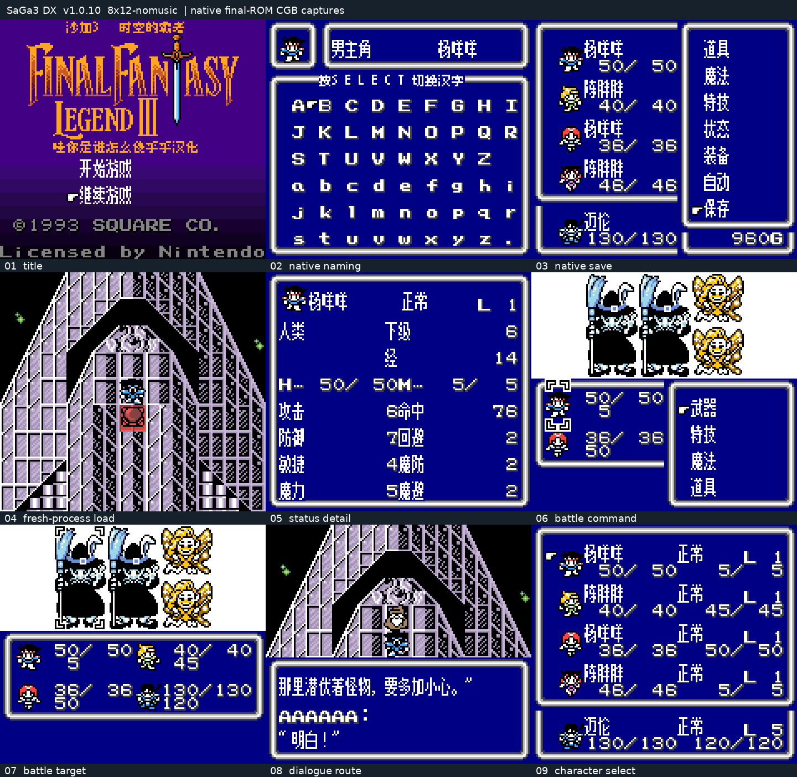
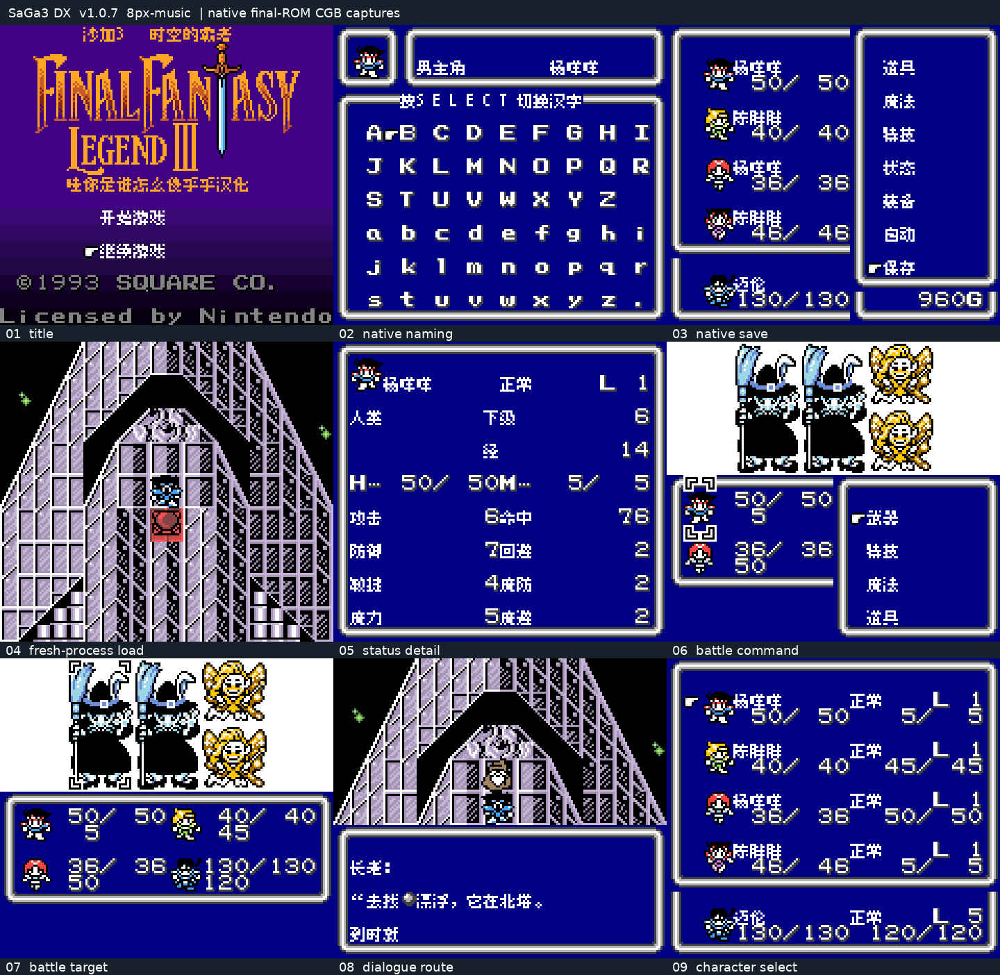
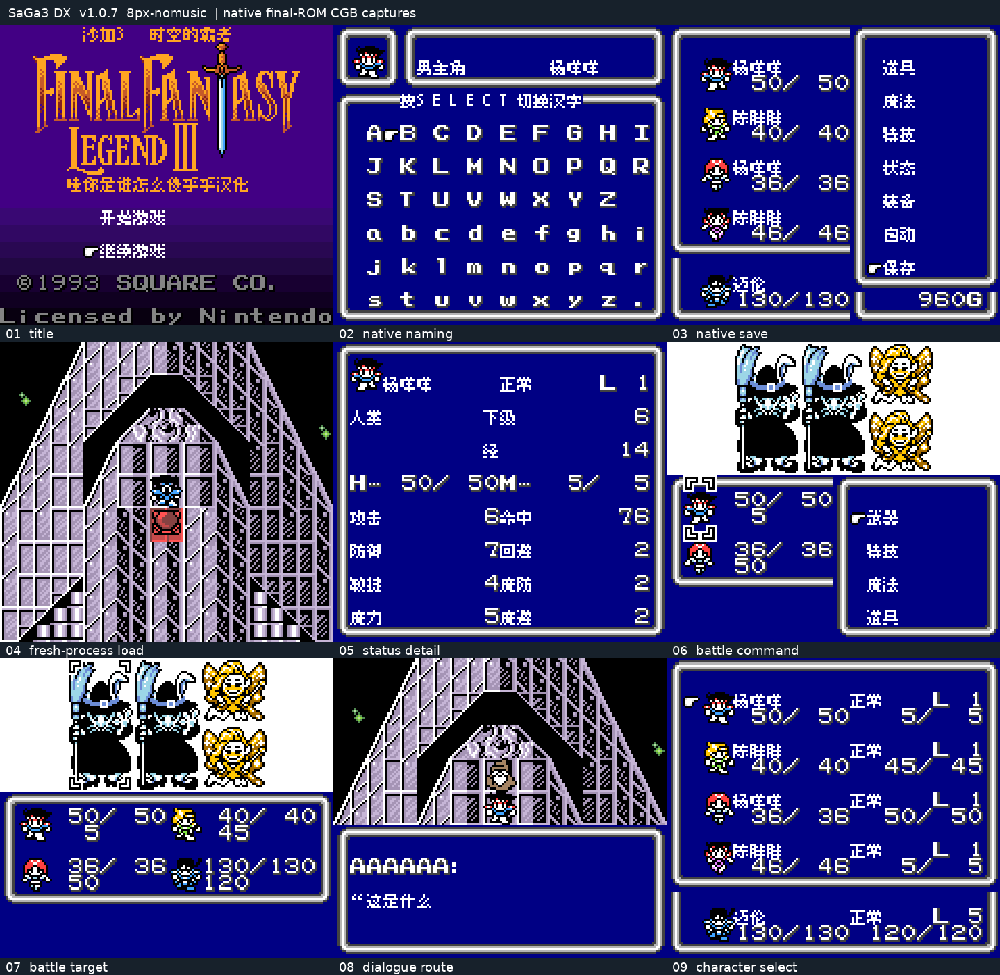

# 沙加3：时空之霸者（彩色DX基底） v1.0.10（限定测试版）

[源码与补丁Release](https://github.com/shiyi1133/youxi-hanhua-releases/releases/tag/saga-3-v1.0.10) · [公开反馈](feedback.md) · [报告BUG](https://github.com/shiyi1133/youxi-hanhua-releases/issues/new?template=bug_report.md)

原游戏／实际输入：Sa-Ga 3 / Final Fantasy Legend III (requester-provided English DX colorization ROM-hack input)

原输入完整 SHA-256：`e54b808db9aa0722975226289415869a19ef5f11c40e7a205f6f2a634c4de565`（524288字节）。

范围：菜单缓存完整2048格引用扫描减负；普通8px与既有8×12分别保留音乐/无音乐变体。

## 8x12 v1.0.10 / music

字号范围：普通8px；既有大字仅对白，密集界面保留原字号。

目标完整 SHA-256：`98cf5e4aad238a91dddf0d74829914efdc5542182e1a0bdfa70927f98377d31a`（524288字节）。

补丁：`8x12-music.bps`，SHA-256 `22aa39182e97655b29735498e2f5ac0f7e2ffe160ff75530dad4e2559b8312f3`。

[源码（完整性未独立确认）](https://github.com/shiyi1133/youxi-hanhua-releases/releases/download/saga-3-v1.0.10/saga-3-v1.0.10-SOURCE-public.zip) · [补丁包](https://github.com/shiyi1133/youxi-hanhua-releases/releases/download/saga-3-v1.0.10/saga-3-v1.0.10-PATCH-public.zip)

v1.0.10 / 8x12 / music 最终ROM提供者实际画面；真实九格，按提供者场景分别保留自然和诊断边界。维护未运行、未全通或实机验收。

## 8x12 v1.0.10 / no-music

字号范围：普通8px；既有大字仅对白，密集界面保留原字号。

目标完整 SHA-256：`c079c3f5fc44721509c4c31024e8b7677f0588102b1e2b0074f1ccce13a76d96`（524288字节）。

补丁：`8x12-nomusic.bps`，SHA-256 `849ed668d4930aaf3cd262917e29ee6eabe66d3b54b0593a9b13a28f697adaf1`。

[源码（完整性未独立确认）](https://github.com/shiyi1133/youxi-hanhua-releases/releases/download/saga-3-v1.0.10/saga-3-v1.0.10-SOURCE-public.zip) · [补丁包](https://github.com/shiyi1133/youxi-hanhua-releases/releases/download/saga-3-v1.0.10/saga-3-v1.0.10-PATCH-public.zip)

v1.0.10 / 8x12 / no-music 最终ROM提供者实际画面；真实九格，按提供者场景分别保留自然和诊断边界。维护未运行、未全通或实机验收。

## 8px v1.0.7 / music

字号范围：普通8px；既有大字仅对白，密集界面保留原字号。

目标完整 SHA-256：`2d9fb637ae1affc26ab6f95a36c016825791e986134eff17bf443980991e3026`（524288字节）。

补丁：`8px-music.bps`，SHA-256 `5da75d56fefad7fe131d1086ec002164da13bb220f06c6504ab075c1c6d23c0d`。

[源码（完整性未独立确认）](https://github.com/shiyi1133/youxi-hanhua-releases/releases/download/saga-3-v1.0.10/saga-3-v1.0.10-SOURCE-public.zip) · [补丁包](https://github.com/shiyi1133/youxi-hanhua-releases/releases/download/saga-3-v1.0.10/saga-3-v1.0.10-PATCH-public.zip)

v1.0.7 / 8px / music 最终ROM提供者实际画面；真实九格，按提供者场景分别保留自然和诊断边界。维护未运行、未全通或实机验收。

## 8px v1.0.7 / no-music

字号范围：普通8px；既有大字仅对白，密集界面保留原字号。

目标完整 SHA-256：`2b4097d3a78e22bdf99681cae23adbb9ebb4077737a2a71efbc25ff81eae6f37`（524288字节）。

补丁：`8px-nomusic.bps`，SHA-256 `2780f4009943abf365e66e330a4f845e59cf3580b2221dcb2bb3fc7055548f8f`。

[源码（完整性未独立确认）](https://github.com/shiyi1133/youxi-hanhua-releases/releases/download/saga-3-v1.0.10/saga-3-v1.0.10-SOURCE-public.zip) · [补丁包](https://github.com/shiyi1133/youxi-hanhua-releases/releases/download/saga-3-v1.0.10/saga-3-v1.0.10-PATCH-public.zip)

v1.0.7 / 8px / no-music 最终ROM提供者实际画面；真实九格，按提供者场景分别保留自然和诊断边界。维护未运行、未全通或实机验收。

## 测试及限制

提供方自然范围：提供者自测：四目标分别原生命名、正常保存新进程冷读、早期菜单/状态及首战指令页；108前后页面原帧对照。

提供方诊断范围：提供者诊断：完整扫描及音频检查点被动审计；PCM/周期核验不是人工听音。

保存边界：仅按具体版本材料，不推定所有旧存档兼容。

维护本轮独立核原输入、补丁逐字节还原、ZIP/CRC、Source安全与原图字节；未执行提供方源码、未重建或运行ROM，未宣称独立人员QA、实机或全流程验收。

- 未验证：维护仅做数据/字节与独立补丁验证，未执行提供者源码或ROM，未独立重建。
- 未验证：只改善可复现菜单等待，忙碌短按仍可能漏收；不称全部迟滞解决。
- 未验证：宙斯及玩家两处冻结现场未验；旧黑块本次未新增修复。
- 未验证：未全通/实机/后期战斗/Delta加速切换及全部最长变量组合。

大字版更容易出现拖慢、刷新残留等问题，遇到请及时在原楼反馈。
