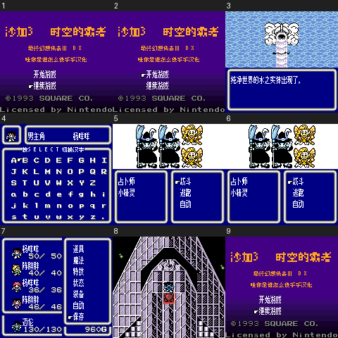

# 沙加3：时空之霸者（彩色DX基底）

原输入：Sa-Ga 3 / Final Fantasy Legend III (requester-provided English DX colorization ROM-hack input)

原输入完整SHA256：`e54b808db9aa0722975226289415869a19ef5f11c40e7a205f6f2a634c4de565`。此处“原输入”保留改版、既有汉化或地区修订身份，不一律称干净零售ROM。

| 字号 | 当前版本 | 音频 | 输出完整SHA256 |
| --- | --- | --- | --- |
| 8px | v1.0.5 | music | `9a22a18846f9787f2384b4a29482d7fc2d497ec0446357157aab917a8d89bfb1` |
| 8px | v1.0.5 | no-music | `13c37bbcef4c8f12d31c0c24bcf1907aa9485276eb13bffc77427893f9512a92` |
| 8x12 | v1.0.8 | music | `7a61f03647c67ee815a86350060e263124d06ddff3cea74ea06dacabfa1b4991` |
| 8x12 | v1.0.8 | no-music | `da1267a2486abc158de5df6fee525b1d19e2417c33635f590dc96038563f7aa3` |

## 源码与补丁

- 8px／v1.0.5／music：源码包（完整性未独立确认）：[下载](https://github.com/shiyi1133/youxi-hanhua-releases/releases/download/source-migration-20261022-02b/saga-3-current-source-ae592725f045-public-r01.zip)（ZIP SHA256 `55c93db088e7df9deec61350e54b8066973fd760a8aa728b2317277663a7a36d`）；补丁：[下载](https://github.com/shiyi1133/youxi-hanhua-releases/releases/download/patch-migration-20261022/saga-3-current-patches.zip)（ZIP SHA256 `e02cbec83482a0686fd7515e9595c91402e4e4edd4b196f154aefda989632b56`）。
  该包已核对对应版本与字节安全；完整修改源码覆盖范围未独立确认。
- 8px／v1.0.5／no-music：源码包（完整性未独立确认）：[下载](https://github.com/shiyi1133/youxi-hanhua-releases/releases/download/source-migration-20261022-02b/saga-3-current-source-ae592725f045-public-r01.zip)（ZIP SHA256 `55c93db088e7df9deec61350e54b8066973fd760a8aa728b2317277663a7a36d`）；补丁：[下载](https://github.com/shiyi1133/youxi-hanhua-releases/releases/download/patch-migration-20261022/saga-3-current-patches.zip)（ZIP SHA256 `e02cbec83482a0686fd7515e9595c91402e4e4edd4b196f154aefda989632b56`）。
  该包已核对对应版本与字节安全；完整修改源码覆盖范围未独立确认。
- 8x12／v1.0.8／music：源码包（完整性未独立确认）：[下载](https://github.com/shiyi1133/youxi-hanhua-releases/releases/download/source-migration-20261022-02b/saga-3-current-source-ae592725f045-public-r01.zip)（ZIP SHA256 `55c93db088e7df9deec61350e54b8066973fd760a8aa728b2317277663a7a36d`）；补丁：[下载](https://github.com/shiyi1133/youxi-hanhua-releases/releases/download/patch-migration-20261022/saga-3-current-patches.zip)（ZIP SHA256 `e02cbec83482a0686fd7515e9595c91402e4e4edd4b196f154aefda989632b56`）。
  该包已核对对应版本与字节安全；完整修改源码覆盖范围未独立确认。
- 8x12／v1.0.8／no-music：源码包（完整性未独立确认）：[下载](https://github.com/shiyi1133/youxi-hanhua-releases/releases/download/source-migration-20261022-02b/saga-3-current-source-ae592725f045-public-r01.zip)（ZIP SHA256 `55c93db088e7df9deec61350e54b8066973fd760a8aa728b2317277663a7a36d`）；补丁：[下载](https://github.com/shiyi1133/youxi-hanhua-releases/releases/download/patch-migration-20261022/saga-3-current-patches.zip)（ZIP SHA256 `e02cbec83482a0686fd7515e9595c91402e4e4edd4b196f154aefda989632b56`）。
  该包已核对对应版本与字节安全；完整修改源码覆盖范围未独立确认。

补丁须直接应用于完整SHA一致的实际原输入；普通字、大字和音乐变体分别核对。公开源码归档不表示本轮重新构建或通过新的运行验收。原作、字体、已有翻译及工具依赖的权利与许可，依各包对应许可保留。

## 范围与验证边界

- 8px／v1.0.5：普通原生Fusion Pixel8px v1.0.5；大字原生Muzai8×12 v1.0.8，密集菜单/命名提示仍8px；标题16px是8px美术2倍，不等于正文字号。。
  普通原生Fusion Pixel8px v1.0.5；大字原生Muzai8×12 v1.0.8，密集菜单/命名提示仍8px；标题16px是8px美术2倍，不等于正文字号。
  未全流程/实机/全部模拟器/深层动态名称/最长变量；大字可能拖慢/残留，忙碌期短按可能漏收。
  战斗固定名称残留未复现，旧“仍漏汉化未修”说明已由新核查纠正；默认英文姓名/英文字母/技术缩写/版权保留，不保证零残留。
  撤回的战斗卡住调查保持撤回；本次不声称修复。无音乐减负不等于整体78–84%提速。
- 8px／v1.0.5：普通原生Fusion Pixel8px v1.0.5；大字原生Muzai8×12 v1.0.8，密集菜单/命名提示仍8px；标题16px是8px美术2倍，不等于正文字号。。
  普通原生Fusion Pixel8px v1.0.5；大字原生Muzai8×12 v1.0.8，密集菜单/命名提示仍8px；标题16px是8px美术2倍，不等于正文字号。
  未全流程/实机/全部模拟器/深层动态名称/最长变量；大字可能拖慢/残留，忙碌期短按可能漏收。
  战斗固定名称残留未复现，旧“仍漏汉化未修”说明已由新核查纠正；默认英文姓名/英文字母/技术缩写/版权保留，不保证零残留。
  撤回的战斗卡住调查保持撤回；本次不声称修复。无音乐减负不等于整体78–84%提速。
- 8x12／v1.0.8：普通原生Fusion Pixel8px v1.0.5；大字原生Muzai8×12 v1.0.8，密集菜单/命名提示仍8px；标题16px是8px美术2倍，不等于正文字号。。
  普通原生Fusion Pixel8px v1.0.5；大字原生Muzai8×12 v1.0.8，密集菜单/命名提示仍8px；标题16px是8px美术2倍，不等于正文字号。
  未全流程/实机/全部模拟器/深层动态名称/最长变量；大字可能拖慢/残留，忙碌期短按可能漏收。
  战斗固定名称残留未复现，旧“仍漏汉化未修”说明已由新核查纠正；默认英文姓名/英文字母/技术缩写/版权保留，不保证零残留。
  撤回的战斗卡住调查保持撤回；本次不声称修复。无音乐减负不等于整体78–84%提速。
- 8x12／v1.0.8：普通原生Fusion Pixel8px v1.0.5；大字原生Muzai8×12 v1.0.8，密集菜单/命名提示仍8px；标题16px是8px美术2倍，不等于正文字号。。
  普通原生Fusion Pixel8px v1.0.5；大字原生Muzai8×12 v1.0.8，密集菜单/命名提示仍8px；标题16px是8px美术2倍，不等于正文字号。
  未全流程/实机/全部模拟器/深层动态名称/最长变量；大字可能拖慢/残留，忙碌期短按可能漏收。
  战斗固定名称残留未复现，旧“仍漏汉化未修”说明已由新核查纠正；默认英文姓名/英文字母/技术缩写/版权保留，不保证零残留。
  撤回的战斗卡住调查保持撤回；本次不声称修复。无音乐减负不等于整体78–84%提速。

本次资料搬运未新增模拟器、实机或全通验收；未记录或未测试的范围不写成通过。问题单开放只表示尚未关闭，已关闭也不单独证明全部场景都修复。

[公开反馈及问题状态](feedback.md) · [报告BUG](https://github.com/shiyi1133/youxi-hanhua-releases/issues/new?template=bug_report.md)

## 对应版本截图

v1.0.5 普通原生Fusion Pixel8px v1.0.5；大字原生Muzai8×12 v1.0.8，密集菜单/命名提示仍8px；标题16px是8px美术2倍，不等于正文字号。 音频：music；四目标各自当前最终ROM九宫格；自然/音频计数/词表诊断分层，不能把旧修复回执全算本版重测。

图像SHA256：`aad719853b33a5d734d968de6b9a922821da5dc42606c44d49ceab3be95bac13`；绑定ROM SHA256：`9a22a18846f9787f2384b4a29482d7fc2d497ec0446357157aab917a8d89bfb1`。

v1.0.5 普通原生Fusion Pixel8px v1.0.5；大字原生Muzai8×12 v1.0.8，密集菜单/命名提示仍8px；标题16px是8px美术2倍，不等于正文字号。 音频：no-music；四目标各自当前最终ROM九宫格；自然/音频计数/词表诊断分层，不能把旧修复回执全算本版重测。

图像SHA256：`906a29568832e65af210cb5ffa251b2576012b5496a63083ade94c7536d806be`；绑定ROM SHA256：`13c37bbcef4c8f12d31c0c24bcf1907aa9485276eb13bffc77427893f9512a92`。

v1.0.8 普通原生Fusion Pixel8px v1.0.5；大字原生Muzai8×12 v1.0.8，密集菜单/命名提示仍8px；标题16px是8px美术2倍，不等于正文字号。 音频：no-music；四目标各自当前最终ROM九宫格；自然/音频计数/词表诊断分层，不能把旧修复回执全算本版重测。

图像SHA256：`8145dd5a04f4924f3bc28ae0294f1bdbe035cb578a39c667ecb77c78ce823afa`；绑定ROM SHA256：`da1267a2486abc158de5df6fee525b1d19e2417c33635f590dc96038563f7aa3`。

v1.0.8 普通原生Fusion Pixel8px v1.0.5；大字原生Muzai8×12 v1.0.8，密集菜单/命名提示仍8px；标题16px是8px美术2倍，不等于正文字号。 音频：music；四目标各自当前最终ROM九宫格；自然/音频计数/词表诊断分层，不能把旧修复回执全算本版重测。

图像SHA256：`d3958c84a61ccf1bd448ce473666f2cc149e72b2b09b92bdaeafb8cd7e29c861`；绑定ROM SHA256：`7a61f03647c67ee815a86350060e263124d06ddff3cea74ea06dacabfa1b4991`。

