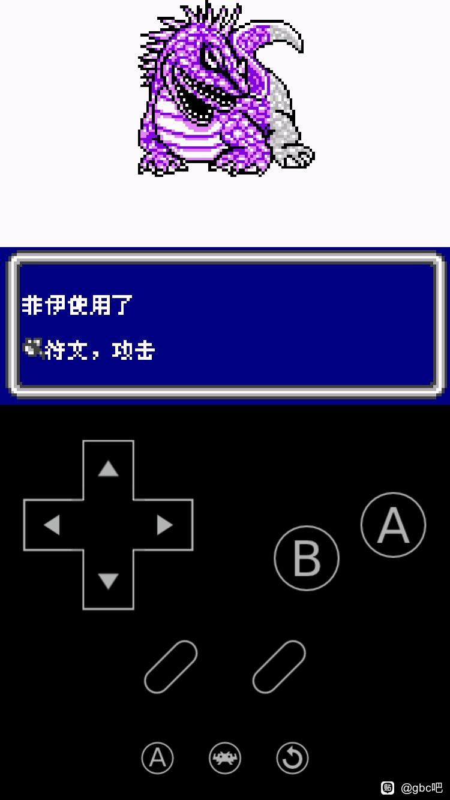

# 沙加3：时空之霸者（彩色DX基底）：公开反馈

以下均为公开证据，玩家原话不自动等于维护已复现或已修复。

## 154042143497

84楼 · 球总好学 · [原回帖](https://tieba.baidu.com/p/11092365551?pid=154042143497#154042143497)

> 8px 1.0.0，标题界面“开始游戏”上方有黑色长条，角色状态页面每位角色的名字后面有黑色方块或者黑色长条

[玩家公开图片](https://tiebapic.baidu.com/forum/pic/item/c2ff0023dd54564e3115f63ef5de9c82d0584ff4.jpg)（玩家反馈图）

[玩家公开图片](https://tiebapic.baidu.com/forum/pic/item/bf0357df8db1cb13d6192e149b54564e93584bf4.jpg)（玩家反馈图）

## 154042147853

84楼 · 球总好学 · [原回帖](https://tieba.baidu.com/p/11092365551?pid=154042147853#154042147853)

> 8px 1.0.0，战斗时指令选择时，移动光标时有1-2秒卡顿。角色状态页面，移动光标时也有类似的1-2秒卡顿

## 154042149640

84楼 · 球总好学 · [原回帖](https://tieba.baidu.com/p/11092365551?pid=154042149640#154042149640)

> 卡顿不确定是不是我模拟器的问题，晚点我换一个模拟器试试

## 154042152715

84楼 · bgcnh · [原回帖](https://tieba.baidu.com/p/11092365551?pid=154042152715#154042152715)

> 小字版，出汉字对话换行的时候有明显卡顿。特别是开了加速在关掉加速后，拖慢明显。ios的delta模拟器

## 154043191051

84楼 · bgcnh · [原回帖](https://tieba.baidu.com/p/11092365551?pid=154043191051#154043191051)

> 文字拖慢是saga3 小字版 1.0.0

## 154052135846

175楼 · folee000166 · [原回帖](https://tieba.baidu.com/p/11092365551?pid=154052135846#154052135846)

> gb saga 3 打宙斯 轉 last boss死機

## 154054417486

175楼 · folee000166 · [原回帖](https://tieba.baidu.com/p/11092365551?pid=154054417486#154054417486)

> 兩版本都是同樣

## 154054418981

175楼 · folee000166 · [原回帖](https://tieba.baidu.com/p/11092365551?pid=154054418981#154054418981)

> 沙加3：时空之霸者（彩色DX基底）

## 问题状态

- 两张玩家图可见开始游戏上方黑条、数个人物姓名后的黑色方块；需当前精确8px目标对照复现，不牵连8x12目标。：开放；公开Issue待单独建档。
- 球总好学明确8px v1.0.0，战斗/状态光标约1–2秒；后续自行计划换模拟器不能当维护已复现。；另一作者bgcnh只说小字版及iOS Delta，版本未知；新增加速后关加速、对话换行时拖慢线索并入此性能Issue，保持其版本未知。；不因发生于换行时就归排版既有反馈，不惯例索模拟器版本或存档。：开放；公开Issue待单独建档。
- 玩家称gb saga3打宙斯转last boss时死机，需精确区分黑白GB日版与彩色DX及实际版本字号。：开放；公开Issue待单独建档。

实际玩家ROM SHA未知时保持未知；当前参考版本SHA不能冒充玩家字节。

## 20261025-0421 公开反馈补充

245楼 · xfbb333 · [原回帖](https://tieba.baidu.com/p/11092365551?pid=154066454789#154066454789)

> 通过百度网盘分享的文件：SaGa-dx3....state4
> 沙加 3dx 小字版卡死前即时存档，试了好几次 100% 复现

245楼 · xfbb333 · [原回帖](https://tieba.baidu.com/p/11092365551?pid=154066466539#154066466539)

> 全能模拟器 mgba 内核

247楼 · xfbb333 · [原回帖](https://tieba.baidu.com/p/11092365551?pid=154068011792#154068011792)

> 通过百度网盘分享的文件：SaGa-dx3....state1
> 沙加 3 彩色版到这个 boss 直接死机了附上即时存档

- [BUG待核版本] 沙加3DX小字：两处战斗卡死与即时状态来源：已记录，开放待核。

[实际公开登记答复](https://tieba.baidu.com/p/11092365551?pid=154068343971#154068343971)：@xfbb333 两处卡死和存档链接已记录，请补实际ROM完整文件名（含版本），以及音乐/静音版。

玩家完整ROM身份未知保留未知；静态图与玩家通关陈述不等于维护运行或全部场景验收。

## 20261025-1619 公开反馈更新

按当前实际未关闭问题去重：纯BUG 4 项，建议/覆盖等 0 项，分类待核 0 项。开放不代表正在修复。

247楼 · xfbb333 · [原回帖](https://tieba.baidu.com/p/11092365551?pid=154068651661#154068651661)

> 版本 SaGa-dx3-8px-music-v1.0.6

- 沙加3 DX：两处卡死报告补充实际版本：登记时保持开放；当前状态以本页问题元数据为准。

[实际公开答复](https://tieba.baidu.com/p/11092365551?pid=154070375194#154070375194)：收到，已补记为 v1.0.6 普通8px音乐版，两处卡死继续按现有问题排查。

玩家实际完整ROM字节未知时仍保留未知；自然流程、原生消费者诊断及静态证据分别记录，不外推实机或全流程。

## 20261026-1624 玩家反馈增量

- 沙加3 DX：普通8px音乐版魔法列表回滚乱码（保持开放）：玩家报SaGa3-DX-zh-v1.0.7-8px-music魔法很多时下拉到底再上拉乱码，附2图并主动给出即时状态来源。黑白日版三列与DX单列只是玩家比较，不能据此断言翻译补丁改变了布局；没有下载或运行即时状态，玩家ROM完整SHA未知。

本次仅登记玩家证据和限定复测，未运行ROM、未新增修复；当前发布参考不代表玩家实际ROM字节。

[xfbb333 · 274楼 · 154072906747](https://tieba.baidu.com/p/11092365551?pid=154072906747#154072906747)

> 通过百度网盘分享的文件：SaGa3-DX....state9
> 链接：网页链接
> 复制这段内容打开「百度网盘APP 即可获取」
> 时空霸者，如果魔法数量太多的话，魔法显示不全，日版黑白版魔法显示是横向一行 3 个魔法显示，彩色汉化版是单列纵向显示，下拉到底 后再上拉显示乱码。版本 SaGa3-DX-zh-v1.0.7-8px-music，附上即时存档，现在彩色版菜单显示速度正常.

[xfbb333 · 274楼 · 154072909316](https://tieba.baidu.com/p/11092365551?pid=154072909316#154072909316)

> 通过百度网盘分享的文件：SaGa3-DX....state9 链接：[下载链接已省略，见原帖定位] 复制这段内容打开「百度网盘APP 即可获取」

下载地址与对应提取码以原帖定位替代；其余原话、空格、观点和标点保留，私库保存完整原文。

[原楼登记答复](https://tieba.baidu.com/p/11092365551?pid=154075364010#154075364010)：v1.0.7普通8px音乐版的魔法列表回滚乱码已记录，截图和状态来源已收到，继续排查。
