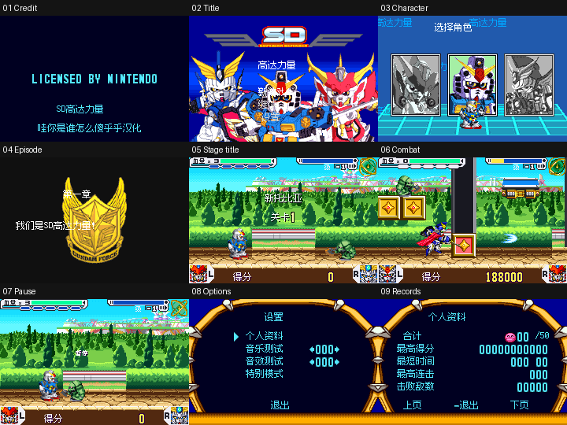

# SD高达力量 v0.1.0（限定测试版）

[源码与补丁Release](https://github.com/shiyi1133/youxi-hanhua-releases/releases/tag/sd-gundam-force-v0.1.0) · [公开反馈](feedback.md) · [报告BUG](https://github.com/shiyi1133/youxi-hanhua-releases/issues/new?template=bug_report.md)

原游戏／实际输入：SD Gundam Force (USA)

原输入完整SHA-256：`2d4bbe9fa0b7051c33a2b63b5b44513cc58e5c9cf91d88449f8cdc94f1b6a8bc`（8388608字节）。

范围：GBA菜单、人物/首章首关、战斗界面及已识别图字；240×160画面。

## 12px v0.1.0

字号范围：原生普通主文字12px，密集HUD8px；不是独立大字版，无10px。

目标完整SHA-256：`03267749e1721dc6d13eabcb0b0539e8c8fbc7dfa49c3dac3e4a261cac1d49f3`（8388608字节）。

补丁：`sd-gundam-force_USA_v0.1.0_native8-12px.bps`，SHA-256 `74d77f1aed1d419840bf6316762db1792c49de6d7587369599ff9a8811d36e47`。

[源码（完整性未独立确认）](https://github.com/shiyi1133/youxi-hanhua-releases/releases/download/sd-gundam-force-v0.1.0/sd-gundam-force-v0.1.0-source-public-r02.zip) · [补丁包](https://github.com/shiyi1133/youxi-hanhua-releases/releases/download/sd-gundam-force-v0.1.0/sd-gundam-force-v0.1.0-patch.zip)

SD高达力量 v0.1.0 12px限定测试版；原生普通主文字12px，密集HUD8px；不是独立大字版，无10px。 自然路径与诊断范围见测试说明，不代表全流程。

## 测试及限制

提供者自然路径：启动、标题、角色/章节选择、首关移动跳跃攻击/切换人物、暂停设置及人物资料。

提供者诊断路径：关卡结算、挑战和结尾标签经诊断；对象残留亦见于原版诊断，不冒称已修。

保存边界：仅有512B空EEPROM导出，不证明有效进度保存/冷读；正常覆盖取消未验。

同一实现者自测，不是独立人员QA；维护未新增ROM运行或源码重建，未宣称实机或完整通关。

- 未验证：自然首关过关及死亡续关
- 未验证：有效进度EEPROM保存冷读
- 未验证：深层关卡、实机及全通
- 核对补丁还原、资产完整SHA和截图字节不等于全部游戏功能验收。

