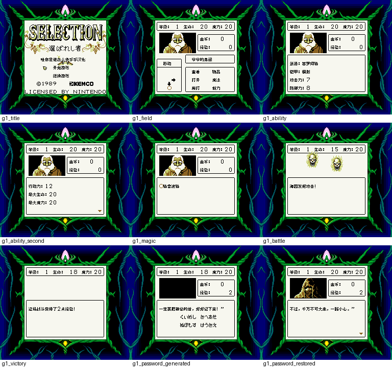
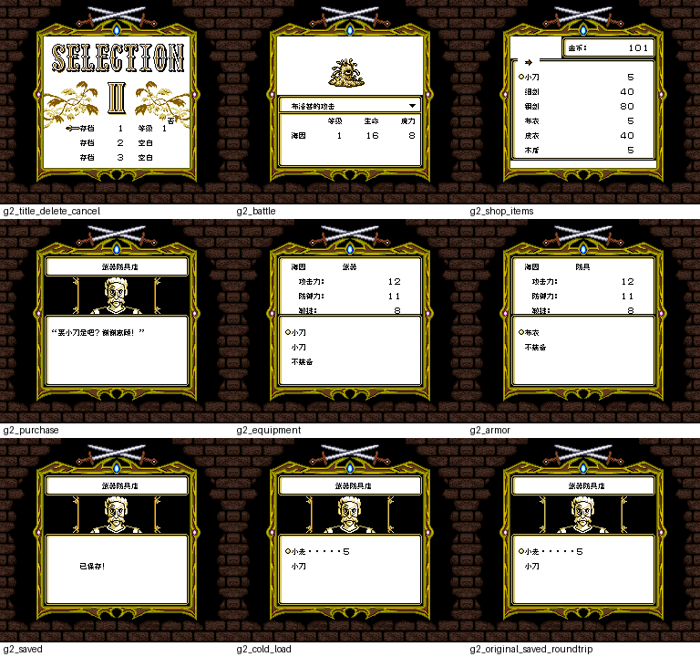

# 抉择一、二代合集

原输入：セレクション1&2 選ばれ者&暗黒の封印

原输入完整SHA256：`3eeaa33a6e9741f5aece3beeaddf13101f52f22e8901d8af51d7bfc48ee2b642`。此处“原输入”保留改版、既有汉化或地区修订身份，不一律称干净零售ROM。

| 字号 | 当前版本 | 音频 | 输出完整SHA256 |
| --- | --- | --- | --- |
| 8px | v0.1.0 | unchanged | `1add81b5da0678720b398e22d35271ae2fffc01d305ab79f7a00023b8ebb5d5a` |

## 源码与补丁

- 8px／v0.1.0／unchanged：源码包（完整性未独立确认）：[下载](https://github.com/shiyi1133/youxi-hanhua-releases/releases/download/source-migration-20261022-04/selection-1-and-2-gb-current-scope-source-public-r01.zip)（ZIP SHA256 `c435ced60ceae0a66e7591c08138173ea056498596aed8b938b7d65d058508f4`）；补丁：[下载](https://github.com/shiyi1133/youxi-hanhua-releases/releases/download/patch-migration-20261022/selection-1-and-2-gb-current-patches.zip)（ZIP SHA256 `d775168d325812f108428545253af55a0993216229baf1c955d4a91be37f7b29`）。
  该包已核对对应版本与字节安全；完整修改源码覆盖范围未独立确认。

补丁须直接应用于完整SHA一致的实际原输入；普通字、大字和音乐变体分别核对。公开源码归档不表示本轮重新构建或通过新的运行验收。原作、字体、已有翻译及工具依赖的权利与许可，依各包对应许可保留。

## 范围与验证边界

- 8px／v0.1.0：原生8px普通字；保留16px行距，两作共用一份合集ROM；无10px交付。。
  已识别两作主要剧情/事件/结局/词典/菜单/战斗/商店/装备/保存与原生口令文字；自然首战、G1口令恢复、G2购买/保存/冷读等为提供者自测。
  两作均未自然通关；结局和深层事件主要为静态编译/控制审计。
  无已确认原生改名入口；未新增取名，原假名口令输入保留。
  部分G2帧从原生电池存档加载；一张final原ROM再保存往返示例不代表所有旧档兼容。
  DMG仅启动/开场冒烟；实机、烧录卡、所有变量/技能/物品/失败复活路线未验。
  SGB九格原生256×224含边框，不能冒称GBC或全程通关。

本次资料搬运未新增模拟器、实机或全通验收；未记录或未测试的范围不写成通过。问题单开放只表示尚未关闭，已关闭也不单独证明全部场景都修复。

[公开反馈及问题状态](feedback.md) · [报告BUG](https://github.com/shiyi1133/youxi-hanhua-releases/issues/new?template=bug_report.md)

## 对应版本截图

抉择一、二代合集 v0.1.0 8px；原生8px普通字；保留16px行距，两作共用一份合集ROM；无10px交付。；合集内第1作真实SGB九宫格

图像SHA256：`3f8be9214354544066148b51a245db6624a2118a10af5ae8d3519725c6903340`；绑定ROM SHA256：`1add81b5da0678720b398e22d35271ae2fffc01d305ab79f7a00023b8ebb5d5a`。

抉择一、二代合集 v0.1.0 8px；原生8px普通字；保留16px行距，两作共用一份合集ROM；无10px交付。；合集内第2作真实SGB九宫格

图像SHA256：`79343062989e03ed93a7e68de25fc21b346de1be3792c13431634c152eb732d4`；绑定ROM SHA256：`1add81b5da0678720b398e22d35271ae2fffc01d305ab79f7a00023b8ebb5d5a`。

