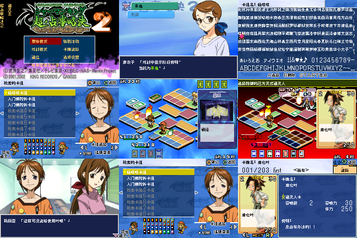

# 通灵王 超占事略决2

原输入：Shaman King Card Game - Chou Senjiryakketsu 2

原输入完整SHA256：`be5421eda8eac576fa64210c4779194ed8ead7853593ea9c533508ccb809879e`。此处“原输入”保留改版、既有汉化或地区修订身份，不一律称干净零售ROM。

| 字号 | 当前版本 | 音频 | 输出完整SHA256 |
| --- | --- | --- | --- |
| 8px | v0.1.0 | unchanged | `3604d8d4f59962ef2e8850e3fd7e135c6614319d68c2a15251f3936d89065d62` |

## 源码与补丁

- 8px／v0.1.0／unchanged：源码包（完整性未独立确认）：[下载](https://github.com/shiyi1133/youxi-hanhua-releases/releases/download/source-migration-20261022-02b/shaman-king-card-game-chou-senjiryakketsu-2-current-source-2c641a7996b5-public-r01.zip)（ZIP SHA256 `4f7a47d8c17cc3602b8da679ce7446ce33723417bb4ba8118bee41728a9feba7`）；补丁：[下载](https://github.com/shiyi1133/youxi-hanhua-releases/releases/download/patch-migration-20261022/shaman-king-card-game-chou-senjiryakketsu-2-current-patches.zip)（ZIP SHA256 `2c51cf578cb556bfeee59f5df022a0c4ea0807a537c0d2ba43089990ee3b5733`）。
  该包已核对对应版本与字节安全；完整修改源码覆盖范围未独立确认。

补丁须直接应用于完整SHA一致的实际原输入；普通字、大字和音乐变体分别核对。公开源码归档不表示本轮重新构建或通过新的运行验收。原作、字体、已有翻译及工具依赖的权利与许可，依各包对应许可保留。

## 范围与验证边界

- 8px／v0.1.0：Fusion Pixel普通8px，仅中文主体/牌组原生命名增强；无独立大字。。
  Fusion Pixel普通8px，仅中文主体/牌组原生命名增强；无独立大字。
  首战胜利、自然有进度剧情存档、全剧情/卡牌可达、商店、深层/结局、实机与实际联机未验。
  牌组诊断姓名/冷读不能当作自然解锁；31开发调试候选保留，不断言绝对不可达。

本次资料搬运未新增模拟器、实机或全通验收；未记录或未测试的范围不写成通过。问题单开放只表示尚未关闭，已关闭也不单独证明全部场景都修复。

[公开反馈及问题状态](feedback.md) · [报告BUG](https://github.com/shiyi1133/youxi-hanhua-releases/issues/new?template=bug_report.md)

## 对应版本截图

v0.1.0 Fusion Pixel普通8px，仅中文主体/牌组原生命名增强；无独立大字。 音频：unchanged；九宫格第3/4/8/9格为命名/冷读/牌组/卡片诊断；第1/2/5/6/7格为冷启动设置或自然首战/后续，同SHA状态续测单列。

图像SHA256：`792e93a71c46ef8b72682a89bfcb93acbf8db3412bf6857d5f0149a935089846`；绑定ROM SHA256：`3604d8d4f59962ef2e8850e3fd7e135c6614319d68c2a15251f3936d89065d62`。

