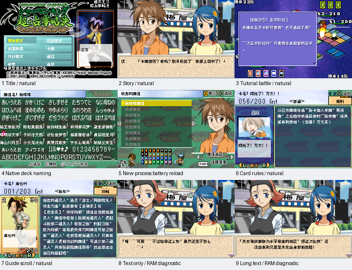

# 通灵王 超占事略决3

原输入：Shaman King Card Game - Chou Senjiryakketsu 3

原输入完整SHA256：`5199ec51c238d1cb5fd2667a92b8bcda55165bcac80c7c071ee0249c44de584f`。此处“原输入”保留改版、既有汉化或地区修订身份，不一律称干净零售ROM。

| 字号 | 当前版本 | 音频 | 输出完整SHA256 |
| --- | --- | --- | --- |
| 8px | v0.1.0 | unchanged | `928c976d158db86e90ea54ff5e11d49f437e61b8dbc2b3f9f788d67812aa4b6d` |

## 源码与补丁

- 8px／v0.1.0／unchanged：源码包（完整性未独立确认）：[下载](https://github.com/shiyi1133/youxi-hanhua-releases/releases/download/source-migration-20261022-02b/shaman-king-card-game-chou-senjiryakketsu-3-current-source-7d369ccc88b6-public-r01.zip)（ZIP SHA256 `be89786ebaf7b051f2b3b4064ff5007e37de5b88fe0cca89e606df966dfd94e2`）；补丁：[下载](https://github.com/shiyi1133/youxi-hanhua-releases/releases/download/patch-migration-20261022/shaman-king-card-game-chou-senjiryakketsu-3-current-patches.zip)（ZIP SHA256 `4791c716bf47254cb6ff0e0eca78a2677399dd52f8a879eae682a85f122a8373`）。
  该包已核对对应版本与字节安全；完整修改源码覆盖范围未独立确认。

补丁须直接应用于完整SHA一致的实际原输入；普通字、大字和音乐变体分别核对。公开源码归档不表示本轮重新构建或通过新的运行验收。原作、字体、已有翻译及工具依赖的权利与许可，依各包对应许可保留。

## 范围与验证边界

- 8px／v0.1.0：Fusion Pixel普通8px；完整组合句保留控制语义，未另制10px或大字。。
  Fusion Pixel普通8px；完整组合句保留控制语义，未另制10px或大字。
  首战未胜、未全通；全国模式玩家姓名字段未自然解锁，不用牌组命名代替。
  深层长句为脚本PC诊断，孤立继续可进入原生错误处理；最长变量、全部卡牌、商店、全国模式全程、联机/实机未验。

本次资料搬运未新增模拟器、实机或全通验收；未记录或未测试的范围不写成通过。问题单开放只表示尚未关闭，已关闭也不单独证明全部场景都修复。

[公开反馈及问题状态](feedback.md) · [报告BUG](https://github.com/shiyi1133/youxi-hanhua-releases/issues/new?template=bug_report.md)

## 对应版本截图

v0.1.0 Fusion Pixel普通8px；完整组合句保留控制语义，未另制10px或大字。 音频：unchanged；原生240×160帧；自然与诊断依原始证据分列，深层诊断背景不能冒充剧情自然到达。

图像SHA256：`7d4629f38a14eb630a25e65a006532999e6d4dac5c4eb0a8d7bf318324bf48ab`；绑定ROM SHA256：`928c976d158db86e90ea54ff5e11d49f437e61b8dbc2b3f9f788d67812aa4b6d`。

