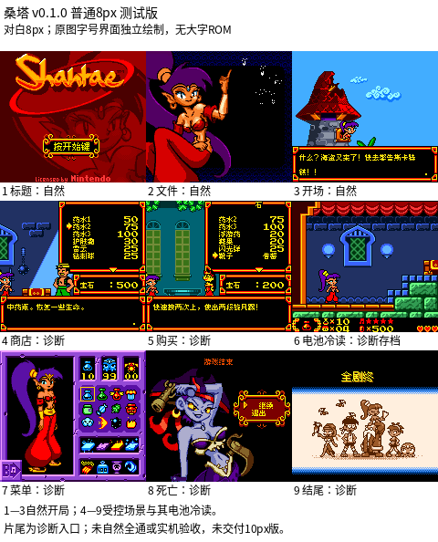

# 桑塔

原输入：Shantae

原输入完整SHA256：`1b92e22d5510c51bab97d23074e4aad7464d93eb15f7596ef7da0a5efa27a19d`。此处“原输入”保留改版、既有汉化或地区修订身份，不一律称干净零售ROM。

| 字号 | 当前版本 | 音频 | 输出完整SHA256 |
| --- | --- | --- | --- |
| 8px | v0.1.0 | unchanged | `1115515e2ab10783dd3e053a14eab74d611120b121bf97fc860d2b3aa50abe6a` |

## 源码与补丁

- 8px／v0.1.0／unchanged：源码包（完整性未独立确认）：[下载](https://github.com/shiyi1133/youxi-hanhua-releases/releases/download/source-migration-20261022-04/shantae-current-scope-source-public-r01.zip)（ZIP SHA256 `a63acb2b1bd3c7f3ed3e797fad65c79b3cdd900af8a95de77e220ee0392b129e`）；补丁：[下载](https://github.com/shiyi1133/youxi-hanhua-releases/releases/download/patch-migration-20261022/shantae-current-patches.zip)（ZIP SHA256 `39430a2248d62dd25133cd09505157e66875876b574eb9f1bd0102fdbe8c4d63`）。
  该包已核对对应版本与字节安全；完整修改源码覆盖范围未独立确认。

补丁须直接应用于完整SHA一致的实际原输入；普通字、大字和音乐变体分别核对。公开源码归档不表示本轮重新构建或通过新的运行验收。原作、字体、已有翻译及工具依赖的权利与许可，依各包对应许可保留。

## 范围与验证边界

- 8px／v0.1.0：对白普通8px；标题/菜单按原画8/10/12px原生绘制。无独立大字ROM。。
  481主脚本段+200额外文字消费者、原尺寸图形与制作人员；普通对白8px有限测试。
  提供方自然冷启动/文件选择/开场；481段为受控解释器消费，不是481段自然流程。
  五镇商店、保存/电池冷读、双重确认删除/冷读、菜单、小游戏、死亡与片尾经受控入口；不能把诊断结尾当自然通关。
  2400次舞蹈菜单桥接调用属诊断回归；自然全通、所有分支/敌人/小游戏结局、全部隐藏音乐/音效与实机未测。
  对白仅普通8px；10px对白测试因底框/保护tile预算被拒绝，无10px可玩ROM。标题/菜单按原画字号原生绘制，不代表新增大字号版。

本次资料搬运未新增模拟器、实机或全通验收；未记录或未测试的范围不写成通过。问题单开放只表示尚未关闭，已关闭也不单独证明全部场景都修复。

[公开反馈及问题状态](feedback.md) · [报告BUG](https://github.com/shiyi1133/youxi-hanhua-releases/issues/new?template=bug_report.md)

## 对应版本截图

桑塔 v0.1.0 8px；对白普通8px；标题/菜单按原画8/10/12px原生绘制。无独立大字ROM。 1—3自然开局；4—9受控场景与其电池冷读。 片尾为诊断入口；未自然全通或实机验收，未交付10px版。

图像SHA256：`f3fc1e32434a875fd2b7ed9d3de54b4c4027b0fbd6a007feaa4c558d5662e263`；绑定ROM SHA256：`1115515e2ab10783dd3e053a14eab74d611120b121bf97fc860d2b3aa50abe6a`。

