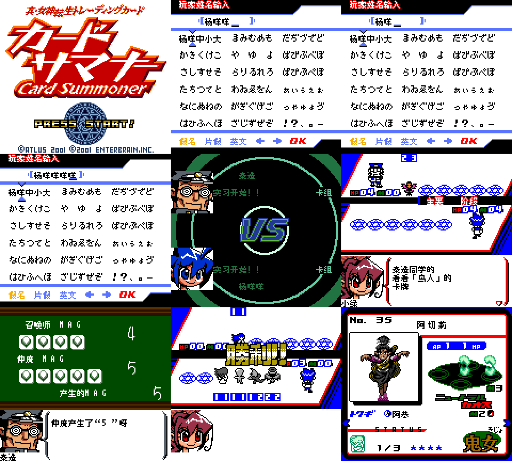

# 真女神转生 卡牌召唤师 v0.1.1（限定测试版）

[源码与补丁Release](https://github.com/shiyi1133/youxi-hanhua-releases/releases/tag/shin-megami-tensei-card-summoner-v0.1.1) · [公开反馈](feedback.md) · [报告BUG](https://github.com/shiyi1133/youxi-hanhua-releases/issues/new?template=bug_report.md)

原游戏／实际输入：Shin Megami Tensei Trading Card - Card Summoner (Japan)

原输入完整SHA-256：`74ba8452990b96d8a3bdfe4af7b0de9d40ed8d1a9b352396ad620c74b5e076b6`（2097152字节）。

范围：普通8px限定修复测试版：取名页黑条、主要/结束阶段残留图块；教学VS固定卡组名及“卡组”标签补译。

## 8px v0.1.1

字号范围：普通 Fusion Pixel 8px，CGB原生彩色；无另行10px大字版；非DMG或SGB验收。

目标完整SHA-256：`239115c6312cb4da9cd5617d66d64ec0deebc00b1ebdbcc2013aaa5ec82436e1`（4194304字节）。

补丁：`Card_Summoner_v0.1.1_8px.bps`，SHA-256 `1a9f0ef463f9c4245632a984053a7c2c055238be721bff59bc29c2acd1cc9ad0`。

[源码（完整性未独立确认）](https://github.com/shiyi1133/youxi-hanhua-releases/releases/download/shin-megami-tensei-card-summoner-v0.1.1/shin-megami-tensei-card-summoner-v0.1.1-8px-SOURCE-public.zip) · [补丁包](https://github.com/shiyi1133/youxi-hanhua-releases/releases/download/shin-megami-tensei-card-summoner-v0.1.1/shin-megami-tensei-card-summoner-v0.1.1-8px-PATCH-public.zip)

v0.1.1 普通8px最终ROM提供者真实九宫格；9格按原生160×144逐像素3倍核对；第6格为同ROM自然检查点续跑，非新维护运行或全流程验收。

## 测试及限制

提供者自然路径：提供者同一实施者自然按键自测：标题冷启动、中文姓名重复/删除/重输/最多5字，VS教学卡组名，MAG、两场教学胜利及奖励卡；主要阶段图为同ROM自然检查点续跑。

提供者诊断路径：提供者受控诊断：10份修改资源经原生解码器比对、314非空SP、6帮助字形、原52密码符号及5个中文命名字形；非自然完整SP/密码或全流程验收。

保存边界：未据原件SRAM或空存档推定保存冷读成功。

同一实现者自测，不是独立人员QA；维护未新增ROM运行或源码重建，未宣称实机或完整通关。

- 未验证：维护只做静态及独立BPS字节校验，未运行提供者代码、未独立重建或新增ROM运行测试。
- 未验证：正常保存、新进程冷读、跨版存档兼容、卡组改名、商店、自然SP/完整密码、深层剧情/首领/全通、联机/实机未验。
- 未验证：原日文Logo、Card Summoner、PRESS START、原版权、WIN!!、阵营/种族图形、97/212条卡片故事及部分深层对手卡组名保留。
- 未验证：Issue135仅教学固定VS两行及卡组标签补译，深层卡组名覆盖未清零；不得关闭整项覆盖反馈。
- 核对补丁还原、资产完整SHA和截图字节不等于全部游戏功能验收。

