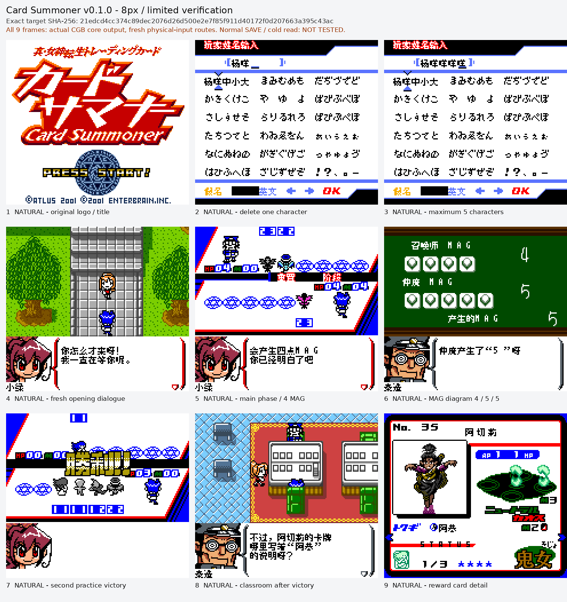

# 真女神转生 卡牌召唤师（限定测试版）

[公开反馈](feedback.md) · [报告BUG](https://github.com/shiyi1133/youxi-hanhua-releases/issues/new?template=bug_report.md)

原游戏／实际基底：Shin Megami Tensei Trading Card - Card Summoner (Japan)

原输入完整SHA-256：`74ba8452990b96d8a3bdfe4af7b0de9d40ed8d1a9b352396ad620c74b5e076b6`（2097152字节）。原输入保留其地区、修订、改版或已有汉化基底身份。

## 8px v0.1.0 unchanged

字号范围：普通Fusion Pixel 8px限定测试版，2MiB原输入扩容至4MiB，CGB，无大字版；帮助沿原9×9容器，部分原16px容器仍用8px字形。16005按地址译文记录及已定位名称、帮助、卡片背景、标签和SP/战斗命令有提供方静态覆盖，不等于16005场实测或全作完成。

[源码包（完整性未独立确认）](https://github.com/shiyi1133/youxi-hanhua-releases/releases/download/localization-update-20261022-six-games/shin-megami-tensei-card-summoner-v0.1.0-8px-source-public.zip) · [补丁包](https://github.com/shiyi1133/youxi-hanhua-releases/releases/download/localization-update-20261022-six-games/shin-megami-tensei-card-summoner-v0.1.0-patches-public.zip)

目标完整SHA-256：`21edcd4cc374c89dec2076d26d500e2e7f85f911d40172f0d207663a395c43ac`（4194304字节）。

图证：v0.1.0 普通8px；提供方同最终SHA自然按键CGB九宫格；原生9单帧与3倍最近邻拼图逐像素相等，标题原图保留；正常SAVE/冷读明确未测，维护未新增运行。

## 范围与测试边界

- 普通Fusion Pixel 8px限定测试版，2MiB原输入扩容至4MiB，CGB，无大字版；帮助沿原9×9容器，部分原16px容器仍用8px字形。16005按地址译文记录及已定位名称、帮助、卡片背景、标签和SP/战斗命令有提供方静态覆盖，不等于16005场实测或全作完成。
- 正常有进度SAVE/新进程读档和存档兼容未测；牌组改名、商店交易、自然SP/完整口令、深层剧情Boss/全通、全部变量图像、联机/实机均未验。
- 标题日文Logo、英文Card Summoner/Press Start、版权、阵营/族别图像和WIN!!原图保留；卡片背景97/212明确保留日文。43代码/数据候选未证实可达，不能称全汉化或全部不可达。
- 仅实现者自测；本轮维护未构建源码或运行模拟器，不把净目录提供方重建称为独立人员QA。

维护侧独立补丁应用与目标字节一致；18张本批最终九宫格已各自核对9张原生单帧。未执行源码、未新增游戏运行、全流程或实机验收。

公开问题状态与玩家测试记录见[反馈页](feedback.md)。开放不代表正在修复；已关闭也不能单独证明所有症状或完整游戏验收。
