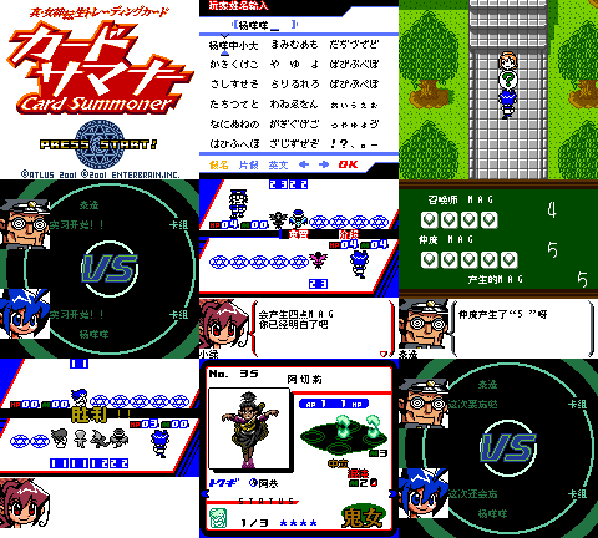

# 真女神转生 卡牌召唤师 v0.1.3（限定测试版）

[源码与补丁Release](https://github.com/shiyi1133/youxi-hanhua-releases/releases/tag/shin-megami-tensei-card-summoner-v0.1.3) · [公开反馈](feedback.md) · [报告BUG](https://github.com/shiyi1133/youxi-hanhua-releases/issues/new?template=bug_report.md)

原游戏／实际输入：Shin Megami Tensei Trading Card - Card Summoner (Japan)

原输入完整 SHA-256：`74ba8452990b96d8a3bdfe4af7b0de9d40ed8d1a9b352396ad620c74b5e076b6`（2097152字节）。

范围：胜负、九阵营标签及种族读音/道具图片残文限定修复；保留既有VS中文与机制。

## 8px v0.1.3 / unchanged

字号范围：普通8px；本批不新增大字号。

目标完整 SHA-256：`499160aa9beb71f875ca92b0cb859af342e81f285c3d3e24b51b471cb33f5da3`（4194304字节）。

补丁：`Card_Summoner_v0.1.3_8px.bps`，SHA-256 `03918dc1c34fe463162ca3f036a131b39a598856a9c28e3acc5409faae3f9146`。

[源码（完整性未独立确认）](https://github.com/shiyi1133/youxi-hanhua-releases/releases/download/shin-megami-tensei-card-summoner-v0.1.3/shin-megami-tensei-card-summoner-v0.1.3-SOURCE-public.zip) · [补丁包](https://github.com/shiyi1133/youxi-hanhua-releases/releases/download/shin-megami-tensei-card-summoner-v0.1.3/shin-megami-tensei-card-summoner-v0.1.3-PATCH-public.zip)

v0.1.3 / 8px / unchanged 最终ROM提供者实际画面；12场景证据板，含明确自然及受控诊断。维护未运行、未全通或实机验收。

## 测试及限制

提供方自然范围：提供者自测：最终ROM自然开机命名、教程VS、阶段/MAG、自然胜利、奖励卡及下一场VS。

提供方诊断范围：提供者诊断：53卡种族/九阵营受控消费者，失败/平局选择器诊断；非自然全收集/自然失败平局。

保存边界：仅按具体版本材料，不推定所有旧存档兼容。

维护本轮独立核原输入、补丁逐字节还原、ZIP/CRC、Source安全与原图字节；未执行提供方源码、未重建或运行ROM，未宣称独立人员QA、实机或全流程验收。

- 未验证：维护仅做数据/字节与独立补丁验证，未执行提供者源码或ROM，未独立重建。
- 未验证：12场景截图板包含自然/诊断画面，不能称九宫格或全流程证明。
- 未验证：未全通/实机/自然失败平局/深层剧情/商店/全部槽与玩家档兼容。
