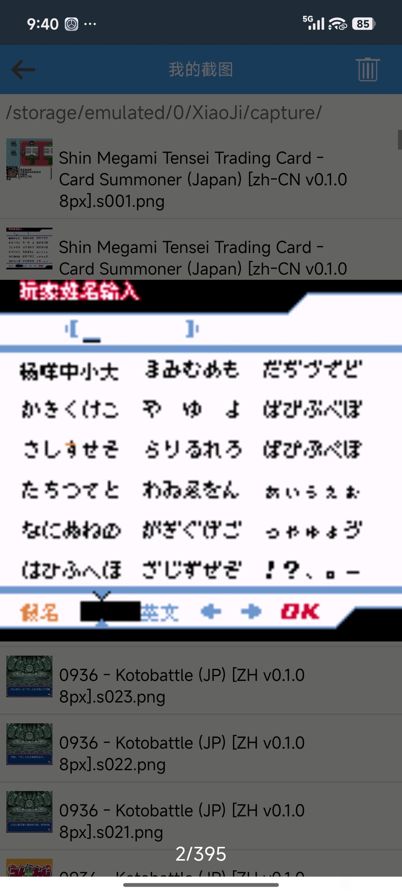
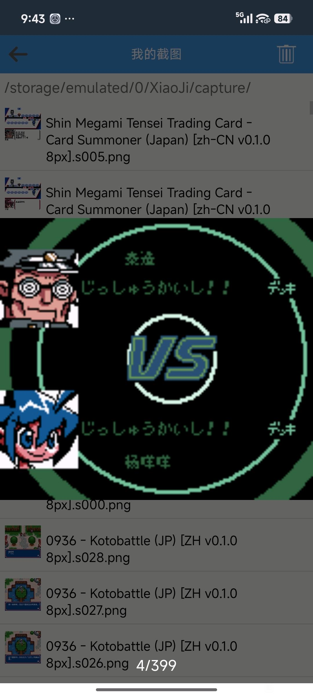
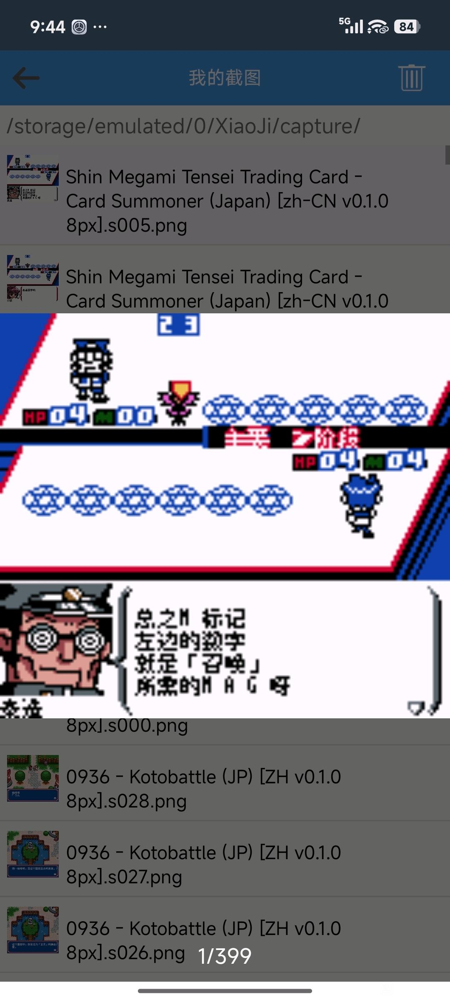
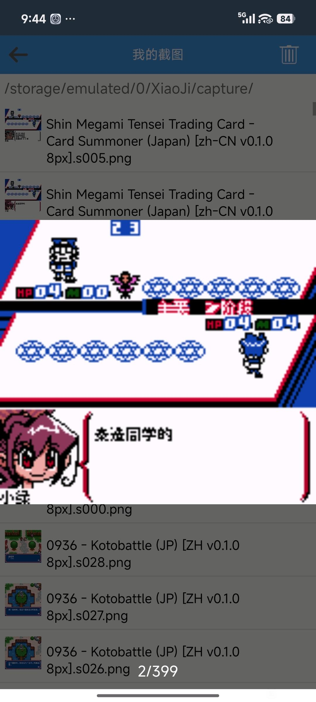

# 真女神转生 卡牌召唤师：公开反馈

以下均为公开证据，玩家原话不自动等于维护已复现或已修复。

## 登记时问题状态（历史）

此前导出时尚无可关联的镜像问题记录；本轮已补充显示异常、漏译覆盖反馈及登记答复，见下文。本仓库未另建公开 Issue，这不表示完成全面测试。

实际玩家ROM SHA未知时保持未知；当前参考版本SHA不能冒充玩家字节。

## 20261024-0412 公开反馈补充

公开 BUG 入口：[提交反馈](https://github.com/shiyi1133/youxi-hanhua-releases/issues/new/choose)。

162楼 · 球总好学 · [原回帖](https://tieba.baidu.com/p/11092365551?pid=154063840386#154063840386)

> 8px 0.1.0，游戏一开始，取名界面，画面左下方有黑条

162楼 · 球总好学 · [原回帖](https://tieba.baidu.com/p/11092365551?pid=154063853152#154063853152)

> 8px 0.1.0，正式开始对战时的这个界面，画面上方和下方各有一行日文没有翻译

162楼 · 球总好学 · [原回帖](https://tieba.baidu.com/p/11092365551?pid=154063859004#154063859004)

> 8px 0.1.0，画面右上方“主要阶段”的“阶段”左边有残留图案或者部分日文文字没有优化好（“主要”和“阶段”的中间，红色字样）

- [BUG待复现] 卡牌召唤师v0.1.0普通8px：取名黑条与主要阶段残留图块：已记录，开放待核。
- [覆盖反馈] 卡牌召唤师v0.1.0普通8px：正式对战VS页上下两行日文：已记录，开放待核。

[已公开登记答复](https://tieba.baidu.com/p/11092365551?pid=154064808031#154064808031)：@球总好学 v0.1.0普通8px的取名黑条、对战开场日文和“主要阶段”栏残留已一起记录，后续排查。

除另注已实收核验的译版 ROM 外，玩家实际输入/输出 SHA 未核定。图片与通关描述仅为玩家反馈；本次没有新增维护运行复现、修复或完整流程验收。

## 已发布版本的限定修复进展（2026-10-24）

- `problem-cf1dcde252ac2624`：原反馈所列定位范围已关闭。对应 v0.1.1 / 8px 限定测试版；[公开版本](https://github.com/shiyi1133/youxi-hanhua-releases/releases/tag/shin-megami-tensei-card-summoner-v0.1.1)。
  已核对：取名页左下黑条：提供者精确旧v0.1.0基线复现及v0.1.1自然同输入对照；LZ短拷贝距离255/256边界修正。；原主要阶段残留已有同ROM自然检查点续行前后对照；主要/结束阶段共用四格字形清理，结束阶段属于共享修正与原生解码诊断，未另称自然结束阶段验收。
  保留：关闭范围限原单两项UI缺陷；玩家本体SHA未取得，不等于玩家已复测。；全流程、实机、联机、正常保存新进程冷读仍未验；覆盖反馈#135另行保持open。
  测试边界：提供者同一实施者自然按键自测：标题冷启动、中文姓名重复/删除/重输/最多5字，VS教学卡组名，MAG、两场教学胜利及奖励卡；主要阶段图为同ROM自然检查点续跑。 提供者受控诊断：10份修改资源经原生解码器比对、314非空SP、6帮助字形、原52密码符号及5个中文命名字形；非自然完整SP/密码或全流程验收。
- `problem-ab91415dc04b6622`：部分修复，问题保持开放。对应 v0.1.1 / 8px 限定测试版；[公开版本](https://github.com/shiyi1133/youxi-hanhua-releases/releases/tag/shin-megami-tensei-card-summoner-v0.1.1)。
  已核对：教学固定VS上下两行“实习开始！！”和“卡组”标签已有最终ROM自然画面。
  保留：原反馈为正式对战VS页，深层对手卡组名未全覆盖，继续open。；用户自定义卡组改名、商店和深层路线未验。
  测试边界：提供者同一实施者自然按键自测：标题冷启动、中文姓名重复/删除/重输/最多5字，VS教学卡组名，MAG、两场教学胜利及奖励卡；主要阶段图为同ROM自然检查点续跑。 提供者受控诊断：10份修改资源经原生解码器比对、314非空SP、6帮助字形、原52密码符号及5个中文命名字形；非自然完整SP/密码或全流程验收。

同一实现者自测与维护字节/补丁/原帧核对分别记录；没有新增维护运行、玩家复测、实机或完整通关声明。开放不表示正在修复；原玩家报告版本、未知ROM字节和既有原话/图片/收件答复均保留。

