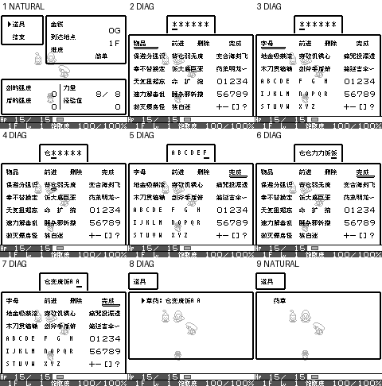
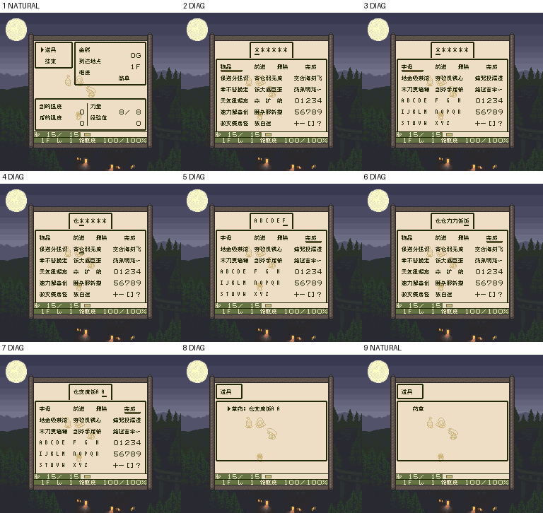

# 风来之西林GB

原输入：Fushigi no Dungeon - Fuurai no Shiren GB - Tsukikage Mura no Kaibutsu (Japan) (SGB Enhanced)

原输入完整SHA256：`e4b62d52e78ef12a1bab0ac1cec68395569538d2e34affd92e67fe67de1f4df2`。此处“原输入”保留改版、既有汉化或地区修订身份，不一律称干净零售ROM。

| 字号 | 当前版本 | 音频 | 输出完整SHA256 |
| --- | --- | --- | --- |
| 8px | 20261021-r4 | unchanged | `dd6f5b88f819d30ef2f1c05d5ca8e470aa0e720feeeff3de5851d9616d19cb16` |
| 10px-dialogue | 20261021-r4 | unchanged | `65022072b5cf566744f47dcc9f52d04dfab7f704c941b3f1e0045b35141118df` |

## 源码与补丁

- 8px／20261021-r4／unchanged：源码包（完整性未独立确认）：[下载](https://github.com/shiyi1133/youxi-hanhua-releases/releases/download/source-migration-20261022-02c/shiren-gb-current-source-5b898a8cce29-public-r01.zip)（ZIP SHA256 `4b5bbf7ac04c899c690766c70e9c8ce592c53253b47b52a13013a6dfca3d021e`）；补丁：[下载](https://github.com/shiyi1133/youxi-hanhua-releases/releases/download/patch-migration-20261022/shiren-gb-current-patches.zip)（ZIP SHA256 `cf291a89d910b91f82b9e992bef1d51e2e02ad4be3a23787ff696277974c05ba`）。
  该包已核对对应版本与字节安全；完整修改源码覆盖范围未独立确认。
- 10px-dialogue／20261021-r4／unchanged：源码包（完整性未独立确认）：[下载](https://github.com/shiyi1133/youxi-hanhua-releases/releases/download/source-migration-20261022-02c/shiren-gb-current-source-5b898a8cce29-public-r01.zip)（ZIP SHA256 `4b5bbf7ac04c899c690766c70e9c8ce592c53253b47b52a13013a6dfca3d021e`）；补丁：[下载](https://github.com/shiyi1133/youxi-hanhua-releases/releases/download/patch-migration-20261022/shiren-gb-current-patches.zip)（ZIP SHA256 `cf291a89d910b91f82b9e992bef1d51e2e02ad4be3a23787ff696277974c05ba`）。
  该包已核对对应版本与字节安全；完整修改源码覆盖范围未独立确认。

补丁须直接应用于完整SHA一致的实际原输入；普通字、大字和音乐变体分别核对。公开源码归档不表示本轮重新构建或通过新的运行验收。原作、字体、已有翻译及工具依赖的权利与许可，依各包对应许可保留。

## 范围与验证边界

- 8px／20261021-r4：原生普通8px；不声明新增大字。。
  20261021-r4物品命名限定测试版；物品命名页含84个汉字与A–Z，保留原生6格及数字符号。91项主要未识别类别在同类别内可用无冲突简记，其它及跨类别名称可重名；手工输入，不自动识别。
  实施者自测不等于独立人员QA。村庄普通草药档及人物自然保存冷读、原生按键物品命名的诊断入口已有提供证据；自然高难入口及真实迷宫物品命名正常保存/冷读、实机和全流程未验证。新物品字码不保证r3及更早版可正确显示；请先备份存档。仅对白10px可能拖慢或刷新残留。本次不关闭自然高难存档相关问题。
- 10px-dialogue／20261021-r4：仅剧情对白10px；本次人物/物品命名及图中全部物品页仍原生8px。。
  20261021-r4物品命名限定测试版；物品命名页含84个汉字与A–Z，保留原生6格及数字符号。91项主要未识别类别在同类别内可用无冲突简记，其它及跨类别名称可重名；手工输入，不自动识别。
  实施者自测不等于独立人员QA。村庄普通草药档及人物自然保存冷读、原生按键物品命名的诊断入口已有提供证据；自然高难入口及真实迷宫物品命名正常保存/冷读、实机和全流程未验证。新物品字码不保证r3及更早版可正确显示；请先备份存档。仅对白10px可能拖慢或刷新残留。本次不关闭自然高难存档相关问题。

本次资料搬运未新增模拟器、实机或全通验收；未记录或未测试的范围不写成通过。问题单开放只表示尚未关闭，已关闭也不单独证明全部场景都修复。

[公开反馈及问题状态](feedback.md) · [报告BUG](https://github.com/shiyi1133/youxi-hanhua-releases/issues/new?template=bug_report.md)

## 对应版本截图

20261021-r4 8px DMG原生最终ROM画面；1/9为自然人物或既有普通草药档冷读，2–8为物品命名诊断入口。所有物品页仍8px，此图不展示10px正文，不代表自然高难物品命名保存冷读。

图像SHA256：`7abb41063dc929d47aaeea2abbc7549491d5c72a7565fb4dbcade2381d77b8b0`；绑定ROM SHA256：`dd6f5b88f819d30ef2f1c05d5ca8e470aa0e720feeeff3de5851d9616d19cb16`。

20261021-r4 10px-dialogue DMG原生最终ROM画面；1/9为自然人物或既有普通草药档冷读，2–8为物品命名诊断入口。所有物品页仍8px，此图不展示10px正文，不代表自然高难物品命名保存冷读。

图像SHA256：`7abb41063dc929d47aaeea2abbc7549491d5c72a7565fb4dbcade2381d77b8b0`；绑定ROM SHA256：`65022072b5cf566744f47dcc9f52d04dfab7f704c941b3f1e0045b35141118df`。

20261021-r4 8px SGB原生最终ROM画面；1/9为自然人物或既有普通草药档冷读，2–8为物品命名诊断入口。所有物品页仍8px，此图不展示10px正文，不代表自然高难物品命名保存冷读。

图像SHA256：`46580ceb05cad28c94ff16856d499c69d9383f329ccc230d1ac5e5d1493f392d`；绑定ROM SHA256：`dd6f5b88f819d30ef2f1c05d5ca8e470aa0e720feeeff3de5851d9616d19cb16`。

20261021-r4 10px-dialogue SGB原生最终ROM画面；1/9为自然人物或既有普通草药档冷读，2–8为物品命名诊断入口。所有物品页仍8px，此图不展示10px正文，不代表自然高难物品命名保存冷读。

图像SHA256：`46580ceb05cad28c94ff16856d499c69d9383f329ccc230d1ac5e5d1493f392d`；绑定ROM SHA256：`65022072b5cf566744f47dcc9f52d04dfab7f704c941b3f1e0045b35141118df`。

