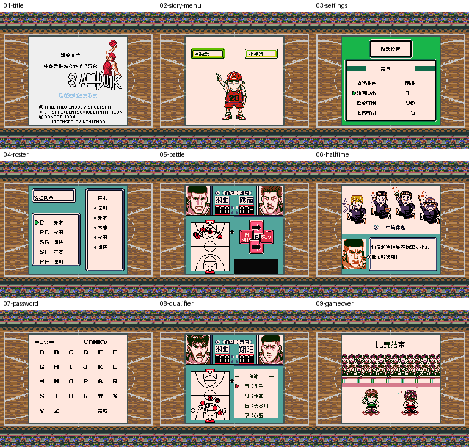

# 灌篮高手1

原输入：From TV Animation Slam Dunk - Gakeppuchi no Kesshou League

原输入完整SHA256：`9a4f40bbd5b4a8cbdb99d22df0f7672c8d67aa5dd4717ddcd56c4c9a4d4c5b2d`。此处“原输入”保留改版、既有汉化或地区修订身份，不一律称干净零售ROM。

| 字号 | 当前版本 | 音频 | 输出完整SHA256 |
| --- | --- | --- | --- |
| 8px | v0.1.0 | unchanged | `7ae5304577b401ea92c7ba95fd71f805905d8b5b14160d64fb5746ea11ec3580` |

## 源码与补丁

- 8px／v0.1.0／unchanged：源码包（完整性未独立确认）：[下载](https://github.com/shiyi1133/youxi-hanhua-releases/releases/download/source-migration-20261022-02c/slam-dunk-1-current-source-ff0508316736-public-r01.zip)（ZIP SHA256 `d5e177c3c52dad9d77c37d522dee3e7d70619348cd2674cf38b1ee9f8a7fd961`）；补丁：[下载](https://github.com/shiyi1133/youxi-hanhua-releases/releases/download/patch-migration-20261022/slam-dunk-1-current-patches.zip)（ZIP SHA256 `c9f93593374440249f86b4e857dce1c7f53dd63638ef595fbafbe61b9c16dd90`）。
  该包已核对对应版本与字节安全；完整修改源码覆盖范围未独立确认。

补丁须直接应用于完整SHA一致的实际原输入；普通字、大字和音乐变体分别核对。公开源码归档不表示本轮重新构建或通过新的运行验收。原作、字体、已有翻译及工具依赖的权利与许可，依各包对应许可保留。

## 范围与验证边界

- 8px／v0.1.0：原生Fusion Pixel 8px对白与UI；12px只用于原尺寸静态图像标题，不是大字ROM。
  原生普通8px的已定位对白、菜单、人名、规则及静态图像汉化；自然练习/预选上下半场、口令继续和失败返回指定样本，七格新进程与两格同ROM自然checkpoint续读。
  普通8px限定测试版；12px只用于原尺寸静态图像标题，没有10px大字ROM。
  维护会话独立补丁套用、封存Source隔离净目录重建和九格原PNG像素绑定通过；未新运行模拟器或独立玩家QA。
  自然九格为provider同ROM原生SGB画面，未改色、缩放或重建画面；实际硬件/烧录卡、双机通信及完整通关未验收。
  九格第4、6格从同ROM自然checkpoint继续，其余7格为fresh process自然输入；没有将checkpoint继续冒充全9格冷启动。
  自然练习赛/预选上下半场、失败返回、YONKY口令fresh-process输入和AAAAA拒绝有provider报告；全胜/全结局/最长变量组合未验收。
  3个调试/遗留对白入口保留原文，自然可达性未确认；未发现原生自由改名或电池存档，未新增。

本次资料搬运未新增模拟器、实机或全通验收；未记录或未测试的范围不写成通过。问题单开放只表示尚未关闭，已关闭也不单独证明全部场景都修复。

[公开反馈及问题状态](feedback.md) · [报告BUG](https://github.com/shiyi1133/youxi-hanhua-releases/issues/new?template=bug_report.md)

## 对应版本截图

灌篮高手1 v0.1.0 普通8px限定测试版；标题、模式菜单、设置、队员、比赛、中场、口令、预选、比赛结束。第4/6格为同ROM自然checkpoint继续，其余7格fresh自然输入。

图像SHA256：`58fe418114bd29b6541540f3bff931cd90f794240962094d293babfb7782bf09`；绑定ROM SHA256：`7ae5304577b401ea92c7ba95fd71f805905d8b5b14160d64fb5746ea11ec3580`。

