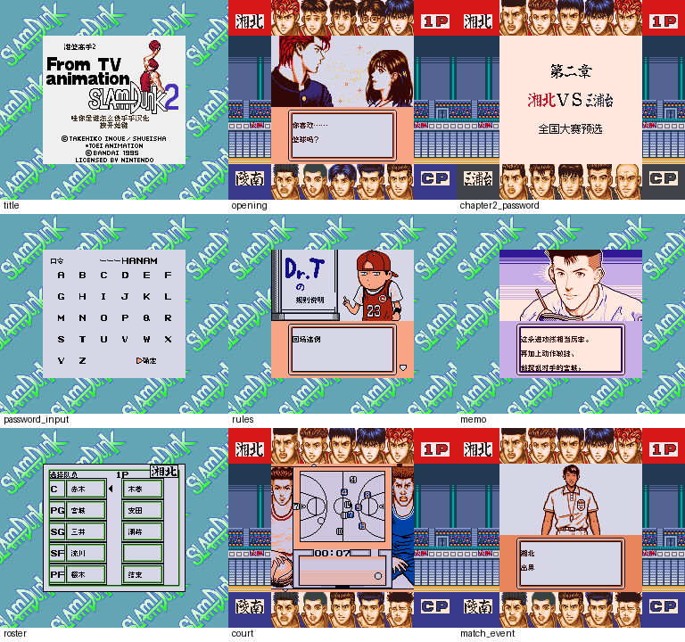

# 灌篮高手2

原输入：From TV Animation Slam Dunk 2 - Zenkoku e no Tip Off

原输入完整SHA256：`cbb113a5c126caf6ef2a0f31ddb12bd4fab2eea597d72e7810c4b75fabf199b2`。此处“原输入”保留改版、既有汉化或地区修订身份，不一律称干净零售ROM。

| 字号 | 当前版本 | 音频 | 输出完整SHA256 |
| --- | --- | --- | --- |
| 8px | v0.1.0 | unchanged | `54b4a086b2a781bf83087b2f991282dd66dcbda2fa5773dafd4035801807cb58` |

## 源码与补丁

- 8px／v0.1.0／unchanged：源码包（完整性未独立确认）：[下载](https://github.com/shiyi1133/youxi-hanhua-releases/releases/download/source-migration-20261022-02c/slam-dunk-2-current-source-afd7841b56dc-public-r01.zip)（ZIP SHA256 `0ec3ae12d0167114c92b2e5a7a96d658ea0aa9a9e2803cdc19ba71388c1c8409`）；补丁：[下载](https://github.com/shiyi1133/youxi-hanhua-releases/releases/download/patch-migration-20261022/slam-dunk-2-current-patches.zip)（ZIP SHA256 `6f604409e4b7a27f0e03cea05956c598b93c8cf0ecc302a3855ba50e26e4a0a2`）。
  该包已核对对应版本与字节安全；完整修改源码覆盖范围未独立确认。

补丁须直接应用于完整SHA一致的实际原输入；普通字、大字和音乐变体分别核对。公开源码归档不表示本轮重新构建或通过新的运行验收。原作、字体、已有翻译及工具依赖的权利与许可，依各包对应许可保留。

## 范围与验证边界

- 8px／v0.1.0：原生Fusion Pixel 8px对白与UI；12px只用于原尺寸静态图像标题，不是大字ROM。
  原生普通8px的已定位UI、人名、比赛事件、剧情、规则、球队笔记和章节静态图像；真实SGB九格均新进程自然输入，含HANAM原生口令进入第二章。
  普通8px限定测试版；12px只用于原尺寸静态图像标题，没有10px大字ROM。
  维护会话独立补丁套用、封存Source隔离净目录重建和九格原PNG像素绑定通过；未新运行模拟器或独立玩家QA。
  自然九格为provider同ROM原生SGB画面，未改色、缩放或重建画面；实际硬件/烧录卡、双机通信及完整通关未验收。
  九格均为provider fresh-process自然输入，无存档/state注入；包括HANAM原生口令进入第二章。
  79个诊断入口、275个计划分页来自同ROM状态替换剧情索引，仅选定页人工查看，不能当自然剧情全流程验收。
  已定位UI/人名/比赛事件/剧情/规则/球队笔记/章节静态图像等范围；深层未访问动态图片、全胜负/加时分支和完整职员表滚动未验收。
  原作无自由改名或常规电池存档；保留原生口令继续，未新增改名/存档。

本次资料搬运未新增模拟器、实机或全通验收；未记录或未测试的范围不写成通过。问题单开放只表示尚未关闭，已关闭也不单独证明全部场景都修复。

[公开反馈及问题状态](feedback.md) · [报告BUG](https://github.com/shiyi1133/youxi-hanhua-releases/issues/new?template=bug_report.md)

## 对应版本截图

灌篮高手2 v0.1.0 普通8px限定测试版；标题、开场、第二章口令进入、口令输入、规则、彦一笔记、队员、球场、比赛事件。9格均为provider fresh自然输入。

图像SHA256：`029f10e4fe332d9e9372f7bb1664e605f96ec40580ccade1ec1427a4f402d643`；绑定ROM SHA256：`54b4a086b2a781bf83087b2f991282dd66dcbda2fa5773dafd4035801807cb58`。

