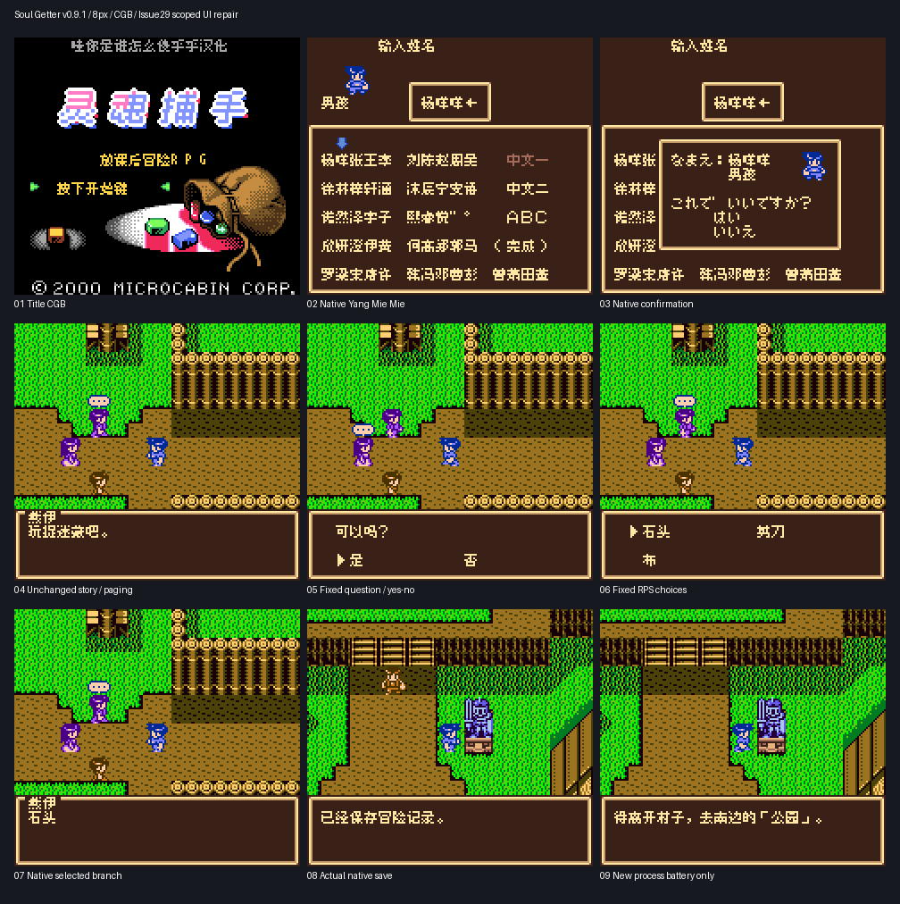
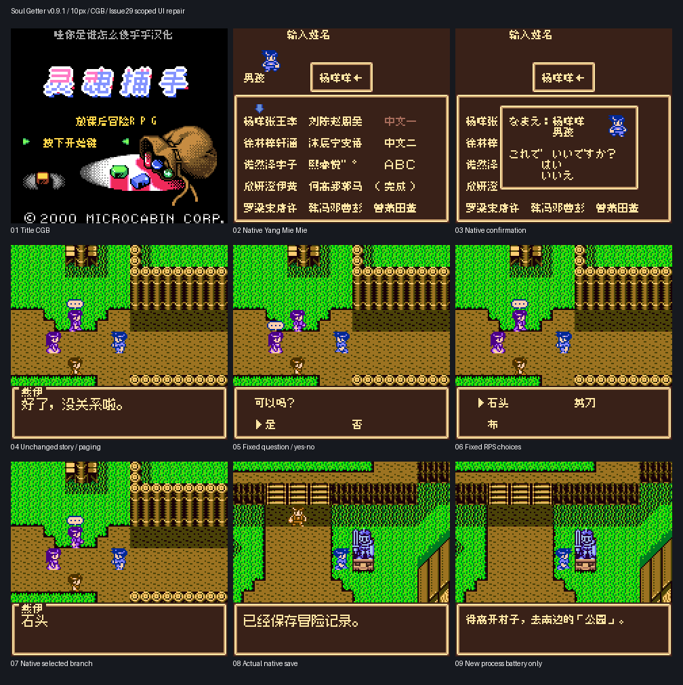

# 放课后冒险RPG

原输入：Soul Getter ～放課後冒険RPG～

原输入完整SHA256：`b035b19a2d38a3c1d122a3f0e47647d42b9f9f94d1ccd9e613d56dad7ffc1b84`。此处“原输入”保留改版、既有汉化或地区修订身份，不一律称干净零售ROM。

| 字号 | 当前版本 | 音频 | 输出完整SHA256 |
| --- | --- | --- | --- |
| 8px | v0.9.1 | unchanged | `6bea0e23855dd6da9dff9ca2aa6a438e36607e8a87c764a71ddacae5f4fc0a98` |
| 10px | v0.9.1 | unchanged | `e54d26ce9953f93cd3c8eaad483d987c9ed631217dc0d018037c889a365a46fa` |

## 源码与补丁

- 8px／v0.9.1／unchanged：源码包（完整性未独立确认）：[下载](https://github.com/shiyi1133/youxi-hanhua-releases/releases/download/source-migration-20261022-02c/soul-getter-current-source-71c914ed70b4-public-r01.zip)（ZIP SHA256 `b4d414586a42740124fd81454792192c65a9ca088881f781be7fca838a1dde4a`）；补丁：[下载](https://github.com/shiyi1133/youxi-hanhua-releases/releases/download/patch-migration-20261022/soul-getter-current-patches.zip)（ZIP SHA256 `b1559d03191f2b66d5744bdd26c6d2ac937e650c4022bf741f5d7e07bdeb6785`）。
  该包已核对对应版本与字节安全；完整修改源码覆盖范围未独立确认。
- 10px／v0.9.1／unchanged：源码包（完整性未独立确认）：[下载](https://github.com/shiyi1133/youxi-hanhua-releases/releases/download/source-migration-20261022-02c/soul-getter-current-source-71c914ed70b4-public-r01.zip)（ZIP SHA256 `b4d414586a42740124fd81454792192c65a9ca088881f781be7fca838a1dde4a`）；补丁：[下载](https://github.com/shiyi1133/youxi-hanhua-releases/releases/download/patch-migration-20261022/soul-getter-current-patches.zip)（ZIP SHA256 `b1559d03191f2b66d5744bdd26c6d2ac937e650c4022bf741f5d7e07bdeb6785`）。
  该包已核对对应版本与字节安全；完整修改源码覆盖范围未独立确认。

补丁须直接应用于完整SHA一致的实际原输入；普通字、大字和音乐变体分别核对。公开源码归档不表示本轮重新构建或通过新的运行验收。原作、字体、已有翻译及工具依赖的权利与许可，依各包对应许可保留。

## 范围与验证边界

- 8px／v0.9.1：原生8px普通版。
- 10px／v0.9.1：3130纯主体C7真10px；594复杂C7/菜单/取名8px。

本次资料搬运未新增模拟器、实机或全通验收；未记录或未测试的范围不写成通过。问题单开放只表示尚未关闭，已关闭也不单独证明全部场景都修复。

[公开反馈及问题状态](feedback.md) · [报告BUG](https://github.com/shiyi1133/youxi-hanhua-releases/issues/new?template=bug_report.md)

## 对应版本截图

最终真实CGB；既有反馈原生8px选项、杨咩咩与正常保存冷读；原字号范围保留，非SGB/未通关实机

图像SHA256：`c5aeb6c93e4b24b5c7ce01e52b30b623bd9fd6c83c3cb02ab9b192597227f415`；绑定ROM SHA256：`6bea0e23855dd6da9dff9ca2aa6a438e36607e8a87c764a71ddacae5f4fc0a98`。

最终真实CGB；既有反馈原生8px选项、杨咩咩与正常保存冷读；原字号范围保留，非SGB/未通关实机

图像SHA256：`a5fefaf9f6be89b13dce89ba461e473f3f4e66c0637a58b0f35890f23fff2455`；绑定ROM SHA256：`e54d26ce9953f93cd3c8eaad483d987c9ed631217dc0d018037c889a365a46fa`。

