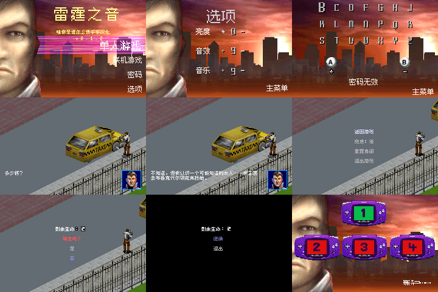

# 雷霆之音

原输入：ASOT（提供原件头部标题）

原输入完整SHA256：`bcfcf623a1addb0fbf251aeeab4f47275388f166a325c23c88b2741f01e070f3`。此处“原输入”保留改版、既有汉化或地区修订身份，不一律称干净零售ROM。

| 字号 | 当前版本 | 音频 | 输出完整SHA256 |
| --- | --- | --- | --- |
| 8px+12px-native | v0.1.0 | unchanged | `fe0753de322fc7db6d19ffc8e8320df151414d0c84e40f0d6c3d874f294824dc` |

## 源码与补丁

- 8px+12px-native／v0.1.0／unchanged：源码包（完整性未独立确认）：[下载](https://github.com/shiyi1133/youxi-hanhua-releases/releases/download/source-migration-20261022-02c/sound-of-thunder-gba-current-source-188c4d61f70c-public-r01.zip)（ZIP SHA256 `3aafb545210a04b476434467fd378bd43ecb44fc8ad7aab71b2c452b48142595`）；补丁：[下载](https://github.com/shiyi1133/youxi-hanhua-releases/releases/download/patch-migration-20261022/sound-of-thunder-gba-current-patches.zip)（ZIP SHA256 `1a305e265ed4e124245fd1e02bc35d420423c3838190629b5b2e9a7739003c1a`）。
  该包已核对对应版本与字节安全；完整修改源码覆盖范围未独立确认。

补丁须直接应用于完整SHA一致的实际原输入；普通字、大字和音乐变体分别核对。公开源码归档不表示本轮重新构建或通过新的运行验收。原作、字体、已有翻译及工具依赖的权利与许可，依各包对应许可保留。

## 范围与验证边界

- 8px+12px-native／v0.1.0：普通原生字号：剧情/位图UI 8px，精灵菜单12px；同一普通ROM混用两种原生字号，无独立大字版。。
  普通原生字号：剧情/位图UI 8px，精灵菜单12px；同一普通ROM混用两种原生字号，无独立大字版。
  未首关通关、深层剧情/全部图像、完整战斗、有效密码新进程恢复、双机联机或实机。
  0字节电池数据不算保存通过；原作原生密码、无命名入口；没有新增保存/取名功能。

本次资料搬运未新增模拟器、实机或全通验收；未记录或未测试的范围不写成通过。问题单开放只表示尚未关闭，已关闭也不单独证明全部场景都修复。

[公开反馈及问题状态](feedback.md) · [报告BUG](https://github.com/shiyi1133/youxi-hanhua-releases/issues/new?template=bug_report.md)

## 对应版本截图

九格为提供方报告的同一最终ROM冷启动自然按键帧。本次独立逐格核对240×160原生PNG、同目标SHA侧证与720×480拼图像素完全一致。未重跑模拟器，不作为独立人员QA或全流程验收。

图像SHA256：`f07601e6622da15b4330931cb460cd664bb8737d0dee40a79d9a14016b79dbdf`；绑定ROM SHA256：`fe0753de322fc7db6d19ffc8e8320df151414d0c84e40f0d6c3d874f294824dc`。

