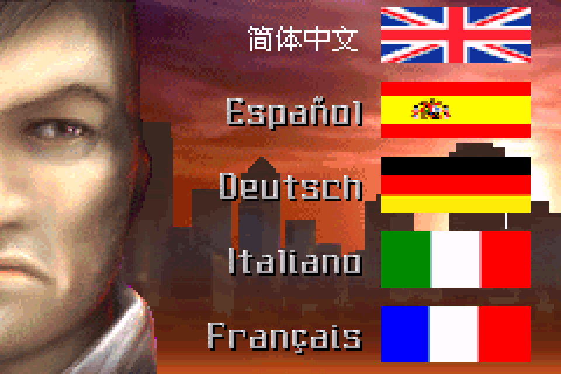

# 雷霆之音：公开反馈

以下为已公开证据摘录，不能自动当成已经复现或修复。下载／存档分享地址、本机路径或项目署名文字省略时逐条标记。

## 问题状态

当前导出未取得可关联的正式问题单；这不表示已完成全面测试。

问题单开放不等于正在修复；关闭不自动代表所有报告症状全部验收。玩家实际ROM SHA未知时仍保留未知，当前版本的参考SHA见[游戏页面](README.md)。

## 20261023-1616 公开反馈补充

17楼 · une21 · [原回帖](https://tieba.baidu.com/p/11097560613?pid=154061939534#154061939534)

> @哇你是谁怎么傻乎乎 已完成该楼层内所有ROM的初步测试，汇总结果见压缩包内截图，我发现问题多的游戏多存在于日版汉化，欧美版问题就没那么多，请您留意查收以下反馈包: 【超级会员V9】通过百度网盘分享的文件：实况世界足球1&…

已省略原件/ROM/即时状态下载链接、提取码、客户端附文及本机路径；保留反馈原话，其余全文可回原楼查阅。

原包文件名：实况世界足球1&2+蜡笔小新+马克思佩恩+雷霆之音问题汇总打包/雷霆之音 v0.1.0/简体中文右侧是英国国旗建议更换为中国国旗.png

- [界面建议] 雷霆之音 v0.1.0：“简体中文”旁旗帜图标：开放待核。

国旗替换为界面建议，未作为纯BUG计数。

[已公开登记答复](https://tieba.baidu.com/p/11097560613?pid=154062976011#154062976011)：@une21 五款游戏的反馈包已收到。足球1/2和蜡笔小新的显示问题、马克思·佩恩标题缺字已登记；蜡笔小新首关卡住并入原问题，补译和国旗建议另记，后续排查。

玩家实际输入/输出SHA保持未知；本次为反馈登记和信息答复，未新增维护运行复现、修复或完整流程验收。
