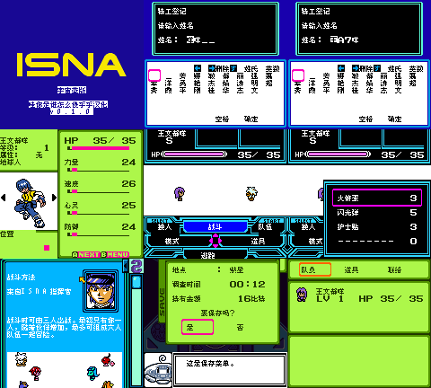

# Space-Net 宇宙蓝版（暂译）

原输入：Space-Net - Cosmo Blue

原输入完整SHA256：`788128d6871d51dba34cf8763e4fa457acc230bdb7079e01aba5b43e2b6252c7`。此处“原输入”保留改版、既有汉化或地区修订身份，不一律称干净零售ROM。

| 字号 | 当前版本 | 音频 | 输出完整SHA256 |
| --- | --- | --- | --- |
| 8px | v0.1.0 | unchanged | `19ad0fca14e340117066a8125890bc25cc51b9bf11e846de88d1cde0a4f0c050` |

## 源码与补丁

- 8px／v0.1.0／unchanged：源码包（完整性未独立确认）：[下载](https://github.com/shiyi1133/youxi-hanhua-releases/releases/download/source-migration-20261022-04/space-net-cosmo-blue-current-scope-source-public-r01.zip)（ZIP SHA256 `3158dfa87bac16023c05fe2a942609cc12e0d9d08a0615211849b968c543974a`）；补丁：[下载](https://github.com/shiyi1133/youxi-hanhua-releases/releases/download/patch-migration-20261022/space-net-cosmo-blue-current-patches.zip)（ZIP SHA256 `5015a97ecd692f1cbd404065c0baf7068a86bc7e7fdcfe304d954cccd142ce3a`）。
  该包已核对对应版本与字节安全；完整修改源码覆盖范围未独立确认。

补丁须直接应用于完整SHA一致的实际原输入；普通字、大字和音乐变体分别核对。公开源码归档不表示本轮重新构建或通过新的运行验收。原作、字体、已有翻译及工具依赖的权利与许可，依各包对应许可保留。

## 范围与验证边界

- 8px／v0.1.0：正文/命名原生Fusion8px，真10px仅可行性审查且未交付。。
  10831处文本映射位置、2118字形；剧情/邮件/论坛/战斗/道具技能物种/商店及菜单等已识别资源处理。提供者姓名/战斗/保存/独立冷读样本自测。
  能力页较原版多57帧，约0.95秒；未称无卡顿。
  九格中02—08帧从同一精确目标ROM即时状态续行，04—06/08还有PC跟踪诊断；不能当成无即时状态全程冷启动证据。
  09冷读帧记录仅加载原生电池存档；不等于全部存档/所有模拟器兼容。
  未全剧情通关、未实机；自然商店交易、伙伴招募昵称和联机未到达。
  真10px对白运行版未交付；二进制候选/遗留表的可达性仍有未知。

本次资料搬运未新增模拟器、实机或全通验收；未记录或未测试的范围不写成通过。问题单开放只表示尚未关闭，已关闭也不单独证明全部场景都修复。

[公开反馈及问题状态](feedback.md) · [报告BUG](https://github.com/shiyi1133/youxi-hanhua-releases/issues/new?template=bug_report.md)

## 对应版本截图

Space-Net 宇宙蓝版（暂译） v0.1.0 8px；正文/命名原生Fusion8px，真10px仅可行性审查且未交付。；最终ROM真实九宫格（自然/诊断/续行边界按本说明）

图像SHA256：`39ebd28f78364e19fd8309feb1c580ccbf9ea4839886e9e6cf2b1d2f71ed8302`；绑定ROM SHA256：`19ad0fca14e340117066a8125890bc25cc51b9bf11e846de88d1cde0a4f0c050`。

