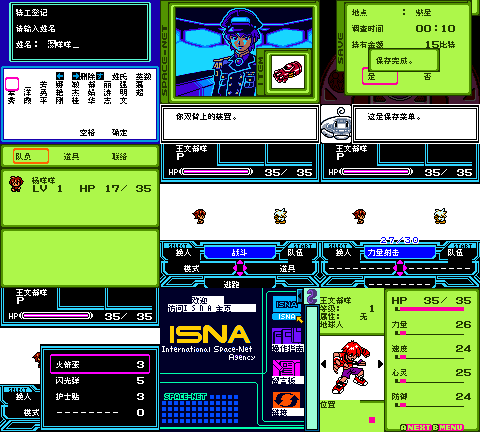

# Space-Net 宇宙红版（暂译）

原输入：Space-Net - Cosmo Red

原输入完整SHA256：`c473cf44bd274435c7bc46aae877a3a6e114af425fde23248ebb05b55aab5f7d`。此处“原输入”保留改版、既有汉化或地区修订身份，不一律称干净零售ROM。

| 字号 | 当前版本 | 音频 | 输出完整SHA256 |
| --- | --- | --- | --- |
| 8px | v0.1.0 | unchanged | `5704593dd3f66d3e750f9c00f57b265c9272f6fb7973691d94ef0db4a9446c68` |

## 源码与补丁

- 8px／v0.1.0／unchanged：源码包（完整性未独立确认）：[下载](https://github.com/shiyi1133/youxi-hanhua-releases/releases/download/source-migration-20261022-02c/space-net-cosmo-red-current-source-e52baa597d4b-public-r01.zip)（ZIP SHA256 `e52baa597d4bec6717003607ec8955beef108ecba12609553d067cff73a6c208`）；补丁：[下载](https://github.com/shiyi1133/youxi-hanhua-releases/releases/download/patch-migration-20261022/space-net-cosmo-red-current-patches.zip)（ZIP SHA256 `41b2141d7a1be37c3bb3b6e2085cc770c870154f1f6bbd283faaf2bf6e21dfeb`）。
  该包已核对对应版本与字节安全；完整修改源码覆盖范围未独立确认。

补丁须直接应用于完整SHA一致的实际原输入；普通字、大字和音乐变体分别核对。公开源码归档不表示本轮重新构建或通过新的运行验收。原作、字体、已有翻译及工具依赖的权利与许可，依各包对应许可保留。

## 范围与验证边界

- 8px／v0.1.0：正文/命名原生8px；无10px运行交付，不缩放裁字。。
  红版独立地址适配；10831处映射、2118正文用字；提供者记录原生CGB取名/首战/保存/新进程电池冷读/技能道具菜单和网页样本。
  能力页较原版多57帧，约0.95秒额外加载；实机性能未测。
  未全剧情/结局，未自然商店买卖、成功招募/合成/进化、全部交流邮件、另两处命名入口、联机或实机。
  道具使用消息不等于消耗数量已验；旧存档及联机互换未全面验证。
  九格提供者manifest绑定最终红版SHA，不能用蓝版测试替代。
  未交付10px版。

本次资料搬运未新增模拟器、实机或全通验收；未记录或未测试的范围不写成通过。问题单开放只表示尚未关闭，已关闭也不单独证明全部场景都修复。

[公开反馈及问题状态](feedback.md) · [报告BUG](https://github.com/shiyi1133/youxi-hanhua-releases/issues/new?template=bug_report.md)

## 对应版本截图

Space-Net 宇宙红版（暂译） v0.1.0 8px；正文/命名原生8px；无10px运行交付，不缩放裁字。；最终ROM真实九宫格（自然/诊断/续行边界按本说明）

图像SHA256：`c96efa291a5235a6af828e90b0863ebc67967094c63ff5baf8623259bf6edc4d`；绑定ROM SHA256：`5704593dd3f66d3e750f9c00f57b265c9272f6fb7973691d94ef0db4a9446c68`。

