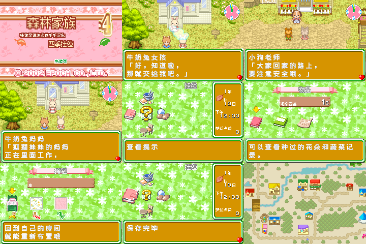

# 森林家族4：四季的挂毯

原输入：Sylvanian Families 4 - Meguru Kisetsu no Tapestry (Japan; requester filename/header identity)

原输入完整SHA256：`cd67965b69e032e7450d6316a3b0069b964cafbb123c23374a42716c8b3e17ee`。此处“原输入”保留改版、既有汉化或地区修订身份，不一律称干净零售ROM。

| 字号 | 当前版本 | 音频 | 输出完整SHA256 |
| --- | --- | --- | --- |
| native8px-12px | v0.1.0限定测试版 | unchanged | `decbcafd6eca04c3e7b67fe1df99aaa1d00fec71caebc28dc26a31754c425ff5` |

## 源码与补丁

- native8px-12px／v0.1.0限定测试版／unchanged：完整修改源码：[下载](https://github.com/shiyi1133/youxi-hanhua-releases/releases/download/source-migration-20261022/sylvanian-families-4-current-source-d43d78429419-public-r02.zip)（ZIP SHA256 `ff0252ad4557b69a64dc4139eb73751cb5f60e27e7e7fc63694e910c78fb8ef5`）；补丁：[下载](https://github.com/shiyi1133/youxi-hanhua-releases/releases/download/patch-migration-20261022/sylvanian-families-4-current-patches.zip)（ZIP SHA256 `25f3249d758be729249edad16584880936a2e8f59f677409bcbd140f623a35f8`）。

补丁须直接应用于完整SHA一致的实际原输入；普通字、大字和音乐变体分别核对。公开源码归档不表示本轮重新构建或通过新的运行验收。原作、字体、已有翻译及工具依赖的权利与许可，依各包对应许可保留。

## 范围与验证边界

- native8px-12px／v0.1.0限定测试版：原生菜单8px、主要对白12px字面/16px字格；Fusion Pixel；没有额外10px版。
  限定验证的首次中文测试交付；2335已识别文字记录及已确认图像文字
  两处极小椭圆装饰招牌46A1B0/46C2E8无法辨认，保留原图
  未证可达预留消息N仍有占位
  商店自然购买、宝宝照顾、烹饪、种植/家具实际操作未验收
  深层剧情/结局/全流程/实机未验收；不是0%空白存档冷读
  不能保证未遍历后期流程绝无输入功能；未保证所有阶段旧存档兼容

本次资料搬运未新增模拟器、实机或全通验收；未记录或未测试的范围不写成通过。问题单开放只表示尚未关闭，已关闭也不单独证明全部场景都修复。

[公开反馈及问题状态](feedback.md) · [报告BUG](https://github.com/shiyi1133/youxi-hanhua-releases/issues/new?template=bug_report.md)

## 对应版本截图

v0.1.0，原生菜单8px、主要对白12px字面/16px字格；Fusion Pixel；没有额外10px版；GBA。最终ROM真实运行九宫格，原图全文SHA与提供方最终ROM绑定已核，维护实际看图、未重跑模拟器。第二格为固定主角画面，不是取名页。

图像SHA256：`73566bf4097b12aa9f0fab551ce2c699cc7a6b41e9191943fa9e1cc8c3ac383d`；绑定ROM SHA256：`decbcafd6eca04c3e7b67fe1df99aaa1d00fec71caebc28dc26a31754c425ff5`。

