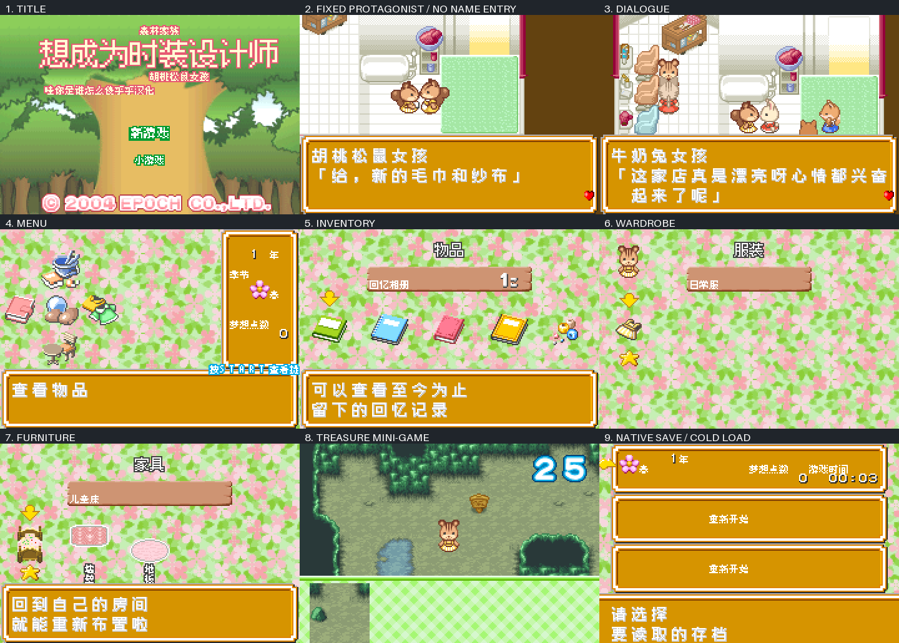

# 森林家族：想成为时装设计师

原输入：Sylvanian Families - Fashion Designer ni Naritai (Japan; requester filename/header identity)

原输入完整SHA256：`38b89dff9b4eb6ee3ab6fdca1ce9150a64b3a641ed72e86570251ee9a23b489b`。此处“原输入”保留改版、既有汉化或地区修订身份，不一律称干净零售ROM。

| 字号 | 当前版本 | 音频 | 输出完整SHA256 |
| --- | --- | --- | --- |
| native8px-12px | v0.1.0限定测试版 | unchanged | `58e5b496799c6cf62201fa64f9a4efd6a2386606cd2901aa3f4a7751894fa3ec` |

## 源码与补丁

- native8px-12px／v0.1.0限定测试版／unchanged：完整修改源码：[下载](https://github.com/shiyi1133/youxi-hanhua-releases/releases/download/source-migration-20261022/sylvanian-families-fashion-designer-current-source-444041c6315d-public-r02.zip)（ZIP SHA256 `e4051123625cd14f4bd43870d7c65772537ac34ffdef5758397a3f811e22c8b0`）；补丁：[下载](https://github.com/shiyi1133/youxi-hanhua-releases/releases/download/patch-migration-20261022/sylvanian-families-fashion-designer-current-patches.zip)（ZIP SHA256 `4ccefc8075b8e4b35f733783d667394145518b41cb845823e0ef273fb4112c16`）。

补丁须直接应用于完整SHA一致的实际原输入；普通字、大字和音乐变体分别核对。公开源码归档不表示本轮重新构建或通过新的运行验收。原作、字体、已有翻译及工具依赖的权利与许可，依各包对应许可保留。

## 范围与验证边界

- native8px-12px／v0.1.0限定测试版：Fusion Pixel native approximately12px dialogue in16px cells; compact menus8px; one mixed-native ordinary test ROM, no separate large-font target.。
  3281 translated-or-preserved records including57 retained credits;34 Japanese image resources claimed replaced; native kana table002C73 preserved with reachable input unconfirmed; fixed protagonist, no naming-entry claim.
  No confirmed reachable naming editor; no Yang/Chen input claim.
  Not all seasons/tasks/ending/shop-crafting success/minigame victories/highest difficulty/longest variables/image consumers tested.
  No hardware or multiplayer; supplied implementation self-test, no new emulator execution here.

本次资料搬运未新增模拟器、实机或全通验收；未记录或未测试的范围不写成通过。问题单开放只表示尚未关闭，已关闭也不单独证明全部场景都修复。

[公开反馈及问题状态](feedback.md) · [报告BUG](https://github.com/shiyi1133/youxi-hanhua-releases/issues/new?template=bug_report.md)

## 对应版本截图

v0.1.0，Fusion Pixel native approximately12px dialogue in16px cells; compact menus8px; one mixed-native ordinary test ROM, no separate large-font target.；GBA。最终ROM真实运行九宫格，原图全文SHA与提供方最终ROM绑定已核，维护实际看图、未重跑模拟器。第二格为固定主角画面，不是取名页。

图像SHA256：`af25f6b076a55e8d6cf65c095020e3dbb3448f47f94ff73054fdb7fdda9db824`；绑定ROM SHA256：`58e5b496799c6cf62201fa64f9a4efd6a2386606cd2901aa3f4a7751894fa3ec`。

