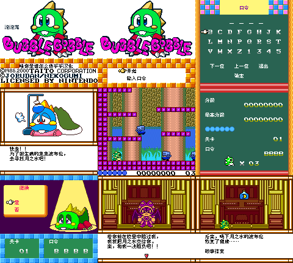
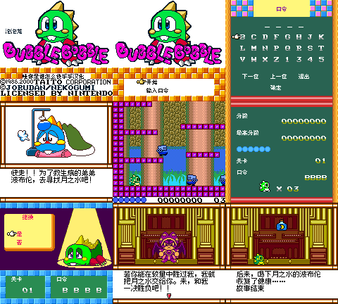

# 泡泡龙（Taito Memorial）：公开反馈

[报告BUG](https://github.com/shiyi1133/youxi-hanhua-releases/issues/new?template=bug_report.md)。请说明实际版本、字号、必要触发步骤和已有截图，不上传ROM、存档、即时状态或私人资料。

当前公开索引尚未登记本作BUG反馈；这不代表没有BUG、已全通或已实机验收。开放问题不等于正在修复。

[贴吧原需求](https://tieba.baidu.com/p/11092365551?pid=154055191306#154055191306)。

## 维护者交付通知：v0.1.0（限定测试版）

[贴吧实际答复](https://tieba.baidu.com/p/11092365551?pid=154064627034#p154064627034)（240楼，PID 154064627034；原关联楼层确认丢失后在原帖新开楼层）。

以下为去除下载信息后的维护者通知摘要，不是玩家测试结论，也不是原文全文。

> 《泡泡龙（Taito Memorial）》v0.1.0限定测试版已发布。
> 字号：普通8px；另有story10px仅15页剧情窗口真实10px，其余界面仍8px。。
> 范围：菜单、密码、剧情及已识别图字；GBC兼容80、原生SGB03。
> 原答复中的ROM下载链接、提取码、网盘目录及下载指示已省略；私库保留完整原文证据。

原答复全文UTF-8 SHA-256：`86d22261a0e1a91c8eda2247e5a15cc7f8b3618207823e34edbb995e629455f4`（506字节）。

泡泡龙（Taito Memorial） v0.1.0 8px限定测试版；普通8px；另有story10px仅15页剧情窗口真实10px，其余界面仍8px。 自然路径与诊断范围见测试说明，不代表全流程。

[贴吧该PID第1张实际公开图片](https://tiebapic.baidu.com/forum/pic/item/9273b53eb13533fad4902629eed3fd1f41345b3a.jpg?tbpicau=2026-11-04-05_e2fce1d08e5231fbe47802ea1997e384)。

原PNG SHA-256：`efd8dce3613e81d92371762b95fdcf7627364650171d62bb07705f87ed8e150a`；贴吧公开图片 SHA-256：`0b1e2d177298944c1dfe21d8d3b5ec0076a64f054ef2e7016e1a5cb497c3cb13`。

泡泡龙（Taito Memorial） v0.1.0 10px限定测试版；仅15页剧情真实10px，其它界面8px；更易拖慢/刷新残留。 自然路径与诊断范围见测试说明，不代表全流程。

[贴吧该PID第2张实际公开图片](https://tiebapic.baidu.com/forum/pic/item/2db5a1d3fd1f4134cc11b079631f95cad1c85e3a.jpg?tbpicau=2026-11-04-05_4fc633cb3b3cc0e5c5afc7676ffee655)。

原PNG SHA-256：`be37b8346853bce145cabc235effcc0e64e01e2b2184b72bc680090fa6a63715`；贴吧公开图片 SHA-256：`507e502ee52298495fb0cb11d3197de0f9ec23782d9e41025e5866340a642629`。

原答复全文与全部图片已按该PID公开核验；此镜像不新增通关、实机、独立QA、源码完整性或BUG全部修复结论。
