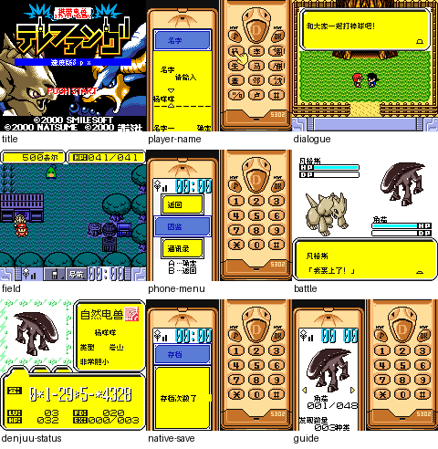

# 携带电兽 速度版

原输入：Keitai Denjuu Telefang - Speed Version (Japan, revision 0)

原输入完整SHA256：`5e7efa5e2abda66eee1577b4507983f5c9c1fdf7c4450aab47191c9c92838098`。此处“原输入”保留改版、既有汉化或地区修订身份，不一律称干净零售ROM。

| 字号 | 当前版本 | 音频 | 输出完整SHA256 |
| --- | --- | --- | --- |
| 8px | v0.1.1 | unchanged | `ae0f6a72d4ca6889fc9fe9615baefd2f7c3882834fe7003cb1edf21c60498a89` |

## 源码与补丁

- 8px／v0.1.1／unchanged：完整修改源码：[下载](https://github.com/shiyi1133/youxi-hanhua-releases/releases/download/source-migration-20261022/telefang-speed-current-source-09aa417c229e-public-r02.zip)（ZIP SHA256 `81a07f5d5e21f1b5baa951b9eb13ae2f4b7e0d3a87b14eb89ce033d276b23e99`）；补丁：[下载](https://github.com/shiyi1133/youxi-hanhua-releases/releases/download/patch-migration-20261022/telefang-speed-current-patches.zip)（ZIP SHA256 `f3a6ca163e42874ceb6953f0ab661eb830c708675b0920e9ce756d085e4f63cc`）。

补丁须直接应用于完整SHA一致的实际原输入；普通字、大字和音乐变体分别核对。公开源码归档不表示本轮重新构建或通过新的运行验收。原作、字体、已有翻译及工具依赖的权利与许可，依各包对应许可保留。

## 范围与验证边界

- 8px／v0.1.1：普通原生8px／Fusion Pixel；无10px大字版。
  继承主文4165条、定长973条与8处明确纯布局修订，本版扩展普通取名157映射/原按键实际可达156。实现者在最终SHA自然按键验证杨咩咩、陈胖胖的玩家及自然招募电兽命名、删除覆盖、正常保存和新进程电池冷读；满8/6字节仅边界删除，不冒称满长冷读。
  同一实现者自测；非全通、实机、联机成功、RTC跨时段、深层进化或自然成功购买、全部技能分支。DMG仅独立开场输入/早期对白，不是全部保存回归。GBC兼容、MBC3/RTC/32KiB RAM，不称SGB；原厂版权和未确认残留保留。 保存结构/RTC不改。玩家原8字节、电兽原6字节；旧自定义假名会按新映射显示，不保证旧外观；不混地区/修订/开发版，不跨版即时状态，先备份普通电池。

本次资料搬运未新增模拟器、实机或全通验收；未记录或未测试的范围不写成通过。问题单开放只表示尚未关闭，已关闭也不单独证明全部场景都修复。

[公开反馈及问题状态](feedback.md) · [报告BUG](https://github.com/shiyi1133/youxi-hanhua-releases/issues/new?template=bug_report.md)

## 对应版本截图

telefang-speed v0.1.1 普通8px最终ROM真实九宫格；自然、受控及诊断范围见独立审计，不代表全流程。

图像SHA256：`9e74015974d3bc07737fed1c1f79cd4ea3d5f2f2bca22cb091aafcec4f6f9ebe`；绑定ROM SHA256：`ae0f6a72d4ca6889fc9fe9615baefd2f7c3882834fe7003cb1edf21c60498a89`。

