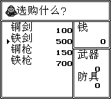

# 吞食天地

原输入：Tenchi o Kurau

原输入完整SHA256：`2884676b3bb261204f480767ba716dfc5266e536b7628fc73f9243c1e0efa8c7`。此处“原输入”保留改版、既有汉化或地区修订身份，不一律称干净零售ROM。

| 字号 | 当前版本 | 音频 | 输出完整SHA256 |
| --- | --- | --- | --- |
| ordinary | v1.0.3限定修复测试版 | unchanged | `06cb17f41a0d428f1fb1ba0e5505df2be2647237215a5a5d1e356e879b05fd00` |

## 源码与补丁

- ordinary／v1.0.3限定修复测试版／unchanged：已知局部修改源码：[下载](https://github.com/shiyi1133/youxi-hanhua-releases/releases/download/source-migration-20261022-02c/tenchi-o-kurau-current-source-8d1e5dc2c95a-public-r01.zip)（ZIP SHA256 `421400ff04a8fa956ce5af5e1001843057d915637d8d64126be80e3f898f143d`）；补丁：[下载](https://github.com/shiyi1133/youxi-hanhua-releases/releases/download/patch-migration-20261022/tenchi-o-kurau-current-patches.zip)（ZIP SHA256 `d0dda91741f2e831781fa7a3e2e6953cc4d80209bd266a55a494c00656421d53`）。
  已知源码缺项：Partial adaptation source archive; upstream semantic source completeness is not established.。

补丁须直接应用于完整SHA一致的实际原输入；普通字、大字和音乐变体分别核对。公开源码归档不表示本轮重新构建或通过新的运行验收。原作、字体、已有翻译及工具依赖的权利与许可，依各包对应许可保留。

## 范围与验证边界

- ordinary／v1.0.3限定修复测试版：普通原版实际字形尺寸与原布局；无新增大字，不标8px。
  既有反馈铁剑/铁枪显示修正已有限验证；13人名静态字形校准，不扩为全部剧情自然验收。
  本次修复验收仅覆盖武器店铁剑/铁枪显示，以及已有选择、取消重开、缺钱拒购、铜剑实购与初村原生保存冷读记录；没有成功买入铁装备。
  13个人名记录仅编码及字形SHA静态检查，未在各后期剧情逐人自然运行，不称人名全剧情通过。
  保持旧普通版实际字形尺寸与布局；没有新增大字号，不标作8px或Fusion全字库换装。
  没有实机、全通、全部存档/剧情失散路线、全部对白排版或全部七件铁装备自然画面验收。
  维护本次未运行附包代码、重建或游戏；使用同一完整SHA候选R2已登记的有限运行证据，并独立核实际输入/补丁/目标/图片字节。
  上游完整旧中文译文、渲染器和字库生成链仍缺，工程是PARTIAL_ADAPTATION_SOURCE；该缺口不作为最新用户ROM/补丁/截图发布授权的前置阻碍，本次不上传源码。
  原件、旧Release/标签/本地历史和玩家存档保留；换版先在旧版原生保存退出，不跨版加载模拟器即时状态。

本次资料搬运未新增模拟器、实机或全通验收；未记录或未测试的范围不写成通过。问题单开放只表示尚未关闭，已关闭也不单独证明全部场景都修复。

[公开反馈及问题状态](feedback.md) · [报告BUG](https://github.com/shiyi1133/youxi-hanhua-releases/issues/new?template=bug_report.md)

## 对应版本截图

R2 v1.0.3：铁剑；实际商店原图，未放大或改字，沿用同SHA R2历史运行证据。

图像SHA256：`ae8a299cff2204f4f04da26cdd65323b384162f3023d862f28b32b25340d79da`；绑定ROM SHA256：`06cb17f41a0d428f1fb1ba0e5505df2be2647237215a5a5d1e356e879b05fd00`。

R2 v1.0.3：铁枪；实际商店原图，未放大或改字，沿用同SHA R2历史运行证据。

图像SHA256：`df2d7daa42eb663a745788e2d020c0e8857911b2576da53cea8829e8da9f5693`；绑定ROM SHA256：`06cb17f41a0d428f1fb1ba0e5505df2be2647237215a5a5d1e356e879b05fd00`。

