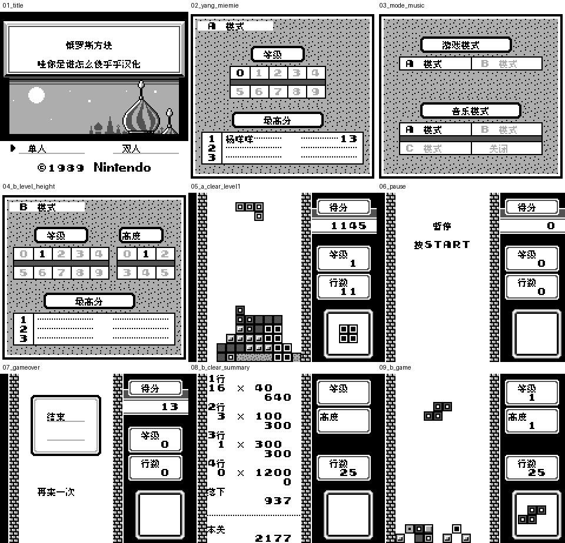

# 俄罗斯方块（GB初代）

原输入：Tetris (JU) (v1.0; requester filename and TETRIS Rev0 header identity)

原输入完整SHA256：`7fde11dd4e594a6905deccd57943d2909ecb37665a030741c42155aeb346323b`。此处“原输入”保留改版、既有汉化或地区修订身份，不一律称干净零售ROM。

| 字号 | 当前版本 | 音频 | 输出完整SHA256 |
| --- | --- | --- | --- |
| 8px | v1.0.0限定测试版 | unchanged | `09ab8800397be2a4c500af131270038300814d509a6e07c3d613e546e7cce422` |

## 源码与补丁

- 8px／v1.0.0限定测试版／unchanged：完整修改源码：[下载](https://github.com/shiyi1133/youxi-hanhua-releases/releases/download/source-migration-20261022/tetris-gb-current-source-d1ee3a3b86c8-public-r02.zip)（ZIP SHA256 `54d6e82c89581daa96b4be0bc8b1bdc93265df921b42c12fddd0ac2e19ae2564`）；补丁：[下载](https://github.com/shiyi1133/youxi-hanhua-releases/releases/download/patch-migration-20261022/tetris-gb-current-patches.zip)（ZIP SHA256 `28320ea183382e32b8275c6e72594b0029b9cd0a1246eed5a7b0cd955ea4f49c`）。

补丁须直接应用于完整SHA一致的实际原输入；普通字、大字和音乐变体分别核对。公开源码归档不表示本轮重新构建或通过新的运行验收。原作、字体、已有翻译及工具依赖的权利与许可，依各包对应许可保留。

## 范围与验证边界

- 8px／v1.0.0限定测试版：Fusion Pixel原生8px，无对白；无大字版；无原生SGB，真实DMG灰阶。
  最终普通8px汉化，有限模拟器自然流程与诊断验收，不声称全部模式组合通过
  真实双机联机/实机未测
  所有A等级/B高度组合/全部高分结局自然达成/隐藏心形条件未验收
  无剧情/商店/战斗/口令/原生电池存档；即时状态不建议跨ROM

本次资料搬运未新增模拟器、实机或全通验收；未记录或未测试的范围不写成通过。问题单开放只表示尚未关闭，已关闭也不单独证明全部场景都修复。

[公开反馈及问题状态](feedback.md) · [报告BUG](https://github.com/shiyi1133/youxi-hanhua-releases/issues/new?template=bug_report.md)

## 对应版本截图

v1.0.0，Fusion Pixel原生8px，无对白；无大字版；无原生SGB，真实DMG灰阶；DMG灰阶，无原生SGB。最终ROM真实运行九宫格，原图全文SHA与提供方最终ROM绑定已核，维护实际看图、未重跑模拟器。第二格为原生命名/成绩录入杨咩咩。

图像SHA256：`e06a638345c2a434df16183280def9905c4ccd7012bb4e6ef27b1196929a6397`；绑定ROM SHA256：`09ab8800397be2a4c500af131270038300814d509a6e07c3d613e546e7cce422`。

