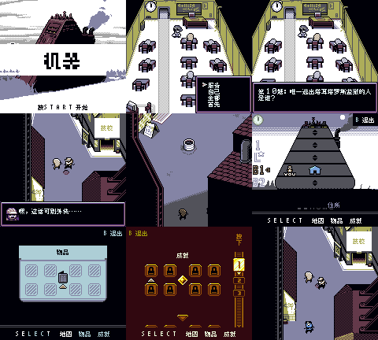

# 机器：公开反馈

[报告BUG](https://github.com/shiyi1133/youxi-hanhua-releases/issues/new?template=bug_report.md)。请说明实际版本、字号、必要触发步骤和已有截图，不上传ROM、存档、即时状态或私人资料。

当前公开索引尚未登记本作BUG反馈；这不代表没有BUG、已全通或已实机验收。开放问题不等于正在修复。

[贴吧原需求](https://tieba.baidu.com/p/11092365551?pid=154054972751#154054972751)。

## 维护者交付通知：v0.1.0（限定测试版）

[贴吧实际答复](https://tieba.baidu.com/p/11092365551?pid=154064628109#p154064628109)（192楼，PID 154064628109；原关联楼层回复）。

以下为去除下载信息后的维护者通知摘要，不是玩家测试结论，也不是原文全文。

> 《机器》v0.1.0限定测试版已发布。
> 字号：普通Fusion Pixel 8px；未交10px。。
> 范围：World v1.2 aftermarket，实际CGB-only，非文件名所称GB Compatible。8024原记录中7703保守根文本消费者已译，321未证实可达遗留/注释保留；251背景467精灵清单，原品牌人名网址/密码保留。
> 原答复中的ROM下载链接、提取码、网盘目录及下载指示已省略；私库保留完整原文证据。

原答复全文UTF-8 SHA-256：`f15794df019c14977dfbe1901d87daa6ea32d42086eec2bb07031118d2b0b713`（254字节）。

机器 v0.1.0 8px限定测试版；普通Fusion Pixel 8px；未交10px。 自然路径与诊断范围见测试说明，不代表全流程。

[贴吧该PID第1张实际公开图片](https://tiebapic.baidu.com/forum/pic/item/a65ee9fe9925bc311d7cb49f18df8db1cb13703b.jpg?tbpicau=2026-11-04-05_0bbb47d2d573e0fcc413a93d5586fa8c)。

原PNG SHA-256：`11d6aa73147c03cfec8fafee9d430ca178192d35c3876a57b9e06d1e9b1f5424`；贴吧公开图片 SHA-256：`09f77a3855163930058076b6c074f543805039e259684bfa6d9043d38138a9fd`。

原答复全文与全部图片已按该PID公开核验；此镜像不新增通关、实机、独立QA、源码完整性或BUG全部修复结论。
