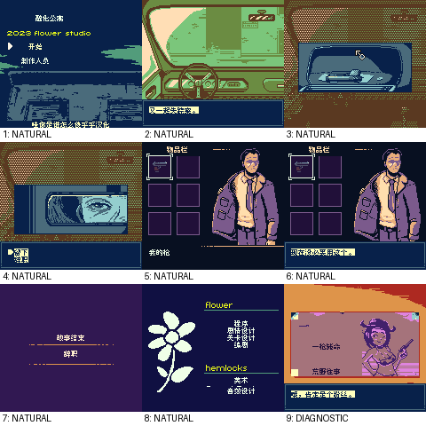

# 融化公寓：公开反馈

[报告BUG](https://github.com/shiyi1133/youxi-hanhua-releases/issues/new?template=bug_report.md)。请说明实际版本、字号、必要触发步骤和已有截图，不上传ROM、存档、即时状态或私人资料。

当前公开索引尚未登记本作BUG反馈；这不代表没有BUG、已全通或已实机验收。开放问题不等于正在修复。

[贴吧原需求](https://tieba.baidu.com/p/11092365551?pid=154054983856#154054983856)。

## 维护者交付通知：v0.1.0（限定测试版）

[贴吧实际答复](https://tieba.baidu.com/p/11092365551?pid=154064632228#p154064632228)（195楼，PID 154064632228；原关联楼层回复）。

以下为去除下载信息后的维护者通知摘要，不是玩家测试结论，也不是原文全文。

> 《融化公寓》v0.1.0限定测试版已发布。
> 字号：Fusion Pixel普通8px；原生双行18格，无10px。。
> 范围：CGB-only aftermarket（不能据.gb推GB）；89候选场景、303LOAD_TEXT/213唯一文本及10选择入口已处理；日期原数值和作者名保留，10背景6精灵图字；未证实可达KERNEL PANIC英文调试说明保留。
> 原答复中的ROM下载链接、提取码、网盘目录及下载指示已省略；私库保留完整原文证据。

原答复全文UTF-8 SHA-256：`33bc3567c32c6c6f2ae458d5adb8edd7b698f6997b71d8ef77686c8a7bb62023`（266字节）。

融化公寓 v0.1.0 8px限定测试版；Fusion Pixel普通8px；原生双行18格，无10px。 自然路径与诊断范围见测试说明，不代表全流程。

[贴吧该PID第1张实际公开图片](https://tiebapic.baidu.com/forum/pic/item/26c5d4c451da81cbb9fb36ca1466d016082431c7.jpg?tbpicau=2026-11-04-05_8f731d1323b7006d234154e91b8836a4)。

原PNG SHA-256：`6de050cf373885b388eea1abfbc3eff0d4e1561c4478b1e717cb1f461ed74b8b`；贴吧公开图片 SHA-256：`bc33814145f610741fa1ad113b8f78486afad2c11f29b692ebadfe1a29f47eda`。

原答复全文与全部图片已按该PID公开核验；此镜像不新增通关、实机、独立QA、源码完整性或BUG全部修复结论。

<!-- player-self-report:20261029-1632 -->
## 玩家反馈：自述可正常通关

[可可洛图书馆 · 2026-10-29](https://tieba.baidu.com/p/11092365551?pid=154084262033#154084262033)：

> 已测试可以正常通关

记录为玩家自述，实际版本、字号、ROM哈希和所达结局未注明。当前发布参考为v0.1.0普通8px限定测试版；全部结局、分支、实机与保存冷读等原有未验范围保持。
