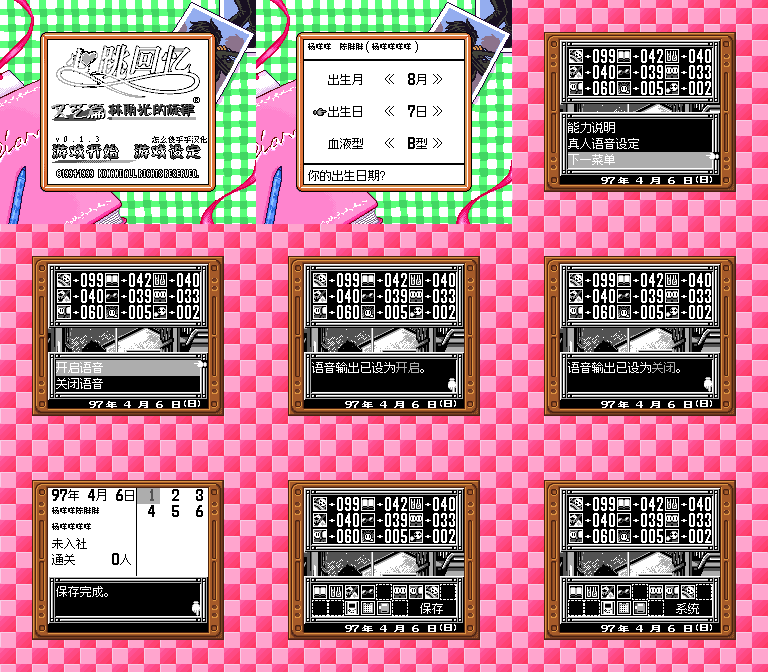

# 心跳回忆Pocket：文化篇 v0.1.3（限定测试版）

[源码与补丁Release](https://github.com/shiyi1133/youxi-hanhua-releases/releases/tag/tokimeki-memorial-pocket-culture-v0.1.3) · [公开反馈](feedback.md) · [报告BUG](https://github.com/shiyi1133/youxi-hanhua-releases/issues/new?template=bug_report.md)

原游戏／实际输入：Tokimeki Memorial Pocket - Culture Hen - Komorebi no Melody (Japan) (SGB Enhanced) (GB Compatible); requester original archive/header identity

原输入完整SHA-256：`9c54d8f58ca6a28ec61294a72bc7eae1d4385ad0422a8d46a379900438618bc7`（4194304字节）。

范围：v0.1.3限定修订：采用用户系列Logo，真人语音设置及5条开关/确认文案；保留v0.1.2敬称/优美酱分支修订，不含拼音输入原型。

## native8px-12px v0.1.3

字号范围：Fusion Pixel原生12px对白、8px姓名/密集栏；无独立大字版。

目标完整SHA-256：`fcdec52d6b8d1614a8b6ed908b659a6d090340c1c471f8ef44a6cad233c77559`（8388608字节）。

补丁：`tokimeki-culture-v0.1.3.bps`，SHA-256 `434b77f998771735ad7407292cad4c14c26a99dfe6b95453b8f3a498cbb5c1df`。

[源码（完整性未独立确认）](https://github.com/shiyi1133/youxi-hanhua-releases/releases/download/tokimeki-memorial-pocket-culture-v0.1.3/tokimeki-memorial-pocket-culture-v0.1.3-native8px-12px-SOURCE-public.zip) · [补丁包](https://github.com/shiyi1133/youxi-hanhua-releases/releases/download/tokimeki-memorial-pocket-culture-v0.1.3/tokimeki-memorial-pocket-culture-v0.1.3-native8px-12px-PATCH.zip)

原生SGB；九格像素逐张等于所附最终目标原帧；部分同ROM状态续测与电池冷读按提供方记录区分，不等于维护者新运行。

## 测试及限制

提供者自然路径：提供方CGB/SGB标题和原生菜单按键；有限中文姓名、正常保存、新进程电池冷读及语音0/1持久化。部分菜单帧使用同最终ROM状态续测，未冒称每帧独立冷启动。

提供者诊断路径：敬称/称呼分支采用原生解释器重定向诊断，不是自然见到相应人物或深层路线；旧版诊断不自动算本版全部重测。

保存边界：提供方原生正常保存/覆盖与新进程仅电池存档冷读；本维护未新增运行。

同一实现者自测，不是独立人员QA；维护未新增ROM运行或源码重建，未宣称实机或完整通关。

- 未验证：普通原生12px对白、8px姓名/密集栏；没有独立大字版。
- 未验证：维护者未运行ROM或提供者Source、未重建；提供方报告仅作提供方证据。
- 未验证：未验证实际语音音质及全部角色播放；未全流程、全结局、真实联机、实机或任意旧即时状态兼容。
- 未验证：Issue67、87、101、111、112均无本批完整原用例修复验收，不关闭或宣称整单修复。
- 未验证：verification/test-receipt.json.title_resources内部保留历史中间目标3eea69fd…；最终ROM、BPS、README、Source manifest和主回执均为fcdec52d…，不把历史中间目标当当前发布。
- 核对补丁还原、资产完整SHA和截图字节不等于全部游戏功能验收。

