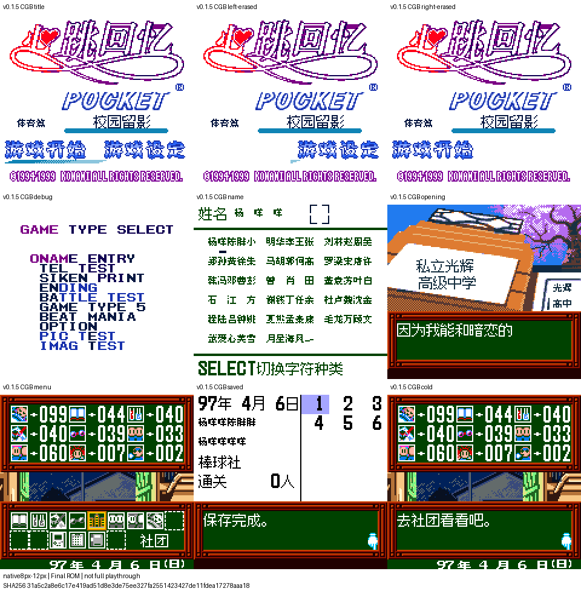

# 心跳回忆Pocket：运动篇 v0.1.5（限定测试版）

[源码与补丁Release](https://github.com/shiyi1133/youxi-hanhua-releases/releases/tag/tokimeki-memorial-pocket-sport-v0.1.5) · [公开反馈](feedback.md) · [报告BUG](https://github.com/shiyi1133/youxi-hanhua-releases/issues/new?template=bug_report.md)

原游戏／实际输入：Tokimeki Memorial Pocket - Sport Hen - Koutei no Photograph (Japan) (SGB Enhanced) (GB Compatible); requester original archive/header identity

原输入完整SHA-256：`99334cdbdd326ce6ce117b4aa2761ee34b33290a226d914ca6d08a70ee14c253`（4194304字节）。

范围：v0.1.5限定修订：补译游戏内待机屏保16组角色气泡字图；恢复POCKET、注册标记、原版权和副标题层级，保留用户中文Logo并去标题署名/版本；继承v0.1.4标题tile0/十列清除与NPC开引号修复。

## native8px-12px v0.1.5

字号范围：Fusion Pixel原生12px对白、8px姓名/密集栏；无独立大字版。

目标完整SHA-256：`31a5c2a8e6c17e419ad51d8e3de75ee327fa2551423427de11fdea17278aaa18`（8388608字节）。

补丁：`tokimeki-sport-v0.1.5.bps`，SHA-256 `e3d9c279a1a91c4ee89bb37f52e6af2a996f95290a677157a8a6e107caaa8571`。

[源码（完整性未独立确认）](https://github.com/shiyi1133/youxi-hanhua-releases/releases/download/tokimeki-memorial-pocket-sport-v0.1.5/tokimeki-memorial-pocket-sport-v0.1.5-native8px-12px-SOURCE-public.zip) · [补丁包](https://github.com/shiyi1133/youxi-hanhua-releases/releases/download/tokimeki-memorial-pocket-sport-v0.1.5/tokimeki-memorial-pocket-sport-v0.1.5-native8px-12px-PATCH.zip)

普通原生8/12px CGB原帧仅整数最近邻2倍展示，非大字版；最终ROM九格逐格与对应原帧精确相符。保存、同ROM续测、自然和诊断边界按回执区分，未全通或实机。

## 测试及限制

提供者自然路径：提供者CGB及原生SGB标题左右选择/Start转场、标题原生开发菜单未选项目进退、中文命名重复/删除重输、正常保存和新进程仅电池冷读；正常指令菜单约五分钟待机进入早期无字小熊，再正常按键退出。

提供者诊断路径：16角色气泡逐项为同一最终ROM的原生屏保消费者诊断：测试进程指定角色/背景，核VRAM字图及截图；不是自然解锁16人物。部分对白、语音及保存上下文沿同ROM状态续测；敬称/优美分支为原生解释器重定向诊断。

保存边界：提供者正常游戏保存和独立新进程仅电池冷读；部分同ROM状态续测按证据分开；维护未新增运行。

同一实现者自测，不是独立人员QA；维护未新增ROM运行或源码重建，未宣称实机或完整通关。

- 未验证：普通原生12px对白与8px姓名/密集栏，仅一个普通ROM，无独立大字版。
- 未验证：维护者未运行ROM、未执行提供者Source或重建；提供者净目录重建和运行回执不是独立人员QA。
- 未验证：未完成全路线/全结局、全部深层消费者、录音音质、实机或真实联机验收；旧即时状态兼容未验。
- 未验证：标题开发菜单仅验未选项目的进入/B退出；原生各调试项目安全未验。
- 未验证：Issue87偷看洗澡事件和Issue101成绩名单伊集院姓名无本次专项修复证据，继续open；其余Issue按实际修复范围和原问题单逐项判断。
- 核对补丁还原、资产完整SHA和截图字节不等于全部游戏功能验收。

