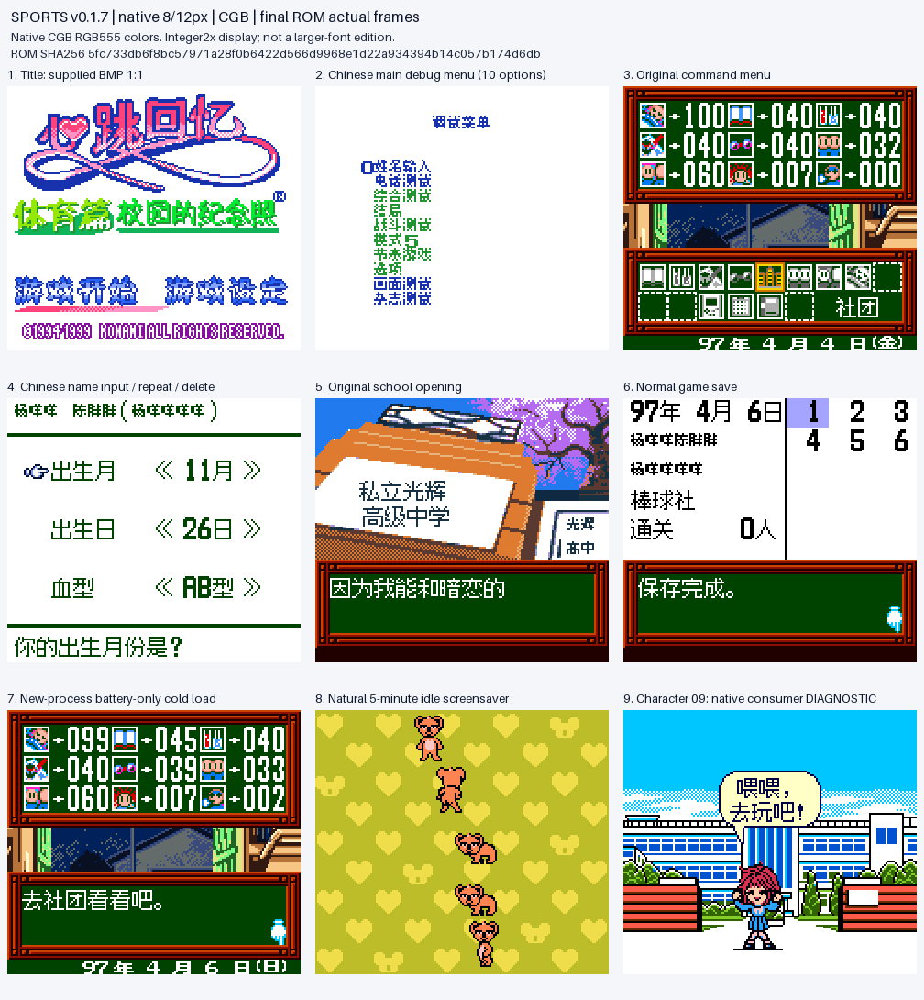
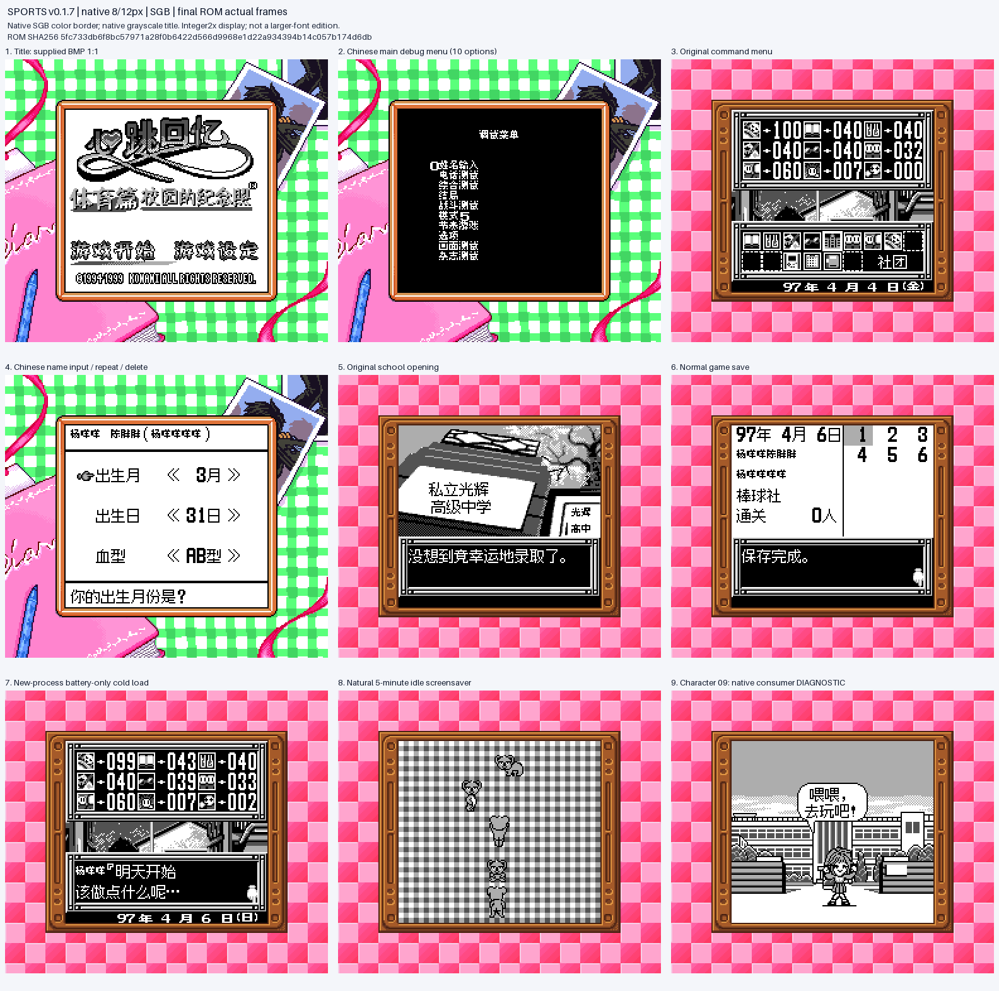

# 心跳回忆Pocket：运动篇 v0.1.7（限定测试版）

[源码与补丁Release](https://github.com/shiyi1133/youxi-hanhua-releases/releases/tag/tokimeki-memorial-pocket-sport-v0.1.7) · [公开反馈](feedback.md) · [报告BUG](https://github.com/shiyi1133/youxi-hanhua-releases/issues/new?template=bug_report.md)

原游戏／实际输入：Tokimeki Memorial Pocket - Sport Hen - Koutei no Photograph (Japan) (SGB Enhanced) (GB Compatible); requester original archive/header identity

原输入完整 SHA-256：`99334cdbdd326ce6ce117b4aa2761ee34b33290a226d914ca6d08a70ee14c253`（4194304字节）。

范围：原生对白12px/密集栏8px，仅汉化原有调试主菜单十项，保留用户标题原图与原生分派。

## native8px-12px v0.1.7 / unchanged

字号范围：原生对白12px/密集栏8px，仅汉化原有调试主菜单十项，保留用户标题原图与原生分派。

目标完整 SHA-256：`5fc733db6f8bc57971a28f0b6422d566d9968e1d22a934394b14c057b174d6db`（8388608字节）。

补丁：`tokimeki-sport-v0.1.7.bps`，SHA-256 `b7060e7ce83e65fdddbbf6a69419f1c3e856f69f0caf86257376be439dc9455c`。

[源码（完整性未独立确认）](https://github.com/shiyi1133/youxi-hanhua-releases/releases/download/tokimeki-memorial-pocket-sport-v0.1.7/tokimeki-memorial-pocket-sport-v0.1.7-complete-source.zip) · [补丁包](https://github.com/shiyi1133/youxi-hanhua-releases/releases/download/tokimeki-memorial-pocket-sport-v0.1.7/tokimeki-memorial-pocket-sport-v0.1.7-patches.zip)

原生对白12px/密集栏8px，仅汉化原有调试主菜单十项，保留用户标题原图与原生分派。；提供方对应最终ROM图证，具体自然/诊断类别见原图标签及材料；非维护运行、全通或实机验收。

原生对白12px/密集栏8px，仅汉化原有调试主菜单十项，保留用户标题原图与原生分派。；提供方对应最终ROM图证，具体自然/诊断类别见原图标签及材料；非维护运行、全通或实机验收。

## 测试及限制

提供方自然范围：提供方报告的自然/正常按键流程，维护未重跑。

提供方诊断范围：提供方明确标注的受控消费者、解锁或边界测试，不能冒充自然到达。

保存边界：仅按具体版本材料，不推定所有旧存档兼容。

维护本轮独立核原输入、补丁逐字节还原、ZIP/CRC、Source安全与原图字节；未执行提供方源码、未重建或运行ROM，未宣称独立人员QA、实机或全流程验收。

- 未验证：维护仅独立核用户输入ZIP/ROM完整SHA、补丁逐字节还原、ZIP成员/CRC与源包静态材料；未执行提供者源码、重建工程或运行ROM。
- 未验证：运行、自然按键、受控诊断、保存/新进程冷读等范围以所附提供方报告分别为据，不冒充维护重跑、独立人员QA、玩家验收、实机或全流程通关。
- 未验证：使用前备份普通存档；不跨ROM版本/字号套用即时状态，旧电池兼容仅按提供方实际样本说明。
