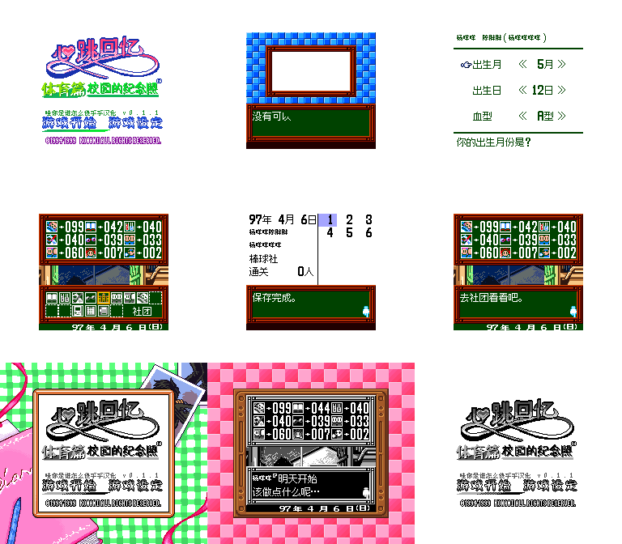

# 心跳回忆Pocket：运动篇

原输入：Tokimeki Memorial Pocket - Sport Hen - Koutei no Photograph (Japan) (SGB Enhanced) (GB Compatible); requester original archive/header identity

原输入完整SHA256：`99334cdbdd326ce6ce117b4aa2761ee34b33290a226d914ca6d08a70ee14c253`。此处“原输入”保留改版、既有汉化或地区修订身份，不一律称干净零售ROM。

| 字号 | 当前版本 | 音频 | 输出完整SHA256 |
| --- | --- | --- | --- |
| native8px-12px | v0.1.1 | unchanged | `1d6657e3ecdfa00f250e8f377ca2ddafd8ff433bbbe35e5c1aabf529320c7cc4` |

## 源码与补丁

- native8px-12px／v0.1.1／unchanged：源码包（完整性未独立确认）：[下载](https://github.com/shiyi1133/youxi-hanhua-releases/releases/download/source-migration-20261022-02c/tokimeki-memorial-pocket-sport-current-source-62a2fc69dfca-public-r01.zip)（ZIP SHA256 `48f8fbc2bdbc12ca9be98f3aaae4bc39420d6ef446d7d64ae53562ada76bf632`）；补丁：[下载](https://github.com/shiyi1133/youxi-hanhua-releases/releases/download/patch-migration-20261022/tokimeki-memorial-pocket-sport-current-patches.zip)（ZIP SHA256 `97fbb9c1e9afa6204b74a441a2d0b3c5ffa97592a482ce63468309e713cc8f3b`）。
  该包已核对对应版本与字节安全；完整修改源码覆盖范围未独立确认。

补丁须直接应用于完整SHA一致的实际原输入；普通字、大字和音乐变体分别核对。公开源码归档不表示本轮重新构建或通过新的运行验收。原作、字体、已有翻译及工具依赖的权利与许可，依各包对应许可保留。

## 范围与验证边界

- native8px-12px／v0.1.1：Fusion Pixel 原生12px对白、8px姓名/密集栏，未新增独立大字版；v0.1.1仅替换开场标题图、菜单闪烁图块及标题署名版本。。
  Fusion Pixel 原生12px对白、8px姓名/密集栏，未新增独立大字版；v0.1.1仅替换开场标题图、菜单闪烁图块及标题署名版本。
  仅标题增量，既有v0.1.0翻译覆盖、未译/未测场景及已打开问题保持；未全流程、全结局、实机、联机或独立人员QA。
  本次维护未执行源码、构建或游戏，仅独立核补丁完整字节、差异范围及截图像素；提供方运行报告不写成维护会话新运行。
  SGB保留原生彩色边框及灰阶游戏画面，DMG为原生灰阶；不能当CGB配色。
  既有反馈 明确排除；姓名对白分隔符 #67 及文化篇浴场漏译 #87 均没有本次修复证明，不关闭。

本次资料搬运未新增模拟器、实机或全通验收；未记录或未测试的范围不写成通过。问题单开放只表示尚未关闭，已关闭也不单独证明全部场景都修复。

[公开反馈及问题状态](feedback.md) · [报告BUG](https://github.com/shiyi1133/youxi-hanhua-releases/issues/new?template=bug_report.md)

## 对应版本截图

九格逐张原PNG、最终ROM完整SHA及未缩放像素完全一致；第7/8格为原生SGB 256×224边框。 运动篇第4/5格含原生断点观测记录，不泛称无诊断自然路径；第6/8格为电池冷读，其余由提供方报告自然按键路径。

图像SHA256：`3117b3cb2395373792ec73279034c8af326d89f387c35f63917db7f4d74105cc`；绑定ROM SHA256：`1d6657e3ecdfa00f250e8f377ca2ddafd8ff433bbbe35e5c1aabf529320c7cc4`。

