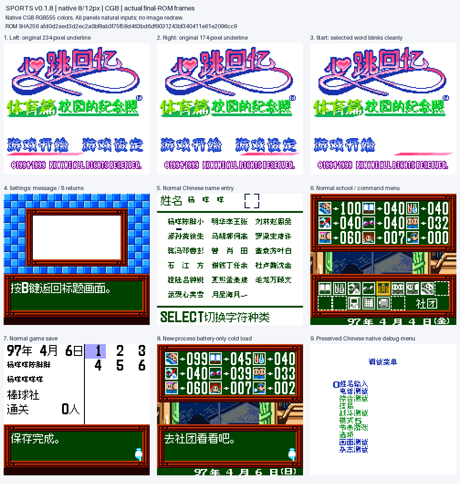
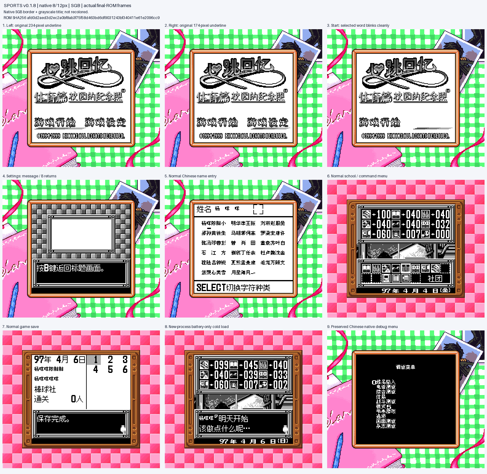

# 心跳回忆Pocket：运动篇 v0.1.8（限定测试版）

[源码与补丁Release](https://github.com/shiyi1133/youxi-hanhua-releases/releases/tag/tokimeki-memorial-pocket-sport-v0.1.8) · [公开反馈](feedback.md) · [报告BUG](https://github.com/shiyi1133/youxi-hanhua-releases/issues/new?template=bug_report.md)

原游戏／实际输入：Tokimeki Memorial Pocket - Sport Hen - Koutei no Photograph (Japan) (SGB Enhanced) (GB Compatible); requester original archive/header identity

原输入完整 SHA-256：`99334cdbdd326ce6ce117b4aa2761ee34b33290a226d914ca6d08a70ee14c253`（4194304字节）。

范围：只恢复标题右选“设定”时消失的原生下划线，保留用户标题图及既有原生8/12px显示。

## native8px-12px v0.1.8 / unchanged

字号范围：原生对白12px／密集栏与姓名8px；未新增大字号。

目标完整 SHA-256：`afd0d2aed3d2ec2a0bf8ab3f75f58d463bd6df9031243bf340411e61e2096cc9`（8388608字节）。

补丁：`tokimeki-sport-v0.1.8.bps`，SHA-256 `121e51869fa0254250f9ce7991a163b5c8e9027bf9d2de837aa9d80593e0d611`。

[源码（完整性未独立确认）](https://github.com/shiyi1133/youxi-hanhua-releases/releases/download/tokimeki-memorial-pocket-sport-v0.1.8/tokimeki-memorial-pocket-sport-v0.1.8-complete-source.zip) · [补丁包](https://github.com/shiyi1133/youxi-hanhua-releases/releases/download/tokimeki-memorial-pocket-sport-v0.1.8/tokimeki-memorial-pocket-sport-v0.1.8-PATCH.zip)

只恢复标题右选“设定”时消失的原生下划线，保留用户标题图及既有原生8/12px显示。 提供方CGB/SGB冷启、左右选与Start、设置出入、普通姓名/保存/新进程电池冷读有界回归；非维护重跑。 原有调试菜单/参数入口回归不外推到任意深层功能；旧版本报告单独保留为历史。

只恢复标题右选“设定”时消失的原生下划线，保留用户标题图及既有原生8/12px显示。 提供方CGB/SGB冷启、左右选与Start、设置出入、普通姓名/保存/新进程电池冷读有界回归；非维护重跑。 原有调试菜单/参数入口回归不外推到任意深层功能；旧版本报告单独保留为历史。

## 测试及限制

提供方自然范围：提供方CGB/SGB冷启、左右选与Start、设置出入、普通姓名/保存/新进程电池冷读有界回归；非维护重跑。

提供方诊断范围：原有调试菜单/参数入口回归不外推到任意深层功能；旧版本报告单独保留为历史。

保存边界：仅按具体版本材料，不推定所有旧存档兼容。

维护本轮独立核原输入、补丁逐字节还原、ZIP/CRC、Source安全与原图字节；未执行提供方源码、未重建或运行ROM，未宣称独立人员QA、实机或全流程验收。

- 未验证：维护独立核输入ZIP/ROM完整SHA、BPS逐字节还原、ZIP成员CRC与Root实际查看最终图；未执行附件源码或ROM、未独立重建。
- 未验证：提供方自然/受控/静态证据分别记录，不冒充维护运行、独立外部人员QA、玩家实际存档、实机、联机或完整通关验收。
- 未验证：备份原件与普通存档，不跨ROM完整SHA加载即时状态；既有旧Release、标签、引用、原始包与本地历史保留。
- 未验证：Issue111保持open，本版不代表两篇全部转场/闪烁反馈闭环；Issue8出生日期/血型确认不在此版修复范围。
