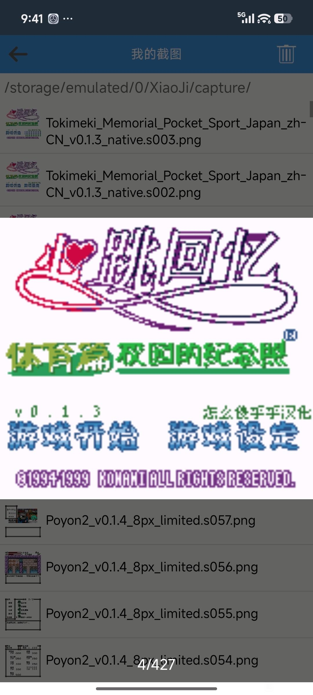
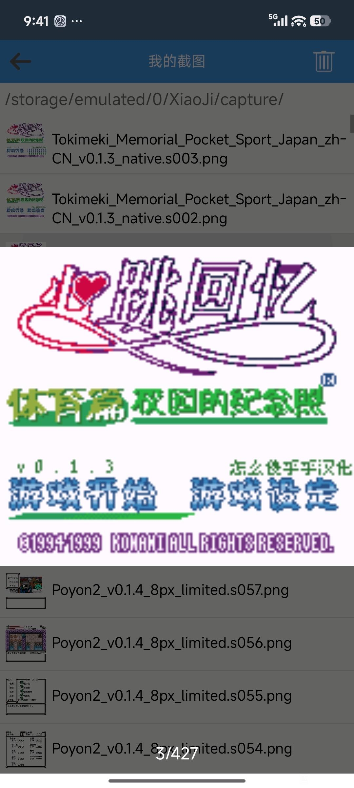
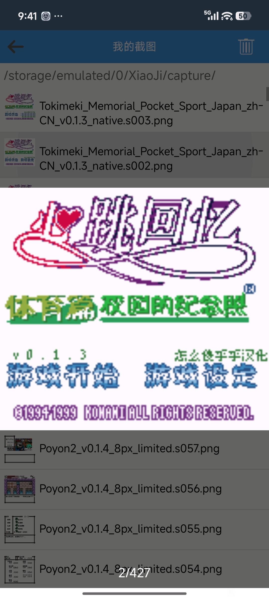
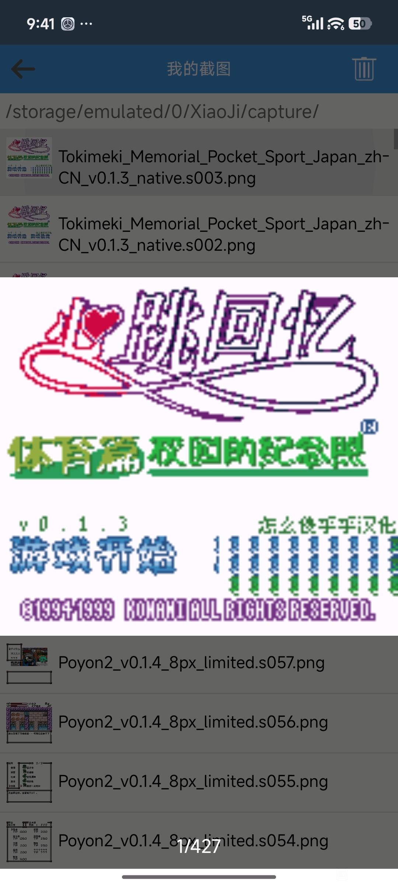
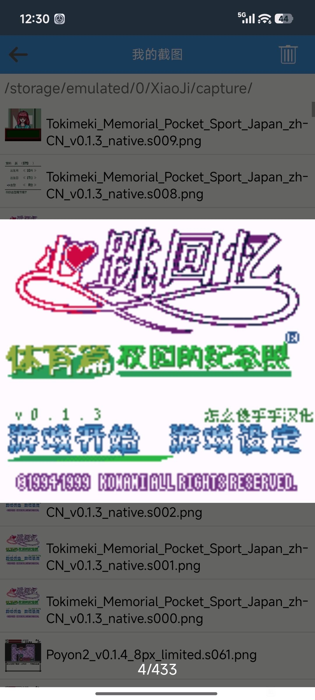
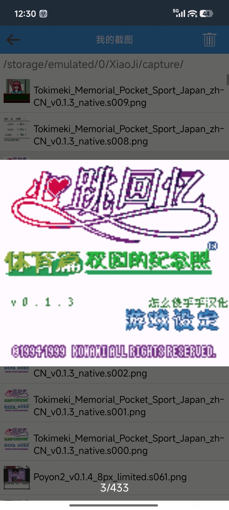

# 心跳回忆Pocket：运动篇：公开反馈

以下均为公开证据，玩家原话不自动等于维护已复现或已修复。

## 154058640162

222楼 · 简单Matser · [原回帖](https://tieba.baidu.com/p/11092365551?pid=154058640162#154058640162)

> 楼主大佬，心跳回忆 体育篇/文艺篇 又测了一下，还有两个小问题。期待完善修复bug版本。
> 1.(图1)更新的这个新菜单画面版本，直接开始没问题，如果选右边的"游戏设定"选项"确认的划下线"消失，点确认进入会短暂"花屏"。
> 2.(图2)游戏"被动"进入屏保模式，或点选择键"主动"进入屏保模式，随机出现的人物话语还是日文。

[玩家公开图片](https://tiebapic.baidu.com/forum/pic/item/be81cf5c10385343d903d526d513b07ecb808810.jpg)（玩家反馈图）

[玩家公开图片](https://tiebapic.baidu.com/forum/pic/item/bd7a262eb9389b500b33b255c335e5dde6116e10.jpg)（玩家反馈图）

## 登记时问题状态（历史）

- 玩家称被动等待进入屏保或按Select主动进入时，随机人物话语仍日文。：开放；公开Issue待单独建档。
- 作者明确同时测试体育篇/文艺篇新版标题：直接开始正常；选右侧游戏设定时确认下划线消失，进入短暂花屏。：开放；公开Issue待单独建档。

## 已公开答复

- [原答复](https://tieba.baidu.com/p/11092365551?pid=154059407741#154059407741)：@简单Matser 体育篇、文艺篇v0.1.1的游戏设定下划线和转场花屏已登记，屏保日文也记作未译范围，后续排查。

实际玩家ROM SHA未知时保持未知；当前参考版本SHA不能冒充玩家字节。

## 版本更新答复（v0.1.3）

[已公开版本答复](https://tieba.baidu.com/p/11092365551?pid=154066310608#p154066310608) · [对应公开版本](https://github.com/shiyi1133/youxi-hanhua-releases/releases/tag/tokimeki-memorial-pocket-sport-v0.1.3) · [版本答复索引](../../feedback/version-replies.md)

> @腌在渡土看了 《心跳回忆Pocket：运动篇》v0.1.3限定测试版（原生12px对白、8px姓名等）已更新：系列Logo、真人语音开关及确认文字，并保留敬称、称呼分支修订。附本版真实九宫格，语音效果及深层路线请继续测试。

此前反馈、确认和问题状态均按原文保留；本次版本答复仅代表明确列出的交付范围。

本条是已有游戏的版本更新完成通知；原BUG确认、原反馈和当前问题状态各自保留，不代表整单、全流程、实机或玩家复测全部通过。

<!-- bounded-progress:manual-six-20261024-2129-git-only-five -->
## Git已发布的限定修复进展（2026-10-25）

Git版本与修复用例已核验；网盘尚未同步本次目标，不将网盘旧ROM记作已更新。贴吧交付通知另行等待，ONIⅤ原有通知暂停保持。

- `problem-93293400b9815d8a`：原反馈定位范围已关闭。v0.1.5 / native8px-12px 限定测试版；[公开版本](https://github.com/shiyi1133/youxi-hanhua-releases/releases/tag/tokimeki-memorial-pocket-sport-v0.1.5)。
  已核对：体育篇、文化篇各16张屏保人物话语资源均已处理；最终v0.1.5在CGB/SGB分别用原生消费者选择角色/背景诊断呈现，VRAM图块SHA与编译资源一致，实际逐图原帧已核。；自然等待约五分钟进入默认无文字小熊屏保并按键退出另有证据，不把它混称16角色话语自然解锁。
  保留：16人物页为原生消费者诊断，不是所有角色自然解锁；本版未自然重跑Select主动激活全部入口。；仅按原单日文人物话语资源覆盖范围关闭，不称所有屏保触发路线、全作、全通或实机验收。
  证据边界：提供者同一实施者自然/受控自测与净重建回执；维护仅独立静态、BPS全字节还原、原帧/网格像素核验，未执行附件源码、未重建或新增ROM运行。提供者CGB及原生SGB标题左右选择/Start转场、标题原生开发菜单未选项目进退、中文命名重复/删除重输、正常保存和新进程仅电池冷读；正常指令菜单约五分钟待机进入早期无字小熊，再正常按键退出。；16角色气泡逐项为同一最终ROM的原生屏保消费者诊断：测试进程指定角色/背景，核VRAM字图及截图；不是自然解锁16人物。部分对白、语音及保存上下文沿同ROM状态续测；敬称/优美分支为原生解释器重定向诊断。

同一实施者自测与维护字节、补丁和原帧检查分别记录；没有新增维护ROM运行、玩家复测、全通或实机验收。原话、报告版本、图片、玩家未知SHA、收件答复及历史保留。

## 20261025-1619 公开反馈更新

按当前实际未关闭问题去重：纯BUG 2 项，建议/覆盖等 0 项，分类待核 0 项。开放不代表正在修复。

83楼 · 球总好学 · [原回帖](https://tieba.baidu.com/p/11092365551?pid=154068754749#154068754749)

> 运动篇0.1.3，标题画面的副标题“体育篇 校园的……”，这一行字显示不全，观感上字体的顶部少了一截 

83楼 · 球总好学 · [原回帖](https://tieba.baidu.com/p/11092365551?pid=154068768689#154068768689)

> 运动篇0.1.3，在标题画面，默认是“游戏开始”，默认选定此选项的时候“游戏开始”字样的下方有一条绿色横线，表示选定了此选项。但按方向键“右”之后绿色横线消失（图2左下角），不确定是否已选定图1、图2的右下角的“游戏设定”选项，且这时按“start”键时，“游戏设定”字样会出现花屏（图3右下角）   

83楼 · 球总好学 · [原回帖](https://tieba.baidu.com/p/11092365551?pid=154069220570#154069220570)

> 运动篇0.1.3，开始新游戏，确定好自己的出生年月和血型后的界面，画面下方有文本显示重叠或显示不全  

83楼 · 球总好学 · [原回帖](https://tieba.baidu.com/p/11092365551?pid=154069228452#154069228452)

> 运动篇0.1.3，进入游戏，选择“游戏开始”后，光标会闪烁，闪烁的时候，右侧“游戏设定”字样会有显示不全或文字被白框遮挡的情况，图2下方“游戏设定”的“游”字左边部分被遮挡  

83楼 · 球总好学 · [原回帖](https://tieba.baidu.com/p/11092365551?pid=154069301880#154069301880)

> 请问运动篇和文化篇，可以分别再来个全8px小字版吗？

61楼 · 球总好学 · [原回帖](https://tieba.baidu.com/p/11092365551?pid=154069350075#154069350075)

> 8px 0.1.4，文本框内文本超出方框 

- 波永2与心跳回忆运动篇：文本越框及出生确认重叠：登记时保持开放；当前状态以本页问题元数据为准。
- 心跳回忆运动篇：标题及游戏设定显示：登记时保持开放；当前状态以本页问题元数据为准。
- v0.1.8：此次恢复运动篇标题右选“设定”时消失的原生下划线；提供方报告CGB/SGB标题选择和设定入口的限定检查。 不扩大到出生/血型确认、跨画面绿线或文化篇；原问题原案仍未完整闭环。 Git发布已完整回读；网盘新版同步待核验，问题保持开放。

[实际公开答复](https://tieba.baidu.com/p/11092365551?pid=154070370287#154070370287)：标题、选项闪烁和出生确认显示问题已补充记录。全8px版本的需求也记下了，目前仍是对白12px、密集栏8px。

玩家实际完整ROM字节未知时仍保留未知；自然流程、原生消费者诊断及静态证据分别记录，不外推实机或全流程。

## 20261026-0419 玩家反馈增量

- 文艺篇：合宿事件日文残留（保持开放）：玩家报告文艺篇合宿洗澡事件仍有日文，附7图；另有玩家询问合宿修订。既有覆盖范围继续开放；本轮新图仅文艺篇，不表示运动篇新复现。最新编号、实际ROM文件和完整SHA未知，既有名单姓名或标题显示修订不代表这段事件已修。

本次仅登记玩家证据和限定复测，未运行ROM、未新增修复；当前发布参考不代表玩家实际ROM字节。

[星之逍遥 · 168楼 · 154070794105](https://tieba.baidu.com/p/11092365551?pid=154070794105#154070794105)

> 更新了版本，间隔符修正了，可以看看合宿日文修正没

[重音teto乄初音未来 · 269楼 · 154071176740](https://tieba.baidu.com/p/11092365551?pid=154071176740#154071176740)

> 大佬你的心跳回忆文艺片最新版本社团活动偷看女生洗澡这里事件这里还全是日文。

