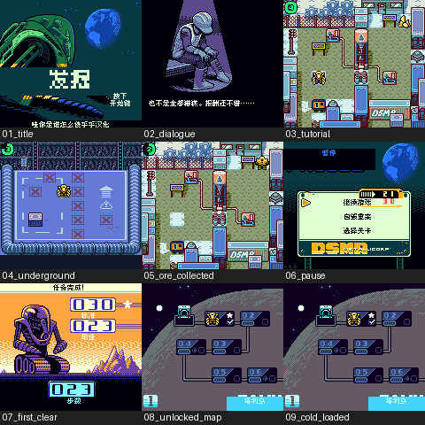

# 发掘：公开反馈

[报告BUG](https://github.com/shiyi1133/youxi-hanhua-releases/issues/new?template=bug_report.md)。请说明实际版本、字号、必要触发步骤和已有截图，不上传ROM、存档、即时状态或私人资料。

当前公开索引尚未登记本作BUG反馈；这不代表没有BUG、已全通或已实机验收。开放问题不等于正在修复。

[贴吧原需求](https://tieba.baidu.com/p/11092365551?pid=154054958062#154054958062)。

## 维护者交付通知：v0.1.0（限定测试版）

[贴吧实际答复](https://tieba.baidu.com/p/11092365551?pid=154064632890#p154064632890)（190楼，PID 154064632890；原关联楼层回复）。

以下为去除下载信息后的维护者通知摘要，不是玩家测试结论，也不是原文全文。

> 《发掘》v0.1.0限定测试版已发布。
> 字号：普通Fusion Pixel 8px；无10px。。
> 范围：用户World v1.1/2024 aftermarket输入；实际CGB-only，文件名GB Compatible不是DMG证据。1011译文、277候选场景、998文本消费者；272背景/310精灵审计，保留作者/商标/按键与隐藏开发注释，候选入口不等于自然可达。
> 原答复中的ROM下载链接、提取码、网盘目录及下载指示已省略；私库保留完整原文证据。

原答复全文UTF-8 SHA-256：`0ccdfcc3aa248158002b68974c74450697f344b3d4937e3eeb179ac184337553`（254字节）。

发掘 v0.1.0 8px限定测试版；普通Fusion Pixel 8px；无10px。 自然路径与诊断范围见测试说明，不代表全流程。

[贴吧该PID第1张实际公开图片](https://tiebapic.baidu.com/forum/pic/item/06bb08e93901213f9c2ffbdb12e736d12e2e95c0.jpg?tbpicau=2026-11-04-05_5f1dffb205af74f89e2518fd4e6bd920)。

原PNG SHA-256：`9db5c649359d744f69f4b8cb7079386a4aa6c9a940225c1446543d3e1ffb75e6`；贴吧公开图片 SHA-256：`467eba5f7d3ebb7b4fd96d6295ac9b2691aa8d75217e880e87cb46329a076d99`。

原答复全文与全部图片已按该PID公开核验；此镜像不新增通关、实机、独立QA、源码完整性或BUG全部修复结论。
