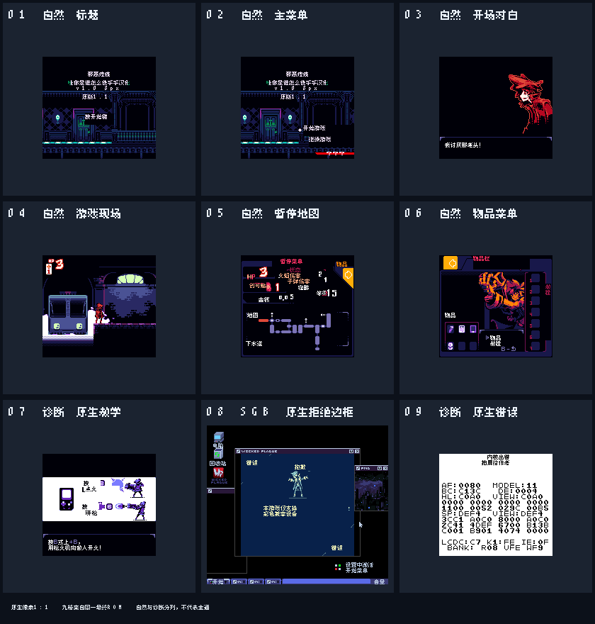

# 邪恶瘟疫

原输入：Wicked Plague

原输入完整SHA256：`e76d3b831d40907161818506a312809251157b3311446837e596f4f744ddf820`。此处“原输入”保留改版、既有汉化或地区修订身份，不一律称干净零售ROM。

| 字号 | 当前版本 | 音频 | 输出完整SHA256 |
| --- | --- | --- | --- |
| 8px | v1.0 | unchanged | `a60240350f81ce787a7c9846a21bc1187e172d9b5bb85c342ca0a2a61acb7afe` |

## 源码与补丁

- 8px／v1.0／unchanged：源码包（完整性未独立确认）：[下载](https://github.com/shiyi1133/youxi-hanhua-releases/releases/download/source-migration-20261022-02c/wicked-plague-current-source-7e4c6ae97191-public-r01.zip)（ZIP SHA256 `99cad387148bec828f203b02f9bd248dfc3aa94c5f2b39e561028dcf29d18461`）；补丁：[下载](https://github.com/shiyi1133/youxi-hanhua-releases/releases/download/patch-migration-20261022/wicked-plague-current-patches.zip)（ZIP SHA256 `8fb74f92b5dd60c3f71bdba4e0f19155eb9d46c37fb5ef3da2542be4af1d60fa`）。
  该包已核对对应版本与字节安全；完整修改源码覆盖范围未独立确认。

补丁须直接应用于完整SHA一致的实际原输入；普通字、大字和音乐变体分别核对。公开源码归档不表示本轮重新构建或通过新的运行验收。原作、字体、已有翻译及工具依赖的权利与许可，依各包对应许可保留。

## 范围与验证边界

- 8px／v1.0：v1.0普通原生8px，CGB可玩；DMG/MGB/SGB/SGB2仅原生拒绝提示。。
  v1.0普通原生8px，CGB可玩；DMG/MGB/SGB/SGB2仅原生拒绝提示。
  自然持久保存路线未达到；保存入口有诊断场景参数注入；未全剧情/首领/结局、长时、真机、Chromatic或旧英文档迁移。

本次资料搬运未新增模拟器、实机或全通验收；未记录或未测试的范围不写成通过。问题单开放只表示尚未关闭，已关闭也不单独证明全部场景都修复。

[公开反馈及问题状态](feedback.md) · [报告BUG](https://github.com/shiyi1133/youxi-hanhua-releases/issues/new?template=bug_report.md)

## 对应版本截图

第1–6格自然操作，第7/9格诊断，第8格真实SGB拒绝提示；不认证SGB可玩。；对应 v1.0 8px 最终ROM。

图像SHA256：`a3f3b541801387c2273adeba76b2e088342b80285fb21a55ec56af8a3f3784a9`；绑定ROM SHA256：`a60240350f81ce787a7c9846a21bc1187e172d9b5bb85c342ca0a2a61acb7afe`。

