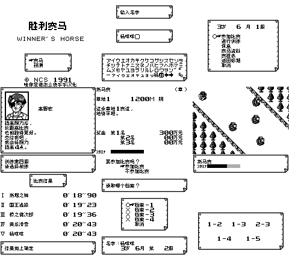

# 胜利赛马 v0.1.0（限定测试版）

[源码与补丁Release](https://github.com/shiyi1133/youxi-hanhua-releases/releases/tag/winners-horse-v0.1.0) · [公开反馈](feedback.md) · [报告BUG](https://github.com/shiyi1133/youxi-hanhua-releases/issues/new?template=bug_report.md)

原游戏／实际输入：Winner's Horse (Japan)

原输入完整SHA-256：`fd508815ba403eafd3a8a3be21139df1891f32e4ee26e1673c3d0fe3285b3bec`（131072字节）。

范围：508记录，包括96固定马名/128赛事表/教练/菜单/预测/年度退役文本与标题图；数字/版权/原姓名保留

## 8px v0.1.0

字号范围：普通8px；标题2倍独立图字不是大字号正文，无10px

目标完整SHA-256：`facf62410e6cb7b38e78eaaeda6e13910fb5116bca1a9ad8018557812e7c9884`（262144字节）。

补丁：`winners-horse_v0.1.0_8px.bps`，SHA-256 `eab644ab43a247e163943fe055a58ce6b071f1982c2435020e54e328921a00ba`。

[源码（完整性未独立确认）](https://github.com/shiyi1133/youxi-hanhua-releases/releases/download/winners-horse-v0.1.0/winners-horse-v0.1.0-source-public-r02.zip) · [补丁包](https://github.com/shiyi1133/youxi-hanhua-releases/releases/download/winners-horse-v0.1.0/winners-horse-v0.1.0-patch.zip)

胜利赛马 v0.1.0 8px限定测试版；普通8px；标题2倍独立图字不是大字号正文，无10px 自然路径与诊断范围见测试说明，不代表全流程。

## 测试及限制

提供者自然路径：六候选马和可选教练循环、训练/B取消/休息/资料/赛程；原键盘杨咩咩/删除重输/10字最长名；自然完赛6月1周→2周自动保存，新OS进程仅MBC2电池冷读姓名和进度；预测5匹数据/节奏/方式到结果

提供者诊断路径：未使用诊断入口；仅限所列自然路径。

保存边界：MBC2结构保留，本版正常保存冷读有提供方记录；中文名标记回原日版会显示异常；全部旧档迁移/即时状态未保证

同一实现者自测，不是独立人员QA；维护未新增ROM运行或源码重建，未宣称实机或完整通关。

- 未验证：多年到7岁退役/全结局
- 未验证：高级G1胜利/全部赛事
- 未验证：所有预测组合/最大金额属性
- 未验证：隐藏口令效果/实机/旧档迁移
- 核对补丁还原、资产完整SHA和截图字节不等于全部游戏功能验收。

