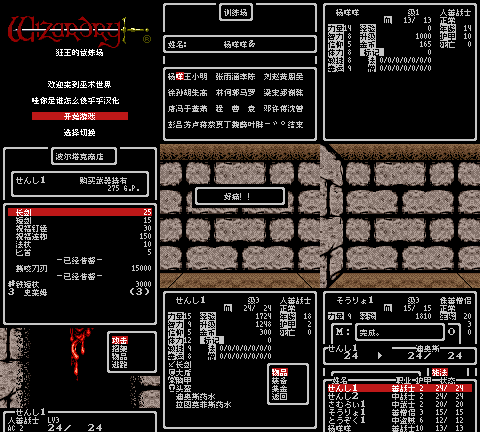

# 巫术Ⅰ狂王的试炼场

原输入：Wizardry I - Proving Grounds of the Mad Overlord (Japan)

原输入完整SHA256：`00609843f9670ad5d3ee069bf84fef1d07cf48d1aa6f9255efe1741257ad5a08`。此处“原输入”保留改版、既有汉化或地区修订身份，不一律称干净零售ROM。

| 字号 | 当前版本 | 音频 | 输出完整SHA256 |
| --- | --- | --- | --- |
| 8px | v0.1.3 | unchanged | `a2fe3b741114a2201ba1bfde717d56d8e422f77335e7c686f9232baea26d2d77` |

## 源码与补丁

- 8px／v0.1.3／unchanged：完整修改源码：[下载](https://github.com/shiyi1133/youxi-hanhua-releases/releases/download/source-migration-20261022/wizardry-1-gbc-current-source-d38a083b3804-public-r02.zip)（ZIP SHA256 `9a5396cae046a03e19e73a6b5a2174f529f3ff6a2e6333a8ddec9e2df0e46cde`）；补丁：[下载](https://github.com/shiyi1133/youxi-hanhua-releases/releases/download/patch-migration-20261022/wizardry-1-gbc-current-patches.zip)（ZIP SHA256 `2fe4f9b749e965f3db94e1b09dbe920f8185ea1efbbde819ad280337463061cb`）。

补丁须直接应用于完整SHA一致的实际原输入；普通字、大字和音乐变体分别核对。公开源码归档不表示本轮重新构建或通过新的运行验收。原作、字体、已有翻译及工具依赖的权利与许可，依各包对应许可保留。

## 范围与验证边界

- 8px／v0.1.3：普通原生8px；无大字版。
  迷宫同坐标保存冷读路线发生分歧，本版该项未通过
  Dios满血耗MP不能证明回血量；有效自然密码往返未测
  深层/全通、所有最长变量、实机/联机及跨游戏兼容未测
  旧自定义假名名称可能按新中文码显示，请备份原生电池存档后按需改名

本次资料搬运未新增模拟器、实机或全通验收；未记录或未测试的范围不写成通过。问题单开放只表示尚未关闭，已关闭也不单独证明全部场景都修复。

[公开反馈及问题状态](feedback.md) · [报告BUG](https://github.com/shiyi1133/youxi-hanhua-releases/issues/new?template=bug_report.md)

## 对应版本截图

普通8px最终ROM真实九宫格；图中自然与诊断范围按说明区分。巫术Ⅰ战斗画面为CA9A诊断触发，非自然随机遇敌。

图像SHA256：`00f39fc5272f0fd75633e98d9ee06c3290aa52d282037121da899a403bb611fb`；绑定ROM SHA256：`a2fe3b741114a2201ba1bfde717d56d8e422f77335e7c686f9232baea26d2d77`。

