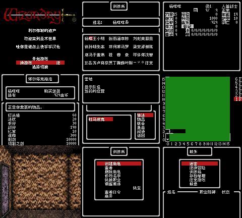

# 巫术Ⅱ利尔伽敏的遗产

原输入：Wizardry II - Legacy of Llylgamyn (Japan)

原输入完整SHA256：`87fb3a0e1f7a8990f77125fb968f556ad1a108cdc953e7a010d73f5cb9efbfca`。此处“原输入”保留改版、既有汉化或地区修订身份，不一律称干净零售ROM。

| 字号 | 当前版本 | 音频 | 输出完整SHA256 |
| --- | --- | --- | --- |
| 8px | v0.1.1 | unchanged | `f322757a36ac05adfce3f5e6789aa406d5e16c13f13b869baf49dfacdce245e1` |

## 源码与补丁

- 8px／v0.1.1／unchanged：完整修改源码：[下载](https://github.com/shiyi1133/youxi-hanhua-releases/releases/download/source-migration-20261022/wizardry-2-gbc-current-source-4ea852586eec-public-r02.zip)（ZIP SHA256 `eed6767b85856e87353c1e069e3e8182a4d2a496fe0732fd94a19087f55df184`）；补丁：[下载](https://github.com/shiyi1133/youxi-hanhua-releases/releases/download/patch-migration-20261022/wizardry-2-gbc-current-patches.zip)（ZIP SHA256 `df3c1b91d09f5e759cd6ab5461b0dbeb44f744bc9abc82d9027560d961140fbc`）。

补丁须直接应用于完整SHA一致的实际原输入；普通字、大字和音乐变体分别核对。公开源码归档不表示本轮重新构建或通过新的运行验收。原作、字体、已有翻译及工具依赖的权利与许可，依各包对应许可保留。

## 范围与验证边界

- 8px／v0.1.1：普通原生8px；无大字版。
  当前版本自然战斗路线未到达，不能计已通过
  继承原文覆盖/控制序列为静态证据，不能等同所有场景实测
  全部法术、装备、陷阱、深层剧情、全部最长变量、全通、实机、联机、跨游戏转移未测
  旧自定义假名显示不保证兼容，先备份原生电池存档

本次资料搬运未新增模拟器、实机或全通验收；未记录或未测试的范围不写成通过。问题单开放只表示尚未关闭，已关闭也不单独证明全部场景都修复。

[公开反馈及问题状态](feedback.md) · [报告BUG](https://github.com/shiyi1133/youxi-hanhua-releases/issues/new?template=bug_report.md)

## 对应版本截图

普通8px最终ROM真实九宫格；图中自然与诊断范围按说明区分。

图像SHA256：`566cd7ea7000883220971676e405340e9b27127014a17413ae9c6798cbf0c537`；绑定ROM SHA256：`f322757a36ac05adfce3f5e6789aa406d5e16c13f13b869baf49dfacdce245e1`。

